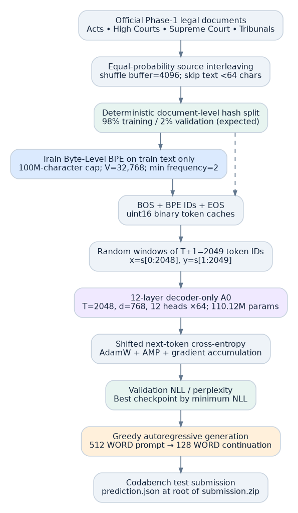
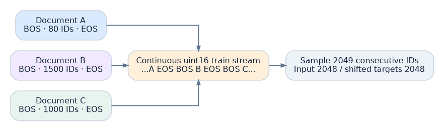
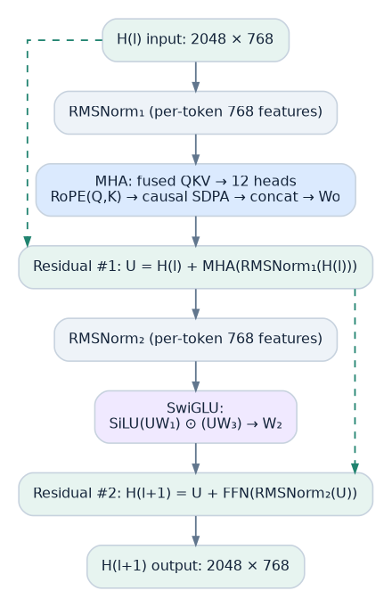
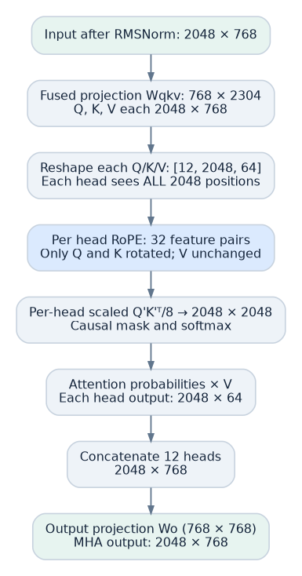
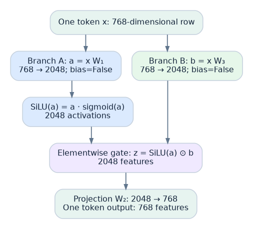
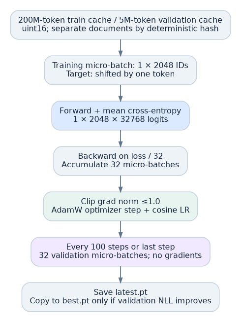
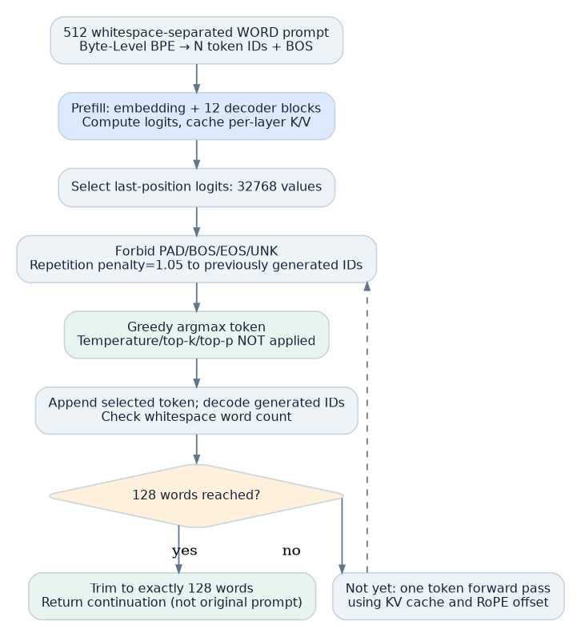

# CS781 Capstone · Phase 1 · A0 Dense Flash LegalGPT

**Implementation-level documentation and reproduction guide**  
**Scope:** A0 only; this is **not** a claim that all Phase 1 architectures have been completed.  
**Evidence level:** Exact source-code behavior is marked **[CODE]**; arguments derived from the lecture/math are **[RATIONALE]**; values requiring an actual run are **[UNVERIFIED]**.  
**Original implementation:** `code/architecture_a_legalgpt.py` (unaltered, SHA-256 in `docs/SOURCE_MANIFEST.md`).  
**Document basis:** audit of supplied Phase 1 A0 source package and its RTX companion; CS781 lecture Module 2.2 (normalization, optimization), Module 2.3 (attention, positional encoding, RoPE, MHA, FlashAttention, Pre-Norm). The accompanying `docs/A0_TECHNICAL_REFERENCE.md` provides more details, a line-oriented code map, tensor ledger and numerical illustrations.

> **Integrity / grading notice.** Architecture, defaults and algorithms below are verified against the supplied Python source. A completed run, trained checkpoint, GPU memory trace, train/validation loss, Codabench BERTScore, public GitHub commit, or final submission is **not** established by the files supplied. Do not assert these results without their actual artifacts. All claimed *reasons* for design choices are methodological explanations rather than measured ablation evidence, unless backed by a result file.

## 0. Repository organization and navigation

```text
README.md                            ← start here; exact execution instructions
code/
  architecture_a_legalgpt.py        ← original 1,377-line A0 Python pipeline
  Architecture_A_LegalGPT_Colab.ipynb ← original Colab command launcher
  requirements.txt                  ← original dependencies
  experiment_ledger.csv             ← original experiment ledger template
  rtx/                              ← original server setup/prepare/train/eval/submit scripts
notebooks/
  A0_Architecture_Illustrated.ipynb ← explanatory notebook + code-backed shape checks
figures/
  01_end_to_end.{png,svg,dot}
  02_block.{png,svg,dot}
  03_heads.{png,svg,dot}
  04_swiglu.{png,svg,dot}
  05_train_validate.{png,svg,dot}
  06_generation.{png,svg,dot}
  07_token_cache.{png,svg,dot}
docs/
  A0_TECHNICAL_REFERENCE.md         ← complete implementation walkthrough
  SOURCE_MANIFEST.md                ← source checksums, files, provenance
  CODE_MAP.md                       ← functions, line numbers and detailed responsibilities
  VALIDATION_CHECKLIST.md           ← reproduce/audit without fabricating scores
report/
  A0_Methodology_Report.md          ← report-ready, self-contained methods subsection
  A0_Methodology_Report.pdf         ← typeset copy (if PDF conversion succeeds)
```

The A0 Python source in `code/` and in `code/rtx/` is byte-for-byte identical. The original Word2Vec/MLP notebook `CS781_A0_KrishnaKarthikeya_GN_250564.ipynb`, although named A0, is an *earlier, unrelated CS781 assignment*. It has **not** been misrepresented as the legal LM model or included among this model's source files.

## 1. Problem definition, and the distinction between training tokens and task words

**[CODE]** Official Phase 1 evaluation supplies 512 **whitespace-separated words** and requires a 128-**word** continuation. The tokenizer is byte-level BPE; consequently **512 words are generally not 512 tokenizer tokens**. Model training samples **2,048 BPE tokens** at once; this window need not correspond to one whole document and is **not** a 512-input/128-label training pair. The vocabulary contains nominally 32,768 token IDs. The model is decoder-only, causal, trained from random initial weights, and predicts one next-token distribution at each training position.

A model with vocabulary size \(V=32768\), width \(d=768\), number of heads \(H=12\), head width \(d_h=64\), decoder depth \(L=12\), and feed-forward intermediate width \(d_{ff}=2048\) has **110,119,680** unique learned scalars for the nominal vocabulary. The LM head **ties** its weight to the input embedding matrix; the same parameter appears at input and output rather than counting twice. No biases are used in attention or FFN linear projections.



## 2. Source corpus, stream formation, document split — exact code behavior

**[CODE: lines 59–68, 187–289, 296–483]** Official dataset identifier: `Exploration-Lab/CS-781-Capstone`, config `phase_1`. Four training JSON sources (Acts, High Courts, Supreme Court, Tribunals) are read by Hugging Face `datasets` in streaming mode. The default `mix_mode=equal` creates four shuffled iterators (`shuffle_buffer=4096`; seeds `781 + 997*j`) and repeatedly selects an active source uniformly with `random.Random(781)`. **This makes the online source-selection probability equal; it does not imply equal eventual token totals**, since document lengths differ and sources can become exhausted. If equal-source streaming raises an exception, the code warns and falls back to `load_dataset(repo_id, "phase_1", split="train", streaming=True)`; this fallback is part of the actual implementation. The alternative `mix_mode=natural` directly uses the combined phase_1 stream. Documents with fewer than 64 characters are skipped.

A document's text comes from the first populated field in `text, document, content, body, judgment, case_text` (recursive nested extraction), falling back to the longest string field if needed; ID comes from `id, ID, doc_id, document_id, case_id, uid`, with deterministic fallback. The code computes `key = source::id::sha1(text[:512])` and calls `is_validation_doc(key, 0.02)`, evaluating whether the first eight bytes of SHA-1 of `"VAL::"+key` as a fraction in [0,1) are less than 0.02. This is a **deterministic document-level partition**; it is not a random split of the 2,048-token windows. A reused ID with different text may receive a different split; there is **no explicit near-duplicate detection**. Approximately 2% of unique keys are expected to be validation, not a guaranteed exact 2%.

## 3. Byte-Level BPE from scratch (trained, not reimplemented)

**[CODE: lines 296–363]** The Hugging Face `tokenizers` package implements the tokenizer; A0 does **not** hand-implement BPE and does not import a pretrained tokenizer. The code constructs `Tokenizer(BPE(unk_token="<unk>"))`, sets `ByteLevel(add_prefix_space=False)` as pre-tokenizer and `ByteLevelDecoder()` as decoder, and trains a `BpeTrainer` with `vocab_size=32768`, `min_frequency=2`, `show_progress=True`, and reserved special tokens in this order: `<pad>`, `<bos>`, `<eos>`, `<unk>`. No custom normalizer, post-processor, or additional tokenization rule is configured by this source.

The `text_iter()` generator streams raw text exclusively from non-validation documents, taking up to `tokenizer_train_chars=100000000` **Python string characters**, not a predefined count of BPE tokens or bytes. The last document may be truncated to the remaining character quota. The trainer iteratively chooses the highest-frequency eligible adjacent token pair, joins its representations, updates pair counts and continues until its vocabulary limit or no eligible merges. `min_frequency=2` excludes lower-frequency pair merges. No top-k, top-p, greedy language decoding or beam search is used for tokenizer training. The number of merges **M is not independently configured**; `vocab_size_actual` is written after fitting. Ties and preprocessing boundary behavior follow the imported library implementation; a precise reproduction should pin its installed version (`requirements.txt` only specifies a *minimum* version).

The trained tokenizer is saved to `tokenizer/tokenizer.json`, and train settings / actual vocabulary size to `tokenizer/tokenizer_meta.json`. A later `prepare` run **reuses** the saved tokenizer unless `--force_prepare` is given. Tokenization uses `tokenizer.encode(text).ids`, with `[bos]` and `[eos]` inserted manually around each document. `uint16` integer IDs are appended to `data/train_tokens.bin` or `data/val_tokens.bin`; default target capacities are 200M train tokens (~400 MB decimal) and 5M validation tokens (~10 MB). These are preparation caps; actual counts are written to `data_meta.json`. A document can be truncated at a cap, so its terminal EOS is not always retained in the corresponding cache. There is no per-document padding.



**[RATIONALE]** Domain-trained subword segmentation avoids depending on a general-domain vocabulary; byte-level representation covers arbitrary UTF-8 input; BPE compresses frequent substrings into reusable units without a learned neural segmentation model. These are technical motivations, **not** measured A0-vs-other-tokenizer improvements.

## 4. Training batches: 2,048 → 2,048 next-token targets

**[CODE: lines 680–695]** `RandomMemmapBatcher` opens the `uint16` file with `np.memmap`. For each micro-batch item, it uniformly samples a valid start position and reads **2,049** consecutive token IDs, converts to `int64`, and forms `x=arr[:,:-1]` and `y=arr[:,1:]`. Thus on the default single GPU, micro-batch size \(B=1\) and training length \(T=2048\): input IDs \([1,2048]\); targets \([1,2048]\). With all 32 gradient-accumulation micro-batches and one GPU, there are \(1\times2048\times32=65,536\) next-token prediction positions per optimizer update. The code samples **with replacement** (windows can overlap). Cross-document transitions may be sampled; EOS is not a training stop/mask token and no document-boundary attention mask is present.

## 5. One complete Pre-Norm Transformer decoder block



**[CODE: lines 496–675]** A sequence of \(T=2048\) input IDs becomes \(X\in\mathbb R^{2048\times768}\) after embedding lookup. Each of the **12 distinct** decoder blocks takes this shape and returns the same shape. `RMSNorm` normalizes **the 768 features within each token row**, never the 2,048 token positions: \(\mathrm{RMSNorm}(x)_i=\gamma_i x_i/\sqrt{\frac1{768}\sum_{j=1}^{768}x_j^2+10^{-6}}\). The implementation computes RMS in float32 before casting back and multiplying a trained gain vector. Both attention and SwiGLU use Pre-Norm plus residual addition:

\[
U=X+\mathrm{MHA}(\mathrm{RMSNorm}_1(X)),\qquad
Y=U+\mathrm{SwiGLU}(\mathrm{RMSNorm}_2(U)).
\]

### 5.1 Multi-head causal attention and RoPE



A single fused **bias-free** `nn.Linear(768,2304)` generates Q, K, V. Split into three matrices of \([2048,768]\), reshape each into 12 heads of \([2048,64]\); **all heads see all token positions**. Each of the 64 features per head is grouped into 32 adjacent coordinate pairs. For pair index \(i\in\{0,\ldots,31\}\) and token-position index \(m\in\{0,\ldots,2047\}\), \(\theta_i=10000^{-2i/64}\), \(\phi_{m,i}=m\theta_i\). The pair \((a,b)\) becomes \((a\cos\phi-b\sin\phi,\;a\sin\phi+b\cos\phi)\). This operates on Q and K **but not V**; each head uses the same RoPE frequencies, all blocks share one fixed, buffer-backed RoPE instance. For cached decoding an offset equals the past K/V sequence length.

Per head the attention operation is

\[
A=\operatorname{softmax}\left(\frac{Q'K'^\top}{\sqrt{64}}+M\right),\quad O=AV,
\]

where future entries in \(M\) are inaccessible via the causal mask. A0 delegates this operation to `torch.nn.functional.scaled_dot_product_attention(attn_mask=None, is_causal=True)` for training/prefill, and sets `is_causal=False` for the single-query cached path (all cached keys are in the past). This can dispatch to optimized Flash kernels **when supported by the GPU/PyTorch backend; no profiler evidence establishes which kernel actually ran**. The 12 results are concatenated to \([2048,768]\) and projected through bias-free \(W_O\in\mathbb R^{768\times768}\). The first residual addition adds the unchanged block input.

### 5.2 SwiGLU feed-forward pathway



Given one normalized \(x\in\mathbb R^{768}\), two separate fully connected projections generate \(a=xW_1\) and \(b=xW_3\), each \(\in\mathbb R^{2048}\). SwiGLU forms \(z=\mathrm{SiLU}(a)\odot b\), with \(\mathrm{SiLU}(a)=a\sigma(a)\), and projects \(zW_2\) back to 768 dimensions. Hence

\[
\mathrm{SwiGLU}(x)=\big[(xW_1)\odot\sigma(xW_1)\odot(xW_3)\big]W_2.
\]

There **is sigmoid** inside SiLU, but the second branch is **not** sigmoid-bounded; multiplicative interactions are learned and can change sign. All three projections are bias-free, of dimensions \(W_1,W_3:[768,2048]\) and \(W_2:[2048,768]\). The **hidden width** 2,048 is unrelated to the **sequence length** 2,048. Each token row is transformed independently by the FFN; cross-token communication happened in MHA. A second residual addition produces the block output.

**[RATIONALE]** Pre-RMSNorm and residuals simplify signal/gradient propagation through 12 deep blocks; SwiGLU affords multiplicative nonlinear feature interaction versus a single activation stream; RoPE represents relative offsets in Q-K scores; MHA learns multiple attention subspaces. These rationales are consistent with the lecture, but no source artifact supplies comparative ablation measurements for A0.

## 6. Exact parameter ledger

| Part | Formula | Learned scalars |
|---|---:|---:|
| Input embedding and **tied** LM head | \(32768\times768\) | 25,165,824 |
| Fused Q/K/V per block | \(768\times(3\times768)\) | 1,769,472 |
| Attention output per block | \(768\times768\) | 589,824 |
| SwiGLU W1, W3, W2 per block | \(3\times768\times2048\) | 4,718,592 |
| Two RMSNorm gains per block | \(2\times768\) | 1,536 |
| **Total per Transformer block** | Sum of four lines above | **7,079,424** |
| 12 Transformer blocks | \(12\times7,079,424\) | 84,953,088 |
| Final RMSNorm gain | 768 | 768 |
| **A0 total, unique parameters** | \(25,165,824+84,953,088+768\) | **110,119,680** |

RoPE has **zero learned parameters**. The output head is not counted separately because its weight tensor is the same parameter object as the token embedding. Parameter count changes if the *actual* trained tokenizer vocabulary size differs from 32,768; training changes the model config to the actual size in that case.

## 7. Initial weights, objective, optimizer, schedule, AMP and distributed execution

**[CODE: lines 612–934]** Token embedding and linear matrices are initialized with independent normal draws of standard deviation 0.02. The two residual output projections per block (`attn.wo`, `ffn.w2`) are subsequently reinitialized with standard deviation \(0.02/\sqrt{2\times12}\). RMSNorm gain vectors start as ones. Loss is mean cross-entropy over **every** shifted target position (including BOS/EOS when present), calculated via `F.cross_entropy(logits.reshape(-1,V),targets.reshape(-1))`, with no pad-ignore rule and no stop at EOS.

AdamW settings: peak learning rate \(3\times10^{-4}\), \(\beta_1=0.9\), \(\beta_2=0.95\), \(\epsilon=10^{-8}\), weight decay 0.1 on parameters with **two or more dimensions**; 0 decay on norm gains and other 1-D parameters. Fused AdamW is attempted on CUDA and falls back to standard AdamW. Global grad clipping is 1.0. Peak LR is preceded by a 2% linear warmup and followed by cosine decay to \(0.1\times\)peak, using total optimizer steps \(\lceil\text{target tokens}/\text{global tokens per step}\rceil\). With a single GPU: \(\lceil200,000,000/65,536\rceil=3052\) optimizer steps; this is a **planned count**, not verified training progress. Gradient accumulation divides each micro-batch loss by 32 before backward. Activation checkpointing on each Transformer block is enabled during training (non-reentrant PyTorch checkpoint); KV cache is disabled for training. BF16 autocast is selected on CUDA devices reporting BF16 support, otherwise FP16 with GradScaler; CPU uses float32. Source also supports NCCL DDP (`torchrun`) with per-rank seeds and only rank 0 responsible for validation/checkpoint I/O.



## 8. Validation and checkpoint mechanics

**[CODE: lines 373–382, 746–806, 912–929, 1065–1115]** Training-time validation samples **32 micro-batches** from the separate `val_tokens.bin` cache every **100 optimizer steps** and at the last step. The function uses `model.eval()` plus `torch.no_grad()`, then restores `model.train()`. It averages cross-entropy and reports perplexity \(\exp(\mathrm{NLL})\) (printed metrics cap the exponent at 20 to avoid overflow). The code writes `latest.pt` atomically via `latest.tmp.pt` plus `os.replace`; if **strictly lower** validation loss is observed, it copies the latest checkpoint to `best.pt`. Checkpoints contain model, optimizer, scaler (if available), step, best validation NLL, tokens seen, model and train configuration. Resume loads **`latest.pt`**, not `best.pt`.

A **separate** held-out generation-validation file is formed only for validation documents with **at least 640 whitespace words**, selecting a hash-deterministic window of exactly 640 words and splitting it into a 512-word prompt and a 128-word reference. It collects up to 128 examples by default, and `--mode eval` uses only the first 32 by default. Local metrics are `rougeL_f1` (stemmed ROUGE-L) and `bleu4` (SacreBLEU score divided by 100); local BERTScore uses a pretrained scoring model and is **disabled unless `--allow_local_bertscore`**. This local generation evaluation is **not** the same as the periodic next-token validation used to choose `best.pt`.

**[UNVERIFIED]** Neither a trained `best.pt` nor loss curves/evaluation output was present in the supplied source ZIPs. Therefore no achieved NLL, PPL, ROUGE-L, BLEU, BERTScore or training duration can be claimed from this package.

## 9. Inference: exact greedy, top-k and nucleus behavior



**[CODE: lines 939–1060]** `load_model_for_inference()` selects `checkpoints/best.pt`, falling back to `latest.pt`, reconstructs the model from checkpoint model config, loads the trained tokenizer, disables gradient checkpointing and switches to `eval()` mode. The prompt is a **string of 512 whitespace words** by the task design, then converted to `[BOS] + tokenizer.encode(prompt).ids`. If this BPE ID count is \(\geq\text{max\_seq\_len}-16=2032\), the function **raises an error** rather than truncating. A full prefill yields logits and per-layer K/V caches. Only final-position logits are used for next-token selection.

For each generated token: make PAD/BOS/EOS/UNK logits \(-\infty\), modify logits for **previously generated IDs only** using repetition penalty 1.05 (`negative → multiply by 1.05`; `nonnegative → divide by 1.05`), and choose next ID by strategy. `greedy` (default) chooses the largest remaining adjusted logit—temperature 0.8, top-k 50, and top-p 0.90 **do not affect greedy**. Optional `topk` uses temperature-scaled logits, top-50 truncation, renormalized softmax, and a seeded sample; optional `nucleus` keeps enough descending-probability tokens to pass cumulative mass 0.90 (including the threshold-crossing token), renormalizes and samples. **Beam search is not implemented.** The generator seed is 781 plus example index for sampling modes.

A0 decodes its generated token IDs at every step and counts words by the regex `\\S+`. It stops when **128 whitespace words** are present, trims at exactly 128, or raises an exception if it reaches `min(max_new_tokens=384,max_seq_len-len(prompt_ids))` tokens without enough words. It does **not** dynamically slide a window past the 2,048-position RoPE limit. Each subsequent token uses **one-token KV-cache decoding**, in which cached K/V are concatenated with the new token's K/V at all 12 layers. The \(Q\) and \(K\) for the new token are rotated with position offset equal to the cache length. For this newest single-query step, `is_causal=False` is correct: all cached keys are already in its past.

For the nominal best-checkpoint tensor shapes with one prompt of \(N\) BPE IDs including BOS: input \([1,N]\), embedding \([1,N,768]\), prefill logits \([1,N,32768]\), choose final row \([32768]\); on cached decoding input \([1,1]\), hidden states \([1,1,768]\), logits \([1,1,32768]\). Each layer's K and V cache has shape \([1,12,N,64]\). This remains variable \(N\) without changing any trainable projection dimensions.

## 10. Official test outputs and report/code submission distinction

**[CODE: lines 1120–1212]** The code fetches the official hidden test JSON and extracts ID→prompt pairs; emits exactly one `{"text": "..."}` for each ID, checks exactly 128 whitespace-delimited words, writes `<workdir>/submission/<strategy>/prediction.json`, then packages a Codabench `submission.zip` containing exactly `prediction.json` at its root. `submission_meta.json` records generation settings, dataset revision (when obtainable), test size and zip contents. **This is the separate Codabench scoring artifact, not the final course report/code ZIP.**

**[USER-SUPPLIED LATEST SUBMISSION ANNOUNCEMENT, 7 Nov 2026]** Final course report/code deadline: **9 Nov 2026, 11:59 PM IST**; provide best-performing model code for each phase, public GitHub repository with detailed README, LaTeX-format PDF report including LLM usage declaration, and a single Hello IITK ZIP named `CS781-CP-[Firstname]-[Lastname]-[RollNo]-report_code.zip` with `code/` and `report/` at the ZIP root. **This A0-only bundle is a documentation component, not a finished multi-phase submission.** No public GitHub repository or submission is claimed here.

## 11. Exact reproduction on one GPU

System assumptions: installed Python, PyTorch, network access to the official Hugging Face dataset, sufficient disk/GPU resources. Since `requirements.txt` contains minimum rather than pinned dependency versions, **byte-identical reproduction additionally requires recording versions, dataset SHA, driver/CUDA, and precision backend**. Run from `code/`:

```bash
python -m pip install -r requirements.txt
python architecture_a_legalgpt.py --mode selftest

python architecture_a_legalgpt.py --mode prepare \
  --workdir ./runs/A0_dense_flash \
  --vocab_size 32768 \
  --tokenizer_train_chars 100000000 \
  --prepare_train_tokens 200000000 \
  --prepare_val_tokens 5000000 \
  --val_generation_examples 128 \
  --mix_mode equal \
  --seed 781

python architecture_a_legalgpt.py --mode train \
  --workdir ./runs/A0_dense_flash \
  --max_seq_len 2048 \
  --micro_batch_size 1 \
  --grad_accum_steps 32 \
  --learning_rate 3e-4 \
  --weight_decay 0.1 \
  --target_train_tokens 200000000 \
  --eval_every 100 --eval_batches 32 \
  --save_every 100 --log_every 10 \
  --seed 781

python architecture_a_legalgpt.py --mode eval \
  --workdir ./runs/A0_dense_flash \
  --strategy greedy --eval_generation_limit 32

python architecture_a_legalgpt.py --mode submit \
  --workdir ./runs/A0_dense_flash \
  --strategy greedy
```

The `code/rtx/` server scripts reproduce those defaults using `venv`, a dedicated cache directory, `select_gpu.sh`, BF16/FP16 device selection by the Python program, log files and automatic resume. `code/Architecture_A_LegalGPT_Colab.ipynb` is the original command launcher; it is **not** a checkpoint, recorded training run or independent model rewrite. Changing training-sequence length to 512 for a smoke test is a controlled **smoke configuration** and not equivalent to the A0 full 2,048-token configuration.

**Artifact paths created by execution (not present here):**

```text
runs/A0_dense_flash/
  tokenizer/tokenizer.json
  tokenizer/tokenizer_meta.json
  data/train_tokens.bin
  data/val_tokens.bin
  data/val_continuations.json
  data/data_meta.json
  checkpoints/latest.pt
  checkpoints/best.pt
  checkpoints/model_config.json
  evaluation/generation_greedy.json
  evaluation/metrics_greedy.json
  submission/greedy/prediction.json
  submission/greedy/submission.zip
  submission/greedy/submission_meta.json
  run_config.json
```

No training checkpoint or result file has been fabricated or added to this documentation package.

## 12. Memory, compute and dimensional ledger

With nominal V=32,768, one GPU and default T=2048:

| Item | Shape or definition | Approximate memory, **not measured peak** |
|---|---|---:|
| Float32 learned weights | 110,119,680 scalars | 420 MiB |
| Float32 weight gradients | Same count | ~420 MiB |
| Two float32 Adam moments | Twice parameter count | ~840 MiB |
| One BF16/FP16 logits tensor | [1,2048,32768] | 128 MiB |
| One FP32 logits tensor | [1,2048,32768] | 256 MiB |
| A naive per-head dense attention matrix (FP16) | [2048,2048] | 8 MiB/head |
| 12 heads' naive score matrices (FP16) | [12,2048,2048] | 96 MiB/block |
| Complete KV cache (BF16/FP16, T=2048) | 12 layers × 2 × 12 heads × 2048 × 64 | 72 MiB |
| Train `uint16` token cache at 200M IDs | 200M × 2 bytes | 381.5 MiB on disk |
| Validation cache at 5M IDs | 5M × 2 bytes | 9.5 MiB on disk |

These figures **exclude** temporary kernels, CUDA allocator fragmentation, attention/MLP intermediates, checkpoint recomputation, tokenizer memory, all runtime buffers, optimizer overhead and distributed copies. Flash SDPA may avoid materializing the full quadratic attention matrix; this does **not** eliminate the quadratic dense-attention arithmetic. Do not claim "A0 uses X GB peak VRAM" without profiler/torch peak-memory output.

## 13. What is verified and what still needs evidence?

**Verified by code/source audit:** model classes and precise shapes, 110,119,680 nominal unique parameters, pretrained-tokenizer independence, BPE min frequency, deterministic hash splitting, training-window construction, default decoding strategy, validation-loss checkpoint selection, submission output contract and RTX launcher configuration.

**Verified by local synthetic self-test:** the original script's `--mode selftest` passes on a tiny 2-layer, 64-feature model with forward pass, finite loss, KV-cache length extension. This is **not** a full 110M-model training run.

**Not verified from supplied artifacts:** actual tokenizer vocab size and merge list, number of processed documents or tokens, dataset revision at actual run, peak GPU memory, compiled kernel choice, loss curves, trained best checkpoint, generated samples, Codabench performance, best-performing architecture across phases, public GitHub URL, external submission status.

See `docs/VALIDATION_CHECKLIST.md` to record these without misreporting.

## 14. Why these particular choices? (explicitly hypotheses, not ablation results)

- **Byte-Level BPE, domain-trained:** vocabulary can reflect legal text frequency; byte fallback preserves coverage. Not tested against unigram BPE or WordPiece in this code.
- **Decoder-only causal LM:** objective aligns with generating continuations, reuses attention and a simple shifted next-token loss.
- **2,048-token context:** permits substantially longer legal passages than 512-token context while fitting the chosen attention and memory constraints; no sensitivity sweep is supplied.
- **12 layers × width 768:** lands inside the course's stated 50M–300M parameter range at ~110M; no search of model size/depth is documented.
- **12 × 64 multi-head attention:** independent attention subspaces, with exact factorization 768=12×64.
- **RoPE, base 10,000:** token order via relative-position-sensitive Q–K dot products without learned positional vectors; no ALiBi comparison is supplied.
- **Pre-RMSNorm:** per-token scale stabilization and more direct residual gradient pathway; no Post-Norm ablation is supplied.
- **SwiGLU width 2,048:** multiplicative gated nonlinear features; no GELU/standard MLP comparison is supplied.
- **Weight tying:** fewer parameters than independent output head; naturally represents output token candidates using input embedding rows.
- **Fused PyTorch SDPA:** performance- and memory-oriented attention kernel selection when available; not guaranteed to be a Flash kernel on every environment.
- **Gradient checkpointing and AMP:** reduce activation storage and/or increase arithmetic efficiency within GPU limits, with recomputation/numerical tradeoffs.
- **AdamW + cosine warmup/decay:** practical baseline optimizer/schedule; not proven optimal by these artifacts.
- **Greedy decoding:** deterministic baseline without sampling variance; may sacrifice output diversity. Optional nucleus and top-k exist for controlled validation sweeps.

## 15. Code-to-text audit map

Every important source function, method, exact line interval, input/output contract and major side effects is indexed in `docs/CODE_MAP.md`. The notebook additionally contains shape checks and a small toy demonstration; it does **not** download 200M tokens or train the 110M model. Where comments in this README are more detailed than the implementation, the **source code remains the behavior-of-record**.

## 16. Honest AI-assistance disclosure (adapt to actual course requirement)

> AI tools were used to help audit and explain the provided A0 implementation, produce documentation, derive tensor dimensions/parameter counts, and format diagrams and report materials. The underlying A0 implementation and its results are presented as separate artifacts. The author is responsible for verifying the final source, execution logs, measured performance, and submitted material. No training or scoring result is claimed on the basis of documentation assistance alone.

This text describes the assistance used to construct **this** package. It should not be represented as a complete disclosure of any separate training/code-development assistance unless independently accurate.

## 17. Library, implementation and theory references

1. `code/architecture_a_legalgpt.py` — primary implementation of all described algorithms.
2. IIT Kanpur CS781, **Module 2.2** — normalization, residual networks and optimization discussions (user-supplied lecture notes).
3. IIT Kanpur CS781, **Module 2.3** — self-attention, MHA, positional encodings, RoPE, FlashAttention and Transformer design (user-supplied lecture notes).
4. Hugging Face **tokenizers** `BPE`, `ByteLevel` and `BpeTrainer` interfaces — specific source imports and configuration.
5. PyTorch `torch.nn.functional.scaled_dot_product_attention`, `torch.utils.checkpoint`, `torch.optim.AdamW` — specific source APIs.
6. RoFormer (Su et al.), *RoFormer: Enhanced Transformer with Rotary Position Embedding*, arXiv:2104.09864 — mathematical basis of RoPE.
7. CS781 capstone announcement supplied by the user (7 Nov 2026) — final report/code submission format and deadline.
