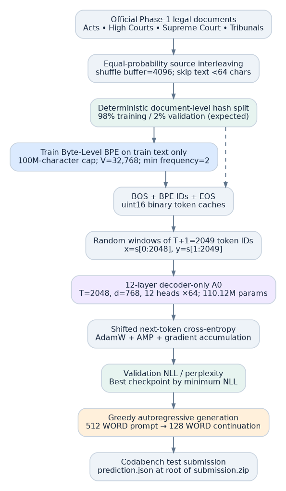
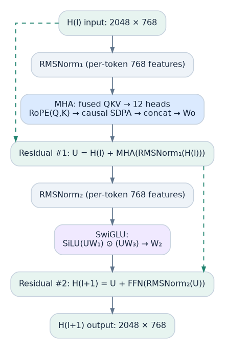
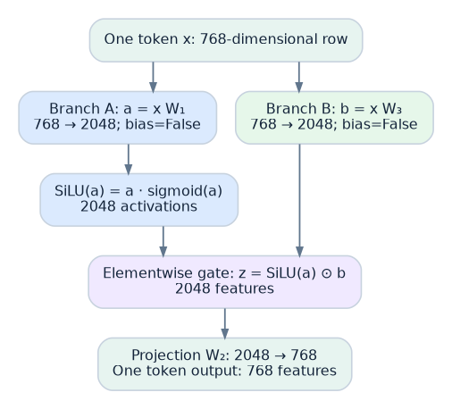
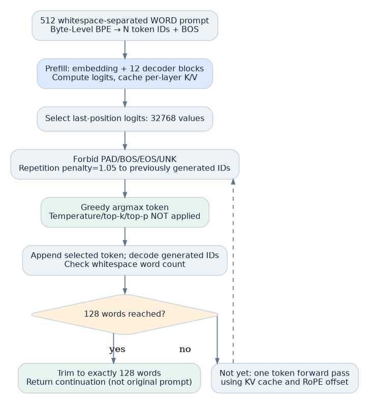

# A0 Technical Reference — Source-Exact Reimplementation Specification

> **Status:** Audited against the supplied implementation `code/architecture_a_legalgpt.py`. This file is an architectural reconstruction guide, not a performance report. The descriptions below specify the concrete A0 variant; optional strategies are not silently substituted for its default behavior.



## A. Definitions, indexing conventions and complete configuration

Use zero-based indexing unless stated otherwise: \(m=0,\ldots,T-1\) for positions, \(i=0,\ldots,31\) for RoPE coordinate pairs, \(\ell=0,\ldots,11\) for Transformer blocks. Let \(B\) denote per-device micro-batch size, \(T\) sequence length in **BPE tokens**, \(V\) actual tokenizer vocabulary size, \(d\) model width, \(H\) attention head count, \(d_h=d/H\) head width, and \(d_{ff}\) FFN hidden width. **Do not confuse**: `max_seq_len=2048` (positions) versus `d_ff=2048` (neurons per token); both happen to equal 2048. The phase challenge's 512 input / 128 output units are **words**, counted as regex `\S+`, not BPE tokens.

### Exact default dataclasses (source lines 73–135)

| DataConfig field | Value | Use |
|---|---|---|
| `repo_id` | `Exploration-Lab/CS-781-Capstone` | Official Hugging Face corpus |
| `config_name` | `phase_1` | Combined official corpus fallback |
| `vocab_size` | 32,768 | Byte-level BPE vocabulary target |
| `tokenizer_train_chars` | 100,000,000 | Tokenizer raw text character budget |
| `train_tokens` | 200,000,000 | Token-cache storage cap, not epochs |
| `val_tokens` | 5,000,000 | Validation token-cache storage cap |
| `val_fraction` | 0.02 | Hash-based document selection threshold |
| `val_generation_examples` | 128 | Maximum held-out continuation windows |
| `shuffle_buffer` | 4096 | Streaming shuffle buffer for each source |
| `mix_mode` | `equal` | Uniform choice among still-active source iterators |
| `seed` | 781 | Corpus-source RNG seed |

| ModelConfig field | Value | Use |
|---|---|---|
| `vocab_size` | 32768 nominal | Overwritten with actual tokenizer vocab in `train()` |
| `max_seq_len` | 2048 | Maximum key/value and RoPE position length |
| `n_layers` | 12 | Number of distinct decoder blocks |
| `d_model` | 768 | Embedding/output and residual width |
| `n_heads` | 12 | Attention channels |
| `d_head` | 64 | Independent Q/K/V dimensions per head |
| `d_ff` | 2048 | Gated feedforward intermediate width |
| `rope_theta` | 10000.0 | Rotary frequency base |
| `dropout` | 0.0 | SDPA dropout probability when training |
| `gradient_checkpointing` | True | Recompute Transformer blocks during backward |

| TrainConfig field | Value | Use |
|---|---|---|
| `micro_batch_size` | 1 | Per-rank sequence count |
| `grad_accum_steps` | 32 | Micro-batches accumulated per optimizer step |
| `learning_rate` | 0.0003 | Peak LR |
| `min_lr_ratio` | 0.1 | Minimum LR = 0.00003 |
| `warmup_ratio` | 0.02 | Approx. 2% of planned steps |
| `weight_decay` | 0.1 | AdamW on ndim≥2 weights |
| `beta1,beta2` | 0.9, 0.95 | Adam moment smoothing |
| `eps` | 1e−8 | Adam denominator stability |
| `grad_clip` | 1.0 | Global norm maximum |
| `target_train_tokens` | 200,000,000 | Planned processed token budget |
| `eval_every` | 100 | Validation interval in optimizer steps |
| `eval_batches` | 32 | NLL validation micro-batches |
| `save_every` | 100 | Latest checkpoint interval if not evaluating |
| `log_every` | 10 | Training logs interval |
| `seed` | 781 | Torch/NumPy/Python seed |

| GenerationConfig field | Value | Use |
|---|---|---|
| `strategy` | `greedy` | **Selected by default** |
| `temperature` | 0.8 | Only `topk`/`nucleus`; no effect on `greedy` |
| `top_p` | 0.90 | Only `nucleus` strategy |
| `top_k` | 50 | Only `topk` strategy |
| `repetition_penalty` | 1.05 | Applied to previously generated token IDs |
| `target_words` | 128 | Regex whitespace word count |
| `max_new_tokens` | 384 | Absolute generation token cap |
| `seed` | 781 | Sampling RNG seed plus example offset |

**CLI limitations:** `rope_theta`, `min_lr_ratio`, `warmup_ratio`, `beta1`, `beta2`, `eps`, and `shuffle_buffer` are dataclass defaults with **no public CLI flags** in `build_parser()`; reproducing non-default values requires source modification or API-level call. `--mode all` performs prepare → train → eval → submit sequentially. `--force_prepare` deletes/recreates token caches and tokenizer; `--no_resume` starts training without reloading `latest.pt`.

## B. Detailed corpus implementation, including source boundary cases

### B.1 Text extraction and ordering

`extract_text()` supports string rows and dictionary rows. Preferred field order `text > document > content > body > judgment > case_text`; recursively handles nested dict; if exactly one entry, recursively unwraps its value; if none found, picks the longest nonblank string value. `extract_id()` selects first available nonblank `id/ID/doc_id/document_id/case_id/uid` or a fallback ID containing source, enumeration index, and SHA1 of a prefix of text. `stream_one_source()` uses `load_dataset("json",data_files={"train":url},split="train",streaming=True)`, where `url` resolves to the official dataset's `main` branch path. It shuffles the streamed iterator with a finite 4096-row buffer and source-dependent seed, then filters empty/under-64-character records. `stream_natural()` uses `load_dataset(repo_id,config_name,split="train",streaming=True)` on the combined dataset, also shuffling and filtering. `stream_equal_mix()` draws a uniform source name from remaining iterators, not a uniform document of the total corpus; as iterators exhaust they are removed.

### B.2 Exact validation split key

For each streamed document `doc`, compute `prefix_hash=sha1(doc['text'][:512])`, `key=f"{source}::{id}::{prefix_hash}"`. Then compute `sha01("VAL::"+key)` as `int.from_bytes(sha1(...).digest()[:8],"big")/2**64`; validation iff value `<0.02`. The partition is independent of document order **if** document identity/prefix text is stable. Corpus version changes, text updates, source changes or ID changes can move rows. There is no code to deduplicate equivalent documents with different IDs or to detect overlap with the hidden test set. Do not claim more than the source guarantees.

### B.3 Tokenizer training: actual BPE stages

`Tokenizer(BPE(unk_token="<unk>"))` with `ByteLevel(add_prefix_space=False)` begins from byte-level pre-tokenization and trains merges through `BpeTrainer(vocab_size=32768,min_frequency=2,special_tokens=["<pad>","<bos>","<eos>","<unk>"],show_progress=True)`. No externally pretrained tokenizer or precomputed merge list is loaded. Raw non-validation source documents are streamed until a **100M-character budget**; on the last document only a prefix may be yielded. Within the imported BPE algorithm, the next eligible merge is the most frequent adjacent pair. A merge replaces occurrences of that pair in the current segmentation, so subsequent pair counts/priorities change. One merge introduces (at most) one new vocabulary symbol, and the trainer stops when its target vocabulary size or available frequency candidates are exhausted. `min_frequency=2` is the eligibility threshold; **there is no independent specified number of merges `M`** and no language-model sampling in this stage. Real byte-level pretokenization differs from the simplified character-only teaching examples because spaces, Unicode bytes, and pretokenization boundaries matter. The exact merge list is saved to `tokenizer.json` and should be inspected for full reproduction; only code is available here, not that fitted tokenizer file. No fitted tokenizer stats have been invented.

A sample **toy merge iteration** (not the source's actual trained merges) begins with words `low`, `lower`, `lowest` represented by byte/pre-token units; tally neighboring pairs and choose a maximal-count eligible pair, e.g. `l + o → lo`; recount and continue. In contrast, decoding tokenizer IDs back to text is deterministic via `ByteLevelDecoder`. This process is completely distinct from Transformer output decoding strategies.

### B.4 Token caches and train–validation distinction

Once trained, the tokenizer is loaded from `tokenizer/tokenizer.json`. Each document's encoding is `[bos] + tokenizer.encode(text).ids + [eos]`, written in binary `uint16` to `train_tokens.bin` or `val_tokens.bin`. Separate target caps stop writing after 200M and 5M IDs; the outer document scan continues until **both** caps and the required number of validation-generation examples have been reached, or the source stream ends. A document can be cut mid-document to respect the token cap and then lose its EOS. Tokenizer and caches are **reused** if expected files exist and `--force_prepare` is not passed; existence alone is checked, not provenance or consistency against current config. Record hashes of cache/tokenizer separately to verify reproducibility.

Validation-generation examples are collected from **validation documents**, but only from docs having \(\ge640\) `re.findall(r"\S+",text)` words. `deterministic_window()` calculates `max_start = num_words - 640` and uses SHA1 of `"WINDOW::"+key` modulo `max_start+1` to select 640 consecutive words. It concatenates first 512 words for prompt and next 128 for reference. Thus a document with only 80 words remaining after some chosen 512-word prefix **does not generate a 512/80 local validation pair**; only windows of 640 words are eligible. LM training is still carried out on packed token windows crossing documents.

## C. Training batch construction and token loss

**One training sample, fully specified:** `np.memmap` reads \(T+1=2049\) adjacent `uint16` IDs from a single continuous stream. `starts = rng.integers(0, len(mm)-T-1, size=B)` draws random start offsets. `np.stack` materializes `[B,2049]`, casts each ID to `int64`, transfers to device as `torch.long`, and shifts: `x=arr[:,:-1]` and `y=arr[:,1:]`. With \(B=1\): `input_ids.shape = [1,2048]`, `targets.shape=[1,2048]`. The model predicts \(p(s_{t+1}\mid s_{\le t})\) for every window position and calculates `F.cross_entropy(logits.reshape(-1,V),targets.reshape(-1))`, with default reduction `mean`. The **causal mask** ensures a prediction at position \(t\) cannot read later input positions; using all 2048 teacher-forced targets simultaneously does not leak next-token labels. The objective is **not** sequence-to-sequence 512→128 and is **not** masked at EOS. The target immediately after EOS might be the BOS of a different document, because documents are concatenated.

## D. Embeddings, norm and attention: per-tensor contract



### D.1 Embedding and weight tying

Let the tokenizer IDs be \(I\in\{0,\ldots,V-1\}^{B\times T}\) and learned embedding \(E\in\mathbb R^{V\times d}\). `nn.Embedding` looks up one row for each ID. The tensor is \([B,T,d]=[1,2048,768]\). No learned absolute positional-embedding table is added; RoPE supplies positional information to per-head Q/K downstream. `lm_head = nn.Linear(768,V,bias=False)` is created and **its `.weight` is rebound to `.tok_embeddings.weight`**. Therefore the same \(E\) is used for input lookup and output dot products \(Z=H_fE^\top\). Both input and output uses contribute to the gradient of one common learned weight tensor.

### D.2 RMSNorm (exact computation)

For each token vector \(x\in\mathbb R^{768}\):

\[
\mathrm{RMSNorm}(x)_j=\gamma_j\frac{x_j}{\sqrt{768^{-1}\sum_{k=1}^{768} x_k^2 + 10^{-6}}}.
\]

No mean subtraction (unlike LayerNorm), no across-token normalization, no learned bias. The PyTorch routine: remember original dtype; convert input float32; `x_float * torch.rsqrt(x_float.pow(2).mean(-1,keepdim=True)+eps)`; cast normalized values back; multiply by trainable \(\gamma\) initialized to ones. Two independent RMSNorm modules per block—attention pre-norm and SwiGLU pre-norm—and one final after block 12.

### D.3 Fused Q/K/V in code vs three conceptual matrices

`nn.Linear(768, 3*768, bias=False)` on \([B,T,768]\) returns \([B,T,2304]\); `.chunk(3,-1)` gives Q, K, V, each \([B,T,768]\). For each, `.view(B,T,12,64).transpose(1,2)` yields \([B,12,T,64]\). Think of the fused matrix as three concatenated 768-by-768 projections. No attention-head index slices off token rows: **each head has all T positions**. Each head's Q, K and V submatrices are learned from its own corresponding projection weight slices.

### D.4 RoPE full matrix derivation

For one head at position \(m\), Q is \(q_m\in\mathbb R^{64}\). Let pair index \(i\in\{0,\ldots,31\}\) select coordinates \((q_{m,2i},q_{m,2i+1})\), \(\theta_i=10000^{-2i/64}\), \(\phi_{m,i}=m\theta_i\). The rotation matrix is \(R(\phi)=\left[\begin{smallmatrix}\cos\phi&-\sin\phi\\\sin\phi&\cos\phi\end{smallmatrix}\right]\). Construct \(R_m=\operatorname{blockdiag}(R(m\theta_0),\ldots,R(m\theta_{31}))\), size \(64\times64\). The new query is \(q'_m=R_mq_m\), and the new key is \(k'_m=R_mk_m\). **It is not one independent complex multiplier per real coordinate**; each feature pair is jointly rotated by its single common angle. The implementation precomputes cosine and sine arrays `[2048,32]` in nonpersistent buffers, slices by current token offset and broadcasts into `[B,12,T,32]` even/odd feature-pair operands. RoPE has no trainable parameters and these buffers are not stored in state_dict.

Relative-position identity (orthogonal rotations):

\[
(R_m q)^\top(R_n k)=q^\top R_m^\top R_n k=q^\top R_{n-m}k.
\]

The dot product is sensitive to relative displacement, *for fixed Q and K content*. Causal masking independently blocks future positions; RoPE itself is not the mask. `apply_rotary` rejects offsets beyond `max_seq_len` instead of extrapolating.

### D.5 Causal SDPA, precise shapes

For each head, rotated \(Q'\in\mathbb R^{T\times64}\), \(K'\in\mathbb R^{T\times64}\), unrotated \(V_h\in\mathbb R^{T\times64}\). The conceptual unnormalized scores are \(S=Q'K'^\top/8\in\mathbb R^{T\times T}\). A causal mask \(M_{mn}=-\infty\) when key \(n>m\), 0 otherwise. \(A=\operatorname{softmax}(S+M)\) and \(O=AV_h\in\mathbb R^{T\times64}\). The source performs `F.scaled_dot_product_attention(q,k,v,attn_mask=None,dropout_p=cfg.dropout if training else 0.,is_causal=causal)`. With no cache, `causal=True`; cached decode requires `t==1`, concatenates cached K/V and sets `causal=False` because the only query is newest. All 12 outputs reassemble into `[B,T,768]` and pass through `wo:Linear(768,768,bias=False)` before the residual sum.

### D.6 SwiGLU, explicit 768→2048→768



For **one token row** \(x\in\mathbb R^{768}\), branch A: \(a=xW_1\in\mathbb R^{2048}\) with learned \(W_1:[768,2048]\); branch B: \(b=xW_3\in\mathbb R^{2048}\), learned independently; then \(z=\mathrm{SiLU}(a)\odot b=[a\odot\sigma(a)]\odot b\). This combines two separate full-width projections via elementwise multiplication. \(b\) can be negative and can amplify, suppress or flip a feature: it is **not a sigmoid-limited gate**. Then \(f=zW_2\in\mathbb R^{768}\) with learned \(W_2:[2048,768]\). For all T tokens in parallel: \([T,768]\to[T,2048]\) twice \(\to[T,2048]\to[T,768]\). The FFN **never mixes token positions**; a weight matrix is shared across token rows. Every linear transform is instantiated `bias=False`.

### D.7 The block and the 12-layer stack

For block \(\ell\), \(U^{(\ell)}=H^{(\ell)}+\mathrm{Attn}_{\ell}(\mathrm{Norm}^{\mathrm{attn}}_{\ell}(H^{(\ell)}))\) and \(H^{(\ell+1)}=U^{(\ell)}+\mathrm{FFN}_{\ell}(\mathrm{Norm}^{\mathrm{ffn}}_{\ell}(U^{(\ell)}))\). Twelve *distinct* `TransformerBlock` instances are held in `nn.ModuleList`, but the same **nonlearned RoPE buffer module** is passed to each block. Attention and FFN use independent trainable matrices in each block. Shape is \([B,T,768]\) at entry/exit of each layer. After block 12, final `RMSNorm` and `lm_head` give \([B,T,V]\) logits. During train: \([1,2048,V]\). **There is no separate softmax layer in `LegalGPT.forward`**: `F.cross_entropy` receives raw logits and internally implements log-softmax/NLL efficiently. During inference, `argmax` of logits suffices for greedy; sampling strategies apply softmax after filtering.

### D.8 Parameters and explicit weight initialization

No QKV, FFN or LM-head biases; RMSNorm gains are the only 1-D trainable tensors. Matrices/embedding initialize Normal(0,0.02²); `attn.wo` and `ffn.w2` for each layer reinitialize Normal(0,(0.02/√24)²) for residual-path scaling. Total distinct scalar parameters, nominal V=32768:

\[
P=Vd + L[(3d^2+d^2)+(3dd_{ff})+2d] + d
=32768(768) + 12(4(768)^2+3(768)(2048)+1536)+768
=110,119,680.
\]

No trainable RoPE frequency; the tied output projection shares the embedding weight. The validator asserts \(Hd_h=d\) and vocab `< 65535` (for uint16 caching). Real vocab size can be smaller than configured if BPE stops early; model config is adjusted at training initialization.

## E. Training execution down to optimizer-state mechanics

`seed_everything(781+rank)` seeds Python, NumPy, torch CPU and CUDA. Device: CUDA if available, else CPU. On CUDA, Flash/memory-efficient/math SDPA backends are **enabled**, but backend dispatch is dynamic. Set matmul precision to `"high"`. AMP chooses BF16 when `torch.cuda.is_bf16_supported()` else FP16; FP16 uses GradScaler. Per train micro-batch:

1. Sample \(B=1\) input/shifted target BPE windows of 2048 tokens, 2049 raw IDs.
2. Train-mode forward with activation checkpointing on each block (if enabled); yield logits `[1,2048,V]` and mean CE.
3. Divide loss by `grad_accum_steps=32`; call backward. When DDP, suppress gradient synchronization on the first 31 accumulation micro-batches using `no_sync()`.
4. Repeat 32 times to aggregate gradients; if FP16 scaler active, unscale grads.
5. Apply global norm clipping at 1.0; perform `optimizer.step()` (via scaler when FP16); clear gradients via `zero_grad(set_to_none=True)`.
6. Increment approximate `tokens_seen` by \(B\,T\,\mathrm{accum}\,\mathrm{world\_size}\). This is a processed training-position count, **not a count of distinct corpus tokens** (windows can repeat).
7. Log every 10 steps (plus first step); validate every 100 or last; save latest/best as applicable.

**Learning-rate formula:** with \(S=\lceil\text{target tokens}/\text{tokens per step}\rceil\), \(W=\max(1,\lfloor0.02S\rfloor)\), peak \(\eta=3\cdot10^{-4}\), floor \(\eta_{min}=0.1\eta\). If `step < W`, `lr=eta*(step+1)/W`; otherwise `progress=(step-W)/(S-W)`, clipped to [0,1], and `lr=eta_min +(eta-eta_min)*(1+cos(pi*progress))/2`. Source-defined max steps on one GPU = 3052 and `tokens_per_step=65536`; wall time and actual success are not established. AdamW groups parameters with `ndim>=2` into decayed group and 1-D gains into non-decay group, using \(\beta=(0.9,0.95)\), epsilon \(10^{-8}\), weight decay 0.1. CUDA attempts fused AdamW and falls back if unavailable.

**Checkpoint details:** `save_checkpoint()` saves model/optimizer/scaler states, step number, best validation loss, tokens seen, model config, training config. Write temp `latest.tmp.pt`, atomically `os.replace` into `latest.pt`. If current NLL strictly improves, `shutil.copy2` latest to `best.pt`. `load_training_checkpoint` resumes from `latest.pt` with optimizer and scaler states but **does not restore RNG states**. So a resumed run is not guaranteed bit-identical to a continuously executed run, even though batchers use fixed seeds. A `--no_resume` run starts from fresh initialization; it does not automatically delete the workdir's prior files. `run_config.json` is re-written by **every** invocation of `main()` (including eval/submit), so it is not a trustworthy immutable historical record of the original train command; the checkpoint's saved configs are more authoritative.

## F. Validation, generation testing, and their distinctions

### F.1 NLL validation used to pick the checkpoint

On each scheduled validation, `evaluate_loss()` sets `eval()`, disables grads, computes NLL over 32 independently sampled validation micro-batches, averages the mean losses, switches back to `train()` and calculates PPL via `exp(min(val_loss,20))` for display. The **checkpoint criterion is validation NLL**. This is independent of how good 128-word continuations sound.

### F.2 Generation-oriented local validation

The script uses prepared 512-word prompt/128-word reference windows from held-out validation docs, and runs the exact inference generator. For each generated/reference text pair it computes stemmed ROUGE-L F1 (`rouge_score`) and corpus SacreBLEU score divided by 100. **BERTScore is optional** only under `--allow_local_bertscore`, and would load a pretrained evaluator. `--eval_generation_limit=32` by default, even though up to 128 examples are prepared. Output files are `evaluation/generation_<strategy>.json` and `evaluation/metrics_<strategy>.json`.

### F.3 Inference code path and KV cache



1. `load_model_for_inference()` checks `best.pt` then `latest.pt`, reconstructs model config, loads `.pt` model state strictly, loads saved tokenizer, switches to `.eval()`. These checkpoints **are not included** in source-only packages.
2. Encode 512-word prompt: `prompt_ids=[bos]+tokenizer.encode(prompt).ids`. Let token count including BOS be \(N\). If \(N>=2032\), fail rather than crop or slide; nominal trained max context 2048.
3. Prefill with `model(x,use_cache=True)`; entire input has \([1,N]\), embedding \([1,N,768]\), and final logits \([1,N,V]\). Read `logits[:,−1,:]` as next-token vector \([1,V]\). K/V caches per layer are `[1,12,N,64]` each.
4. Set PAD/BOS/EOS/UNK logits to negative infinity; penalize **generated** token types, not prompt token types, by 1.05 using sign-aware formula.
5. With strategy `greedy`, output index with max adjusted logit. This is fully deterministic conditional on weights and numerical arithmetic. With `topk`, temperature-scale, top 50, normalize by softmax and draw. With `nucleus`, temperature-scale, sort full vocab, use cumulative probability cutoff 0.90 **including first crossing token**, renormalize and draw. No beam search is present.
6. Append token ID to `gen_ids` and decode `tokenizer.decode(gen_ids,skip_special_tokens=True)`; if regex whitespace word count \(\ge128\), trim and return only the first 128 words.
7. Otherwise pass the single selected new token `[1,1]` with past cache into `model()`: each layer concatenates cached K/V, rotates new Q/K by `offset=past_len`, and calls SDPA with `is_causal=False` because every available key is at an earlier/current position. Repeat.
8. Hard token limit \(L=\min(384,2048-N)\). Raise RuntimeError if fewer than 128 words after L generated BPE tokens. The code does not use EOS to stop; EOS is forbidden. Near the context limit this can fail. It does not invent 48 missing reference words when an 80-word document suffix ends; local evaluation excludes insufficient 640-word windows.

**Shape evolution for one prompt:**

| Inference stage | Shape (ignoring dtype) | Interpretation |
|---|---|---|
| Prompt BPE IDs | `[1,N]` | N includes BOS |
| Embeddings | `[1,N,768]` | Learned E rows |
| Q/K/V | `[1,12,N,64]` each | Each head sees N positions |
| Full prefill LM logits | `[1,N,V]` | Only last time index needed for next token |
| One sampled token | scalar integer | Reused as next input token |
| Cached step input | `[1,1]` | One new token only |
| Cached-step hidden | `[1,1,768]` | Same trained model parameters |
| Cached-step Q | `[1,12,1,64]` | Only latest query |
| Cached-step K/V | `[1,12,N+g,64]` | N prompt tokens + g generated tokens so far |
| Cached-step LM logits | `[1,1,V]` | Next-token scores |

### F.4 Test-time submission formats

`make_submission()` downloads the official test JSON using `hf_hub_download`; normalizes IDs and text with fallback support for dict/list schema; logs warnings when prompt words differ from 512; then runs exact generator and verifies a `{"text": continuation}` dictionary for each test ID. It builds **Codabench** ZIP containing *only* `prediction.json`, as code asserts. Separate course final report/code ZIP has the different `code/` and `report/` root folder contract from the supplied 7 November 2026 Discord announcement. These ZIP structures must not be conflated.

## G. Memory engineering and reproducibility limitations

For **nominal** \(P=110119680\): float32 parameter bytes \(4P\)=440,478,720 bytes (~420.1 MiB); gradient storage same when populated; two AdamW float32 moments ~840.1 MiB. Training logits `[1,2048,32768]` has 67,108,864 elements: FP16/BF16 ~128 MiB, FP32 ~256 MiB. A naive materialized score tensor `[12,2048,2048]` would be 50,331,648 elements (~96 MiB FP16) **per block**, but optimized SDPA can avoid full-matrix storage. KV cache for 12 blocks with full T=2048, two tensors K/V, 12 heads and head_dim 64 has \(12\times2\times12\times2048\times64=37,748,736\) elements; at 2 bytes, 72 MiB. The cache is used in generation, **not** standard training. `train_tokens.bin` cap 200M uint16 IDs ~381.5 MiB on disk. These are **tensor-level estimates**, not an empirical GPU-memory trace. In reality autograd intermediates, checkpoint recomputation, kernels, allocator overhead, optimizer workspace, device dtype and model implementation affect peak. A0 does not record measured `torch.cuda.max_memory_allocated()` or actual chosen SDPA backend.

**Potential limitations to disclose (verified from code):**

- No packed-document reset of attention at BOS/EOS; fixed T windows cross documents.
- No attention loss masking after EOS.
- No validation dedup / near-duplicate overlap checking in supplied implementation.
- Equal source **draw probability** is not equal source **token quota**.
- The HF `main` branch URL and version lower bounds do not guarantee immutable data/library versions. Repo SHA at start is recorded if fetch succeeds, but specific fetched source URLs resolve `main` independently.
- BPE training stops at up to 100M **characters**, while cache targets count **token IDs**.
- Tok cache reuse can leave stale caches after configuration changes unless `--force_prepare` is given.
- LR schedule, RNG states and multi-rank sampler state are not fully restored for bitwise-identical resume.
- `run_config.json` is overwritten by the most recent CLI invocation.
- No tokenizer.json, trained checkpoint, observed curves or Codabench scores were provided in the original source ZIPs.
- `max_seq_len` limits both inference prompt plus generated BPE tokens; prompt rejection threshold at 2032 IDs and generation cap 384.
- Default greedy output may be repetitive; `repetition_penalty=1.05` only considers already generated IDs.
- Optional local BERTScore is external-pretrained evaluation, deliberately disabled by default.

## H. Exact executable commands and artifact paths

From `code/`:

```bash
python -m pip install -r requirements.txt
python architecture_a_legalgpt.py --mode selftest
python architecture_a_legalgpt.py --mode prepare --workdir ./runs/A0_dense_flash --vocab_size 32768 --tokenizer_train_chars 100000000 --prepare_train_tokens 200000000 --prepare_val_tokens 5000000 --val_generation_examples 128 --mix_mode equal --seed 781
python architecture_a_legalgpt.py --mode train --workdir ./runs/A0_dense_flash --max_seq_len 2048 --micro_batch_size 1 --grad_accum_steps 32 --learning_rate 3e-4 --weight_decay 0.1 --target_train_tokens 200000000 --eval_every 100 --eval_batches 32 --save_every 100 --log_every 10 --seed 781
python architecture_a_legalgpt.py --mode eval --workdir ./runs/A0_dense_flash --strategy greedy --eval_generation_limit 32
python architecture_a_legalgpt.py --mode submit --workdir ./runs/A0_dense_flash --strategy greedy
```

`data/*.bin`, `tokenizer/tokenizer.json`, `checkpoints/latest.pt`, `checkpoints/best.pt`, `evaluation/metrics_greedy.json`, and `submission/greedy/submission.zip` are runtime artifacts created *only after their respective commands execute*. No generated result is supplied in this documentation bundle. See `CODE_MAP.md` for per-function source contracts, `SOURCE_MANIFEST.md` for hashes, and `VALIDATION_CHECKLIST.md` for a TA verification list.

## I. Evidence and rationale separation

Reproducibility requires distinguishing **implemented** from **successful execution**. All sizes, names, algorithms, defaults and line references here are implementation facts. The stated motivations (legal-domain tokenization, efficient SDPA, Pre-RMSNorm, SwiGLU, RoPE, weight tying, checkpointing and cosine schedule) are established *theoretical/engineering reasons one might choose them*; the source does **not** include ablation outcomes proving these choices are optimal. BERTScore is a **testing metric** and not a differentiable training objective used by this code. When reporting scores or claims of "best model", attach the actual logs, checkpoint hashes, validation split metadata, generation outputs and Codabench result.
