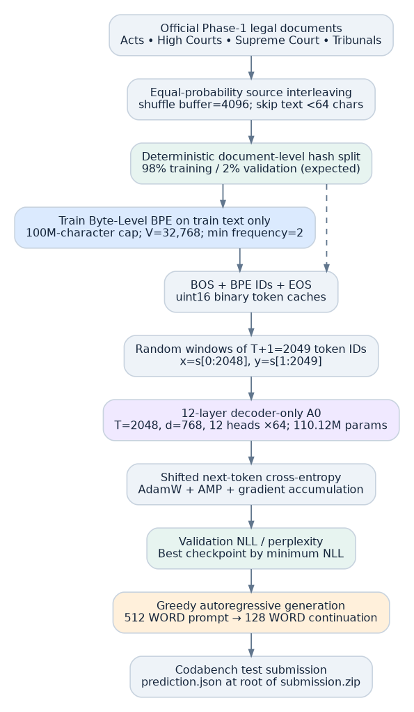
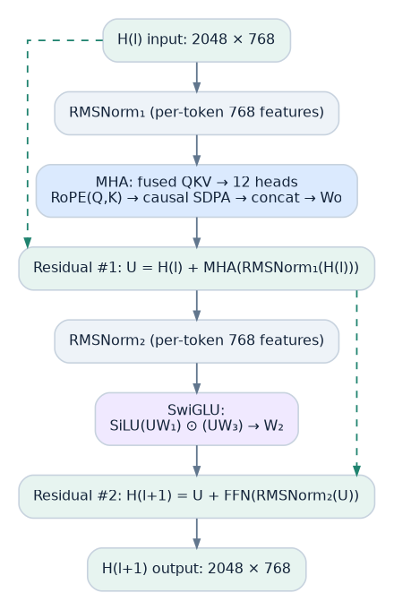
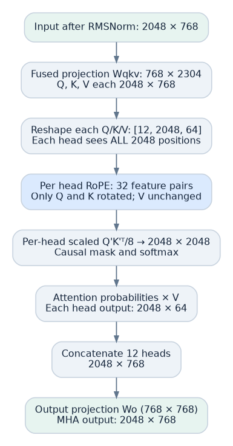
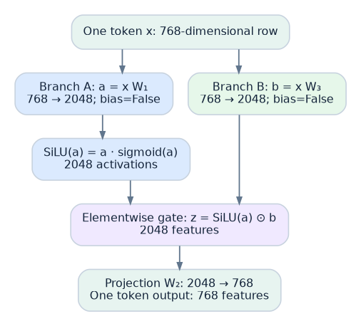
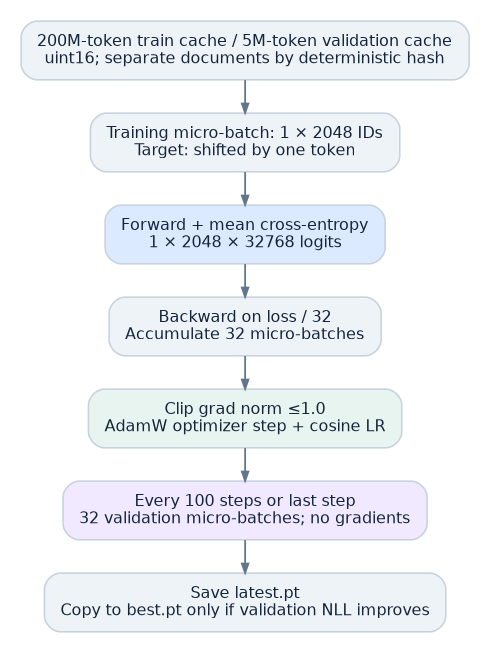
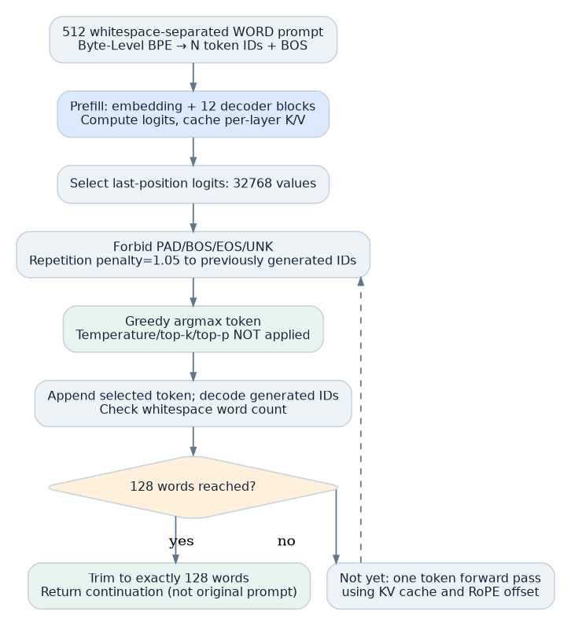

# Phase 1, Architecture A0: Dense Flash LegalGPT

**Reproducible implementation, modeling decisions, training procedure and evaluation protocol**

*This is the A0 contribution to the capstone final report. It is intended to be inserted into the supplied course LaTeX report template, alongside results and contributions from other phases. Implementation details below are verified against the supplied A0 Python source; absent results are not manufactured.*

## 1. Task formulation and architecture overview

Architecture A0 is a **from-scratch, decoder-only autoregressive Transformer** for continuation of legal text. The official task presents a 512-**word** prompt and requests a 128-**word** continuation. Word counts are based on whitespace separation; a 512-word sequence generally maps to an unequal number of Byte-Level BPE tokens. During pretraining, instead of learning on 512→128 word pairs, A0 predicts every next BPE token in a fixed-length 2,048-token sequence sampled from a packed legal-text corpus. The model contains **12 decoder blocks, 768 hidden features, 12 attention heads of 64 dimensions each, a 2,048-dimensional SwiGLU intermediate transformation, Pre-RMSNorm, RoPE, causal self-attention, and tied output/input embeddings**. The nominal number of unique parameters at vocabulary size 32,768 is **110,119,680**.

The design objective is to develop a domain-trained baseline within the capstone's stipulated parameter range, while providing straightforward autoregressive pretraining and efficient cached generation. Justifications described below are design rationale, not empirically validated superiority claims absent controlled comparisons.

## 2. Dataset loading, train/validation isolation and corpus representation

The implementation streams four official source files from Hugging Face dataset `Exploration-Lab/CS-781-Capstone`: `train_acts.json`, `train_high_courts.json`, `train_supreme_court.json`, and `train_tribunals.json` under `Phase_1_Pretraining/Train/`. The default `mix_mode="equal"` creates shuffled streams (buffer size 4,096) and picks an available source uniformly for each document yielded. Its equal weighting is a **selection policy, not a guarantee of equal token mass**, because source documents have different lengths. A combined `phase_1` dataset streaming fallback is implemented if source-level streaming fails. Text extraction uses multiple supported field names, recursively handles simple wrappers and rejects texts shorter than 64 characters.

Train and validation are separated deterministically at **document level** rather than on randomly sampled token windows. A key constructed from source, record identity and SHA1 of a text prefix is hashed again; keys whose normalized eight-byte SHA1 value is below 0.02 enter validation. The expected validation fraction is 2% of such keys. Validation documents are excluded both when fitting the tokenizer and when building the language-model training token cache. The code does not implement near-duplicate matching between distinct records; therefore this is a deterministic partition, not proof of semantic deduplication.

The program sets default caps of **200,000,000 training BPE IDs** and **5,000,000 validation BPE IDs**. Document IDs are encoded and appended without padding as `[BOS, ...document token IDs..., EOS]` to separate `uint16` binary streams. A document can be truncated to respect the cache cap, and continuous training windows can straddle EOS/BOS boundaries. There is no reset-of-attention at document boundaries, and EOS remains an ordinary training target. These are material algorithmic details rather than incidental implementation choices.

## 3. Tokenizer training: the complete Byte-Level BPE protocol

A0 imports the Rust-backed Hugging Face `tokenizers` implementation and trains a **new Byte-Level BPE model** on official legal text. The algorithm itself is not written from scratch and no pretrained vocabulary is loaded. The configuration is `Tokenizer(BPE(unk_token="<unk>"))` with `ByteLevel(add_prefix_space=False)`, `ByteLevelDecoder()`, and `BpeTrainer(vocab_size=32768,min_frequency=2,special_tokens=["<pad>","<bos>","<eos>","<unk>"],show_progress=True)`. The raw text iterator supplies non-validation documents until the first **100 million Python string characters** have been processed, with the final supplied text optionally truncated to the remaining quota. No extra normalizer or tokenizer post-processor is specified.

Byte-Level BPE starts from byte-level units and learns a succession of merges. At each iteration, the trainer counts **adjacent pairs inside its pre-tokenized sequences**, picks the most frequent eligible pair (minimum frequency 2), assigns a merged symbol and updates the segmentation; later merge priorities depend on earlier merges. It terminates at the requested vocabulary size or when remaining eligible merges are exhausted. The program does not set a separate merge count \(M\) or a top-k pair list. The final actual vocabulary size and metadata are saved in `tokenizer/tokenizer_meta.json`, and learned symbol IDs/merge rules in `tokenizer/tokenizer.json`. The exact realized merge list, IDs and final size require this generated tokenizer file; they cannot be inferred from configuration alone. The tokenizer is thereafter fixed: it maps text deterministically to subword IDs, while the Transformer learns the trainable semantic embeddings of those IDs.

Top-k sampling, nucleus sampling, beam search and temperature scaling are **not BPE training algorithms**. They are choices for generating the next token from a trained language model. In A0, the selection of BPE merges is frequency-driven and greedy; inference decoding is separately configured as described in Section 7.

## 4. Transformer computation: every representation and sublayer

For one training example of length \(T=2048\), the input token IDs have shape \([T]\). An embedding matrix \(E\in\mathbb R^{32768\times768}\) maps these indices to \(H^{(0)}\in\mathbb R^{2048\times768}\). The full default micro-batch has shape \([1,2048,768]\), but the following ignores the batch dimension. A0 does not add a learned absolute position vector to these embeddings; the attention projections use RoPE for position.

In block \(\ell\), the first step is \(\widetilde H=\mathrm{RMSNorm}_1(H^{(\ell)})\), independently normalizing each token's **768 features** (not features across token positions):

\[
\mathrm{RMSNorm}(x)_j = \gamma_j x_j\big/\sqrt{\frac1{768}\sum_{k=1}^{768}x_k^2+10^{-6}}.
\]

RMSNorm uses an initialized-to-one learned gain vector, no centering and no learned bias. The code evaluates its mean squares in float32 before casting back for AMP. Next, a fused bias-free `nn.Linear(768,2304)` produces Q, K, V, each \([2048,768]\), and reshapes them into 12 heads, each having Q/K/V of shape \([2048,64]\). Every head observes all 2,048 positions; the 768 **feature** channels are divided among heads, not the tokens.

Rotary Position Embedding groups each 64-dimensional Q and K vector into 32 adjacent pairs. For token position \(m=0,\ldots,2047\) and coordinate pair \(i=0,\ldots,31\), the frequency and angle are

\[
\theta_i=10000^{-2i/64},\qquad \phi_{m,i}=m\theta_i.
\]

Each pair \((a,b)\) becomes \((a\cos\phi-b\sin\phi,\;a\sin\phi+b\cos\phi)\). Q and K are rotated; V is untouched. Equivalently, the position-dependent block-diagonal \(64\times64\) rotation \(R_m\) yields \(q'_m=R_m q_m\) and \(k'_m=R_m k_m\), and

\[
(R_mq)^\top(R_nk)=q^\top R_{n-m}k.
\]

Thus the query-key compatibility is explicitly sensitive to relative token positions. Frequencies are fixed, and RoPE adds **zero learned parameters**. The source precomputes sine/cosine buffers for up to 2,048 positions and uses a cache-length offset during autoregressive generation.

Attention per head computes \(S=Q'K'^\top/\sqrt{64}=Q'K'^\top/8\), a \([2048,2048]\) score matrix conceptually. Its causal mask suppresses future positions; softmax yields attention weights that multiply the corresponding V matrix, producing \([2048,64]\) per head. The implementation calls PyTorch's `scaled_dot_product_attention` (SDPA), enabling CUDA Flash, memory-efficient and math backends. An optimized Flash kernel may be dispatched if supported; the package does **not** demonstrate a profiler-confirmed kernel choice. Outputs from 12 heads concatenate to \([2048,768]\) and pass through a bias-free \(768\to768\) projection \(W_O\). The first residual operation is

\[
U=H^{(\ell)}+\operatorname{MHA}(\operatorname{RMSNorm}_1(H^{(\ell)})).
\]

A second RMSNorm operates on U. SwiGLU applies two *independent*, fully connected \(768\to2048\) transformations, \(a=xW_1\) and \(b=xW_3\), to **each token separately**. The gated intermediate is \(z=\mathrm{SiLU}(a)\odot b\), where \(\mathrm{SiLU}(a)=a\odot\sigma(a)\) contains a sigmoid. Branch b is an **unbounded linear projection** rather than a bounded sigmoid gate; multiplicative interaction controls sign/magnitude of hidden features. The final \(2048\to768\) matrix \(W_2\) restores the residual width:

\[
\mathrm{SwiGLU}(x)=\big[\mathrm{SiLU}(xW_1)\odot(xW_3)\big]W_2,
\qquad H^{(\ell+1)}=U+\mathrm{SwiGLU}(\mathrm{RMSNorm}_2(U)).
\]

Each layer has two RMSNorms and two residual additions. Every one of 12 blocks has distinct learned weights, preserving the \([2048,768]\) hidden shape across blocks. After the last block, the final RMSNorm produces \(H_f\in\mathbb R^{2048\times768}\), and the vocabulary head computes \(Z=H_fE^\top\in\mathbb R^{2048\times32768}\). Crucially, \(E\) is the **same learned matrix** used to embed input IDs; the LM head does not introduce an independent second 25.2M-parameter matrix. There is no final softmax inside `LegalGPT.forward`; cross-entropy consumes logits directly.

**Parameter derivation.** Embeddings plus tied head contribute \(32768\cdot768=25,165,824\); each Transformer block contributes QKV \(3d^2\), attention output \(d^2\), SwiGLU \(3dd_{ff}\) and two norm gains \(2d\), totaling 7,079,424. Twelve blocks contribute 84,953,088, with a final 768-element norm gain. Total \(P=25,165,824+84,953,088+768=110,119,680\). Linear projections have `bias=False`; therefore no additional bias counts are hidden.

## 5. Training objective, initialization, numerical settings and optimizer

`RandomMemmapBatcher` reads **2,049 consecutive IDs**, generates input `x=arr[:,:-1]` and shifted targets `y=arr[:,1:]`, each of length 2,048. The training loss is mean autoregressive cross-entropy:

\[
\mathcal L(\theta)=-\frac1{T}\sum_{t=0}^{T-1}\log p_\theta(s_{t+1}\mid s_0,\ldots,s_t),\quad T=2048.
\]

The sum includes any EOS/BOS labels inside the packed window. Since all T input positions undergo causally masked attention, these T next-token predictions can be processed in parallel; **the model does not generate 2,048 tokens sequentially in the training loop**.

All embedding and linear weights initialize as Normal(mean 0, standard deviation 0.02). Attention-output and SwiGLU-output projection weights are subsequently scaled to standard deviation \(0.02/\sqrt{2L}\) with \(L=12\); RMSNorm gains initialize to one. No pretrained Transformer weights are loaded. A0 uses AdamW with peak learning rate \(3\times10^{-4}\), betas (0.9, 0.95), epsilon \(10^{-8}\), weight decay 0.1 for tensors with at least two dimensions and zero decay for 1-D parameters, a **2% linear warmup**, and cosine decay to **10%** of peak LR. Global gradient-norm clipping threshold is 1.0.

The default micro-batch size is one 2,048-token sequence, accumulated for 32 micro-batches before an optimizer step, giving **65,536 processed token positions/step** on one GPU. The code's target of 200M processed positions implies \(\lceil200,000,000/65,536\rceil=3052\) planned updates, not proof of completed steps. It uses activation checkpointing per block, CUDA autocast BF16 if supported or FP16 with GradScaler, and can use NCCL distributed data parallelism. The code enables optimized SDPA backends but the precise backend remains hardware-dependent.

## 6. Validation, model selection and checkpoint integrity

The main validation criterion is **held-out next-token cross-entropy**, computed with `no_grad()` over 32 randomly sampled validation micro-batches every 100 optimizer updates and at training end. Perplexity is reported as \(\exp(\mathrm{NLL})\). At each such evaluation the script atomically saves `latest.pt` (including model weights, optimizer state, scaler state, step, best NLL, processed-token count and saved configs) and copies it to `best.pt` if the NLL **strictly improves**. Training resumes from `latest.pt`, whereas evaluation/inference loads `best.pt` if present, otherwise latest. Resumption does not save and restore every RNG state, so exact bitwise equivalence to uninterrupted training is not guaranteed. No actual `best.pt` or training metrics were present in the supplied source files; this document therefore makes **no claim about achieved loss, perplexity or convergence**.

A distinct **generation validation** is constructed from held-out documents with at least 640 whitespace words, selecting one reproducible 640-word window per document, splitting it into 512-word prompt and 128-word reference, and storing up to 128 such examples. The default local evaluation runs 32 examples and reports stemmed ROUGE-L F1 and SacreBLEU-4 normalized to [0,1]. Local BERTScore is deliberately disabled by default because the scorer involves external pretrained weights. Codabench is the authoritative source for the task's primary BERTScore F1. Training and scoring protocols are not interchangeable: no gradients flow through BERTScore during A0 training.

## 7. Exact generation algorithm and token-to-word stopping rule

For inference, A0 loads a saved checkpoint and tokenizer, and encodes a 512-word input prompt into a **variable number** of BPE tokens \(N-1\), prepending BOS so there are \(N\) ID positions. It rejects \(N\ge2032\) and does not dynamically crop prompts. Prefill passes the entire \([1,N]\) sequence through the 12-layer model, returning logits \([1,N,V]\) and per-block KV caches; only the **last-position** vocabulary logits \([1,V]\) are used to predict the next token. Thereafter the generator runs the model on **one new token per step**, reusing cached K/V with the appropriate RoPE positional offset. The number of attention heads and all weight dimensions remain fixed even though N changes at inference.

The **default** strategy is **greedy decoding**: first forbid PAD, BOS, EOS and UNK; apply sign-aware repetition penalty 1.05 only to *previously generated* token IDs; then return the highest remaining logit. Because greedy uses `argmax` directly, configured `temperature=0.8`, `top_k=50` and `top_p=0.90` do **not** affect the default. Optional `topk` and `nucleus` modes use temperature-scaled probabilities and seeded multinomial sampling; no beam search is coded. The generator repeatedly decodes all accumulated generated BPE IDs and checks `len(re.findall(r"\S+",text))`. It stops and trims when it reaches **128 words**, not 128 BPE IDs, with a hard limit of `min(384,2048-N)` generated token IDs. If insufficient words appear by this cap, the code raises an exception instead of silently padding or producing a shorter answer. EOS is excluded to avoid early termination in the fixed-word output task. Any final 128-word output is text only, without the original input prompt.

The Codabench output format is exactly a ZIP with `prediction.json` at its root, mapping each official test ID to a JSON object containing only `text`, whose value contains exactly 128 whitespace-separated words. This is **separate** from the capstone's final report/code ZIP, for which the 7 November 2026 staff announcement requires `code/` and `report/` at the root of a single archive and a public GitHub link in the report. The present artifact documents A0 only, not the best architecture across all phases.

## 8. Computation and memory implications

With \(P=110,119,680\) learned scalars, float32 parameter storage is about **420 MiB**; gradients require approximately another **420 MiB** when allocated, and two Adam moments approximately **840 MiB**, before activations or device allocator overhead. A training logits tensor of shape \([1,2048,32768]\) has **67,108,864 elements**, requiring ~128 MiB in FP16/BF16 or 256 MiB in float32. Naively materializing all head scores would involve \(12\times2048\times2048\) entries per layer (~96 MiB in FP16), while a suitable fused Flash SDPA kernel may avoid writing that full score tensor to global memory. One fully populated 12-layer BF16/FP16 K/V cache at T=2048 requires ~72 MiB. These are **analytical tensor estimates**; the actual peak GPU allocation and selected attention kernel were not measured in the supplied artifacts. The 200M-token `uint16` training cache occupies ~381.5 MiB on disk at the configured cap.

## 9. Methodological rationale, limitations and reproducibility status

**Rationales.** Byte-Level BPE trained on the domain can learn frequent legal terminology and preserves byte-level coverage. A decoder-only causal objective matches continuation generation. MHA provides parallel learned token-interaction subspaces; RoPE encodes relative offsets without learned positional weights; Pre-RMSNorm improves scaling of sublayer inputs and residual pathways; SwiGLU provides multiplicative feature interactions; embedding tying reduces parameter count and aligns output token scoring with learned input embeddings; AMP, activation checkpointing and SDPA address computational cost; AdamW and cosine decay are standard stable baseline choices. Greedy inference offers a deterministic generation baseline. These are **engineering motivations**, not evidence that this configuration outperforms alternatives.

**Limitations explicitly visible in source.** The packed-corpus objective attends across BOS/EOS boundaries; there is no sequence masking at document ends. Training data are streamed without explicit near-duplicate removal. The source's dataset URLs resolve mutable `main` versions; dependency versions are bounded below but not pinned. Tokenizer/cache artifacts are reused based on existence rather than verified config compatibility. Resumed runs omit RNG-state restoration. A prompt consuming too much of the 2,048 BPE context raises an error; 384 generated BPE tokens may not always yield 128 words. The selected CUDA attention backend is not profiler-confirmed. No training or evaluation output is included in this original A0 source package.

**Reproduction status.** The supplied original Python file successfully passes its built-in tiny-model forward/cache self-test. No full-corpus tokenizer fit, 110M-parameter training, best checkpoint validation or Codabench scoring was run to create this document. This prevents scientifically unsupported numerical result claims. Exact commands, tensor ledger, entire source code, complete options, environment/data caveats and validation checklist are in the accompanying `README.md`, `docs/A0_TECHNICAL_REFERENCE.md` and `docs/CODE_MAP.md`.

## 10. A0-specific AI assistance disclosure

AI assistance was used in auditing and explaining the provided A0 source implementation, deriving explicit tensor shapes and parameter/memory estimates, drafting the methodological documentation, and generating illustrative diagrams. The source implementation, executed experimental results, and final academic claims must be verified separately. No experimental metric or completed training run has been invented for the report.

*References:* Original `architecture_a_legalgpt.py` supplied by the student; CS781 Modules 2.2 and 2.3 lecture PDFs supplied in this conversation; Hugging Face `tokenizers` and PyTorch API conventions used by the code; RoFormer, arXiv:2104.09864; final report-code submission announcement (7 November 2026).
