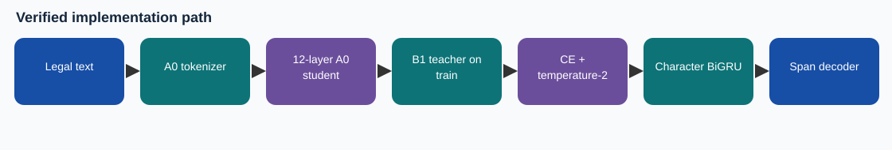

# A0 distilled from B1 NER

This is a **source-audited reconstruction of documentation**, built from the original Phase 2 code and completed-run archive. The notebook was assembled later; it does not claim to be the notebook that executed training.

## What it does

A 12-layer causal A0 student is fully tuned. The completed B1 LoRA NER model supplies temperature-2 teacher probabilities on training windows only; the loss mixes hard-label cross-entropy and teacher KL equally.

## Result and status

- Local 12-document strict macro-F1: **0.409579**.
- Prediction export: `submission/UPLOAD_Phase2_04_A0_Distilled.zip`; 35 test document IDs; SHA-256 `6b2ddb633ea55ad837549ffe06c3a26239204c92cfd133986f6aa9856daf144e`.
- Hidden Codabench score: **not established** by these records.
- Timing: Pre-deadline export.

## Read this package

1. `docs/TECHNICAL_REFERENCE.md` explains the model, tensor path, optimization, and limits.
2. `docs/CODE_MAP.md` maps original functions to source locations.
3. `notebooks/04_A0_KD_Explained.ipynb` is the illustrated, **unexecuted** companion notebook.
4. `code/` is the original source/config snapshot extracted from `CS781_Phase2_04_a0_distilled_Complete.zip`; `evidence/SOURCE_HASHES.json` records exact bytes.
5. `evidence/` contains copied run metrics, selection, completion, and provenance; `report/` contains the later technical report.

## Running the source

The original configs use paths on the former training server. Supply the original archived selected weights and tokenizer, map those paths to your machine, and install the dependencies used by the source. For the first four variants the entry point is `python -m lner.train --config configs/queue.json`, with only the desired experiment in the queue. For D222 use `python -m legal_d.pipeline --config configs/d222.json`; for the header and role variants use `run_boost.py` or `run_role_span.py` with their configs. The consensus uses `scripts/build_consensus.py` and requires exact exports from all four base models. **These commands are reference instructions, not a claim that this compact ZIP alone includes weights or course data.**

## Distinctions

The file under `submission/` is a prediction ZIP, not a code bundle. The code/report package ZIP is for review and reproducibility. A local validation number is not a private leaderboard result. The full original archive remains separately preserved at `C:\Users\Iwill\Documents\Codex\2026-10-06\referenced-chatgpt-conversation-this-is-an\outputs\phase2_20261011\CS781_Phase2_04_a0_distilled_Complete.zip`.
