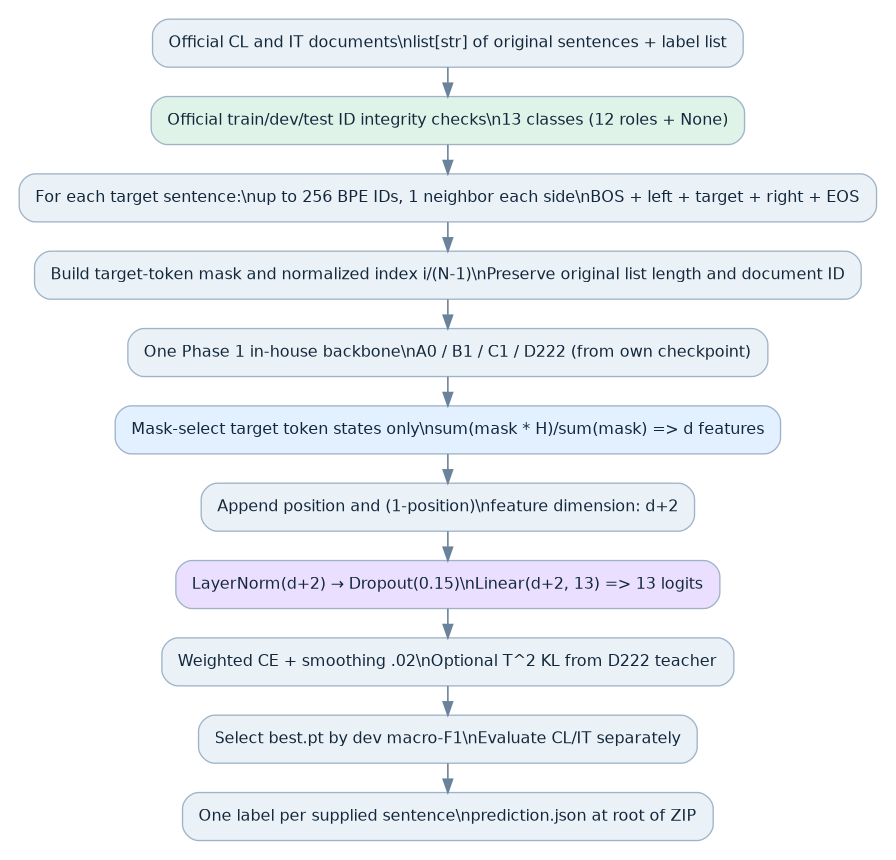
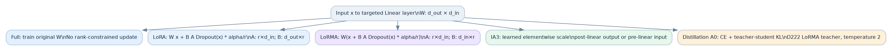
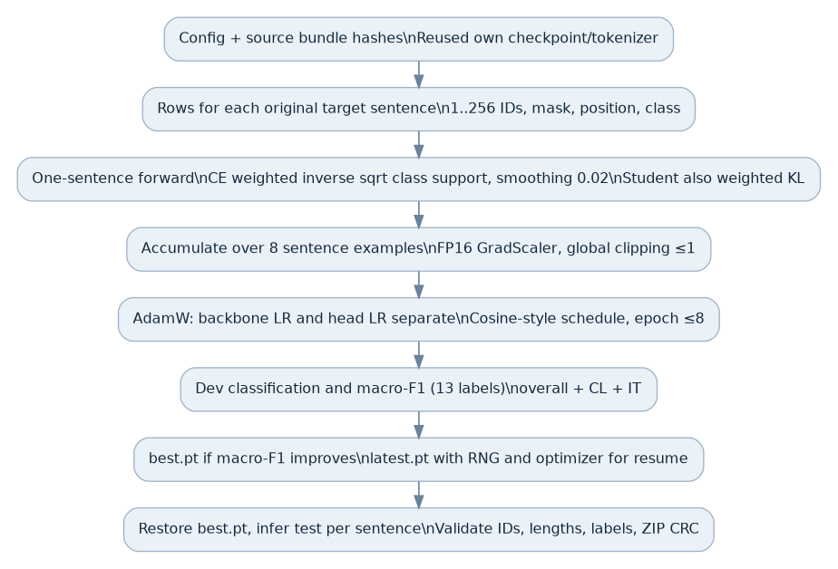

# Phase 3 · 02_B1_LoRA: Full Source-Audited Methodology Report

**Original implementation:** `phase3_rr/data.py`, `models.py`, `train.py`; corresponding prepared notebook on public GitHub. **Evidence status:** source and notebook configuration inspected; training completion, checkpoint and scores not verified.

## Exact notebook configuration and model-specific rationale

| Configuration parameter | Value in the prepared notebook |
|---|---|
| Model family | `b1` |
| Adaptation method | `lora` |
| Input bundle(s) | `Phase3_B1_Input.zip` |
| RNG seed | 781 |
| Rank / alpha | 8 / 16 (used only if method is low-rank) |
| Max BPE tokens, neighbor count | 256 / 1 each side |
| Gradient accumulation | 8 sentence rows |
| Backbone/adapter learning rate | 0.0002 |
| Classification head learning rate | 0.0003 |
| Maximum epochs / patience | 8 / 3 |
| Configured GPU training-hours | 3.0, potentially adjusted by notebook |
| Save interval | Every 50 optimizer updates |
| Distillation temperature/weight | 2.0 / 0.5 (active only in student pipeline) |
| Selection metric | Overall held-out 13-label Macro-F1 |
| Output contract | One official role per original sentence, root `prediction.json` in ZIP |

### Why B1 + LoRA is a distinct architecture

B1 is the own Phase 1 encoder–decoder model. The Phase 3 classifier first calls `encode()` to create contextual memory, and then runs the original decoder on input token embeddings while attending to that memory; it applies the decoder's normalization before selecting target-sentence hidden states. This is not identical to a standalone BERT classifier or A0's simple causal final state. The Phase 3 code wraps eligible projections in rank-8 standard LoRA `base(x)+BAx` updates, keeping base matrices frozen and learning the new head.

The code's LoRA initial `up` matrix is zeros, so at the first forward call the adaptation has zero effect on the Phase 1 representation. During training the matrix receives gradients; the effective frozen backbone plus trainable update gradually changes the space. The two separate LRs are configured as 2e−4 for the adapter/backbone trainable group and 3e−4 for the newly initialized classifier. The prediction remains argmax across 13 roles.

The architectural comparison to D222 LoRMA cannot isolate the low-rank rule alone because **both backbone family and adaptation geometry change**. This dossier identifies those moving parts rather than claiming a controlled win without a completed local result.

---

## Shared exact pipeline, mathematical derivations and source maps

**CS781 capstone, source-level methods reference.** This is a *design and implementation report*, not a measured experiment report. Four prepared variants are examined separately: D222 + LoRMA, B1 + LoRA, C1 + IA³, and A0 student distillation. The source is the preserved `phase3_rr` package in the user's final report-code ZIP, checked against the public Phase 3 notebook configs. The repository itself marks them **prepared, unscored**. No selected actual Phase 3 checkpoints, measured CL/IT Macro-F1, completed local experiment, or Codabench submission are claimed.

## 1. What exactly is the input, and why does that determine the architecture?

This is **rhetorical role classification of the supplied sentence units**, not legal named-entity recognition. Each original judgment is a record containing an `id`, an ordered `text` list of sentences, and, in labeled train/dev, an equally long list of role names. The code never applies a new generic sentence segmenter to create supervision units. If one official judgment has N provided sentences, the final prediction for that judgment must have exactly N ordered role labels.

The official data are split into Corporate Law (`CL`) and Income Tax (`IT`) domains, with train/dev/test JSON files for each and a `label_vocab.json`. The Phase 3 loader defines 13 output strings: `Fact`, `Issue`, `ArgumentPetitioner`, `ArgumentRespondent`, `Statute`, `Dissent`, `PrecedentReliedUpon`, `PrecedentNotReliedUpon`, `PrecedentOverruled`, `RulingByLowerCourt`, `RatioOfTheDecision`, `RulingByPresentCourt`, and `None`. **There are 12 rhetorical roles plus the `None` class**, so the classifier head has 13 logits, not 12. The code compares the official label vocabulary with this set and raises an error if they disagree.

`data.py:34–65` handles dictionary or list JSON containers, checks that each ID is unique, ensures that sentence/label lists have the same length in labeled records, and verifies that IDs across CL and IT and across train/dev/test do not collide (including the official `.txt` ID normalization). Dataset files are fingerprinted with SHA-256; changing one file invalidates a prior cache. There is no undocumented random train/dev split: the source uses the **provided official splits**. Test labels are not read.

The data archive loader checks for unsafe ZIP entry paths (absolute paths or `..`), preserves original official files if identical, and refuses to overwrite a changed existing data file. Alternatively, it downloads the named official seven files from `Exploration-Lab/CS-781-Capstone` using `huggingface_hub`; a permission error requires using the authorized official files, not substituting another corpus. It neither generates synthetic labels nor augments test labels.

## 2. Sentence-to-sequence preprocessing: exact 256-token construction

One training or inference row is created for **each target sentence**, retaining its document ID and integer sentence index. The configuration shared by all four prepared notebooks is `max_tokens=256` and `context_sentences=1`. Thus each row may include up to one preceding sentence and one following sentence. The supervised target is the middle sentence; context is visible to the backbone but not directly pooled to create the classification vector.

The saved Phase 1 tokenizer is loaded from the corresponding backbone input bundle. Two tokenizer formats are supported: a previously saved Hugging Face tokenizer JSON, or the custom `cs781-own-byte-bpe-v1` representation. For the latter the code reconstructs the saved Unicode category decisions using a bundled `UnicodeData-13.0.0.txt` or `UnicodeData-14.0.0.txt`, rather than silently accepting a different host Python Unicode version. The tokenizer maps input strings into BPE **token IDs**, so a 256-token budget is not 256 words.

For one target sentence, let `target=tokenizer.encode(sentence)`, with length t. The source reserves two positions for explicit start/end tokens. If t exceeds 254, it does **not drop the sentence**; it keeps approximately half of the earliest and half of the latest IDs (`head+tail`) to reach 254. An empty tokenization falls back to ID 3. The surviving target length is t′ ≤ 254.

The remaining context budget is `254−t′`. The loader first asks for approximately half of that budget from the *end* of the preceding sentence and then the remainder from the *start* of the following sentence, backfilling unused capacity where possible. The resulting sequence is

\[
\mathrm{ids}=[1]\;||\;\mathrm{left} \;||\; \mathrm{target}\;||\;\mathrm{right}\;||\;[2],
\]

where `||` means concatenation. Its length T is at most 256. The code builds an equally long **binary target mask**: zeros over BOS, left context, right context and EOS; ones for surviving target tokens. The supervised label is one of 13 IDs. The normalized location of sentence i (zero indexed) in a document of N sentences is

\[
p_i=\frac{i}{\max(1,N-1)}.
\]

The two scalar features `p_i` and `1−p_i` are both appended to the classifier representation. Thus the model can learn a preference for roles that tend to occur early/late, without replacing the linguistic evidence.

**Example.** Suppose a judgment has N=101 sentences and the target is at i=25. The two positional features are `(0.25,0.75)`. Suppose the target produces 80 BPE IDs, the preceding sentence supplies 90 and the following 100. The 254-token content budget leaves 174 context slots; the loader can keep 87 recent preceding IDs and 87 initial following IDs. Then 1 BOS + 87 left + 80 target + 87 right + 1 EOS = 256 total IDs. Only the middle 80 hidden-state rows are pooled for this label. This is an **illustrative** construction, not an observed dataset record or performance number.

`prepare_examples()` also records the number of sentences truncated under this rule and writes `tokenization.json` alongside the exact input-data/tokenizer fingerprints. A pre-existing tokenization cache is reused only if all fingerprints match; otherwise the code requires a fresh run directory.

## 3. Backbone initialization: own pretrained weights, not third-party legal checkpoints

The reusable `load_backbone()` routine accepts one of four model families: `a0` (own causal LegalGPT), `b1` (own encoder–decoder), `c1` (own recurrent hybrid) and `d222` (own efficient decoder). For A0/B1/C1 it obtains a `model_config` and tokenizer digest from the saved checkpoint metadata; D222 uses the checkpoint's `evidence['model_config']`. The code reconstructs the named architecture from that configuration, checks tokenizer SHA-256 when the original digest is present, and calls `load_state_dict(...,strict=True)`. This is important: a tokenizer vocabulary of the right size is not enough if its assigned token IDs differ from the checkpoint's vocabulary.

The original network's output width is **read from its recovered configuration**, not chosen once for all four lineages. Call that width d. The shared `RRClassifier` does not require all families to have identical d, because it constructs its own head of dimension `d+2` after loading the backbone. This also prevents unsupported claims such as "all four Phase 3 models have width 768": width is determined from each checkpoint, which is not supplied in this documentation-only package.

The representation method differs by actual architecture. For D222 it uses `features(ids)[0]`. For A0 it embeds the IDs, passes them through the saved Transformer blocks (using activation checkpointing if configured in training), and applies the final normalization. B1 calls its encoder to obtain memory and valid-token mask, then feeds the input embeddings through its decoder with cross attention to the memory. C1 produces encoder memory, initializes the GRU from the mean memory projected through a learned linear/tanh operation, runs its GRU in float32 for T4 numerical stability, applies cross attention, and combines residual/fusion blocks. The per-token hidden features have a shared semantic contract for the classifier but are **not** produced by identical networks.

## 4. Exact classifier head: dimensions and forward computation

Let B denote the number of examples being processed, T≤256 the token length of each (the provided single-sentence code often evaluates one example at a time), and d the backbone representation width. The backbone returns contextual states \(H\in\mathbb{R}^{B\times T\times d}\). The target mask \(M\in\{0,1\}^{B\times T}\) is broadcast across the d hidden features and used to calculate the average target-sentence representation:

\[
\bar h_b=\frac{\sum_{t=0}^{T-1}M_{bt}H_{bt}}{\max(1,\sum_tM_{bt})}\quad\in\mathbb{R}^{d}.
\]

This is a **masked mean**, not the last hidden state, `[CLS]` representation, max pooling, or a document-level CRF. The neighboring context can influence target hidden states through the backbone, but its own feature rows have mask zero when pooling. Appending both position features gives \(g_b=[\bar h_b;p_b;1-p_b]\in\mathbb{R}^{d+2}\). The head is

\[
z_b=W\left[\mathrm{Dropout}_{0.15}\bigl(\mathrm{LayerNorm}_{d+2}(g_b)\bigr)\right]+b,
\quad z_b\in\mathbb{R}^{13}.
\]

`nn.Linear(d+2,13)` has a learned 13×(d+2) weight matrix and a learned 13-vector bias. LayerNorm includes learned scale and shift of length d+2 each. Thus the classifier head alone contains \(2(d+2)+13(d+2)+13 = 15(d+2)+13\) learned scalars, irrespective of the backbone adaptation parameters. The predicted rhetorical role is the **argmax** of the 13 logits. No temperature, top-k, nucleus sampling, beam search, or BIO decoding is involved in the final label selection.

| Tensor/operation | Shape (variable batch B) | Exact meaning |
|---|---|---|
| Tokenized row IDs | `B × T` | BOS + left + target + right + EOS, T≤256 |
| Target mask | `B × T` | 1 for target sentence BPE IDs only |
| Backbone contextual states | `B × T × d` | d comes from loaded Phase 1 checkpoint |
| Mask-weighted sum and denominator | `B × d`, `B × 1` | Reduction over token positions T |
| Pooled target feature | `B × d` | Average of target tokens |
| Relative positions | `B × 1` each | p and 1−p |
| Concatenated head input | `B × (d+2)` | Sentence features plus location |
| LayerNorm, Dropout | `B × (d+2)` | 0.15 dropout during training |
| Classification logits | `B × 13` | 12 role types + None |
| Predicted labels | B integer IDs | Argmax converted to label strings |

## 5. Four adaptation options: what actually changes in the pretrained parameters?

`adapt(model, method, rank, alpha)` first freezes the entire backbone for low-rank and IA³ methods, recursively walks child modules, and wraps selected `nn.Linear` projections named `wqkv`, `wo`, `wq`, `wk`, `wv`, `w1`, `w2`, or `w3` where present. If no target modules exist for the chosen architecture, it raises an exception; the code does not pretend that a nominal adapter was attached. `method='full'` leaves the original backbone trainable and introduces no parameter-efficient wrapper. The new 13-class head is trainable for every method.

**LoRA.** For a frozen original linear projection \(Wx\) with \(W\in\mathbb R^{d_{out}\times d_{in}}\), the wrapped layer computes

\[
y=Wx+\frac{\alpha}{r}B A\mathrm{Dropout}_{0.05}(x),
\quad A\in\mathbb R^{r\times d_{in}},\ B\in\mathbb R^{d_{out}\times r}.
\]

With r=8 and α=16, the update scale is 2. The `up` matrix B starts at zero, and the `down` matrix A is Kaiming initialized; the initial effective layer is exactly the frozen base projection. At train time only the low-rank update and task head are optimized, rather than a second independent full W.

**LoRMA.** In the inspected source, LoRMA applies the low-rank perturbation *before* the original frozen projection:

\[
y=W\left(x+\frac{\alpha}{r}B A\mathrm{Dropout}_{0.05}(x)\right),
\quad B\in\mathbb R^{d_{in}\times r}.
\]

Thus the low-rank path acts in **input-feature space**, and its effect is transformed by W. This is not algebraically identical to arbitrary output-space LoRA `Wx+BAx` because the range of the effective update is constrained by W. The `down` matrix is zero-initialized for LoRMA; the update begins at zero. The name LoRMA alone does not establish its exact projection geometry: the formula here is taken from `LowRank.forward` in the actual code. The source uses the same rank 8 and alpha 16 settings in the prepared notebook.

**IA³.** Rather than learning a matrix product, IA³ learns an elementwise scale. If the wrapped layer is the FFN `w2`, it multiplies its **input** channels before applying the frozen W. For standard selected projections, it scales the output channels. The fused `wqkv` special case constructs ones for the first third (Q) and learns scales for the remaining two thirds (K and V). The scale values initialize to 1, so the first forward operation equals the original frozen layer.

**Teacher/student distillation.** A0 distillation uses an A0 model with **full fine-tuning** as student, and a D222 LoRMA trained teacher. The teacher's 13-dimensional per-sentence training logits are computed in the exact same sentence order, stored with fingerprints and hashes, and loaded into the student loss. The temperature is 2.0 and distillation weight is 0.5 in the prepared config. If `existing_teacher_run` is supplied, the code checks its original D222 family/method, parent SHA, data fingerprint, and best checkpoint checksum before reuse; otherwise it trains a separate teacher and then the student. No external pretrained teacher model is inserted.

The student objective mixes supervised label CE and temperature-scaled KL, with \(T_d=2\) and \(\lambda=0.5\):

\[
\mathcal L=(1-\lambda)\mathcal L_{CE}
+\lambda T_d^2 D_{KL}\left(\operatorname{softmax}(z_{teacher}/T_d)\,\Vert\,\operatorname{softmax}(z_{student}/T_d)\right).
\]

KL is evaluated in float32 and multiplied by temperature squared. The student sees the teacher's **soft class distribution**, not just its hard argmax label. No score should be quoted until the teacher and student have both actually run and been evaluated.

## 6. One optimizer update: exact sequence, weighting and gradients

Each prepared notebook specifies `accumulation=8`, so the trainer collects gradients from eight **individually forwarded sentence examples**, averaging their contributions before its optimizer update. The training loop shuffles rows with a per-epoch NumPy seed `seed+epoch`, not by independently shuffling the original document-level split. Each row provides one target label and one sequence ID/mask/position tensor. The optimizer has separate trainable parameter groups for backbone/adapters and classification head, using `torch.optim.AdamW(..., weight_decay=0.01)`. The prepared D222 and B1 methods set backbone LR 0.0002 and head LR 0.0003; C1 IA³ sets both 0.0003; A0 student uses backbone LR 1e−5 and head LR 0.0003.

The per-label class weighting is a capped inverse-square-root frequency expression. For training count \(n_c\) of class c among N sentence examples, raw weight is `min(5, sqrt(N/(13*max(1,n_c))))`; the training loss is weighted by the selected class weight divided by the average class weight. This reduces dominance by common roles, but does **not** replace the true class-label distribution or imply rare classes have been successfully learned. The supervised classification loss is `F.cross_entropy(logits.float(), target, label_smoothing=0.02)`, multiplied by that class weight. The optional student adds the soft-label KL above. Training losses are computed in float32 for T4 numerical stability.

The trainer uses `torch.amp.GradScaler` for CUDA, gradient norm clipping at 1.0, and a per-step schedule combining a warmup scale and cosine factor. It verifies that a non-full adaptation has at least one actual parameter receiving finite, nonzero gradients on the first step; otherwise it refuses a long run. The notebook sets `max_epochs=8`, `patience=3`, `save_every=50`, and `training_hours=3.0`, subject to a runtime deadline adjustment for the first D222 notebook. These are **configured budgets**, not observed achieved epochs or hours. The trainer benchmarks forward time on some dev sentences and reserves time for evaluation/export rather than spending the entire time budget on training.

A training update follows this order: choose next eight examples (last group possibly smaller); `zero_grad`; adjust backbone/head LRs; per example compute forward logits and scalar weighted CE/KL; scale the normalized loss and call backward; unscale and clip gradients; optimizer step and scaler update; update progress and optionally snapshot. Logging writes `metrics.jsonl` every ten updates and `status.json` atomically. The trainer is structured to resume from `latest.pt` with optimizer, scaler, step/epoch position and **Python, NumPy, torch CPU and CUDA RNG states**. Its output is therefore more reproducible across interruptions than a checkpoint containing model weights alone, although exact kernel determinism is not guaranteed without additional controls.

## 7. Validation selection, domain-specific diagnostics, and export

The validation function collects logits for every official dev sentence and computes class precision/recall/F1 for **all 13 labels**, assigning zero to classes with undefined division. It reports Macro-F1, macro precision and recall both **overall** and separately for CL and IT; per-label support and confusion matrices are retained. The selected metric for `best.pt` is **overall dev Macro-F1**, not training accuracy or a heuristic label imbalance proxy. If it improves by more than 1e−6, the source saves the model and a `selection.json` containing metrics and the selected (possibly partial) epoch, plus exact dev predictions. Otherwise it increments patience. It periodically snapshots `latest.pt` to support resuming the optimizer. The selected model is restored for test inference.

`phase3_rr/train.py:145–158` builds a map from original official test document IDs to one label per original sentence, then packages `prediction.json` alone at the root of a ZIP. `data.py:115–126` asserts the exact set of IDs and the label-list length for **every** document, verifies that each label belongs to the official set, writes a temporary ZIP and tests its CRC before committing the final path. No extra per-token or per-sentence metadata is allowed in the competition output structure.

On the held-out development partition, the code also calls the organizer-supplied evaluator using separate CL and IT truth files plus the combined predicted JSON. A context ablation optionally reruns evaluation after removing neighboring sentences **without retraining**, which isolates a context-at-inference contrast (not a new training architecture). A larger `MODEL_RECORDS_*` archive is distinct from the Codabench upload ZIP: it collects the selected checkpoint, metadata, tokenizer, source and results only if those were actually produced. The optimizer `latest.pt` remains in persistent storage separately.

## 8. Data science rationale and failure modes: what the method would test

Why supply context to a sentence? A legal utterance like “the earlier ruling cannot be followed” may be a cited precedent, a distinction from an earlier precedent, or a court conclusion depending on the surrounding sentences. Making adjacent sentences visible is an architecture choice designed to reduce such ambiguity, but it also introduces a context-budget trade-off: the 256 BPE positions are shared among target and neighbors. The mask is the crucial compromise: contextual information can flow through attention, while the classifier directly summarizes only the target's hidden features.

Why keep location features? Legal judgments often have rhetorical structure: facts and arguments may appear earlier while final rulings and ratio may occur later. The position features give the classifier an explicit, low-dimensional prior. They should not be interpreted as proof that role order is fixed, and could cause domain shift if CL and IT organize judgments differently.

Why separate CL and IT? A single pooled Macro-F1 can hide that one legal domain is much easier. The official code therefore carries domain metadata through data loading and computes separate diagnostics. Similarly, the code deliberately scores rare roles such as `Dissent` or `PrecedentOverruled` rather than silently dropping labels with few examples. Head/tail truncation of a very long target can still remove decisive middle information; the recorded `target_sentences_truncated` count is necessary for interpreting this weakness.

Why compare four transfer paths? The pretrained Phase 1 families are structurally different, so comparing full tuning, low-rank perturbations, channel rescaling and teacher/student imitation probes different trade-offs between trainable size, memory and adaptation freedom. Such comparisons require the **same dev split, runs, checkpoint selection and evaluation**. The prepared notebooks alone do not establish that those comparisons succeeded or that one method is superior. No Phase 3 hidden or held-out score should be printed without a verified completed record.

## 9. Reproducibility limits and code locations

**Source-level facts verified:** full class list, official data paths, original sentence boundaries, tokenizer version pinning, token head/tail and context packing, target-only pooling, positional features, per-family backbone dispatch, LoRA/LoRMA/IA³ actual formulas, configured hyperparameters from notebooks, cross-entropy and distillation objective, optimizer/scheduler, resume fields, selection by Macro-F1, local official evaluator and ZIP validation.

**Not verified or absent:** current numerical model widths from the missing specific Phase 1 bundle checkpoints, completed Phase 3 run histories, observed number of train steps, actual fitted per-label weights, selected checkpoint hashes, measured class/domain F1, memory peak, execution wall time and Codabench result. Therefore this document is *not* an executed experiment or score report.

**Source map:** `data.py` (official splits 34–65; Unicode-aware tokenizer 67–93; 256-token packing 95–113; submission validation 115–126); `models.py` (LoRA/LoRMA 17–27; IA³ 29–41; adapter targeting 43–56; Phase 1 loading 58–77; head and pooling 79–108; model creation 110–116); `train.py` (per-role/domain scoring 25–35; token cache 37–53; optimizer/training/checkpoints 55–169; teacher/student distillation 177–209; full records archive 211–228). For actual source bytes and SHA-256 see `source_maps/` and the user's original Phase 3 source archive.

**Sources:** the source and notebooks in the public CS781 repository; the official Phase 3 data loader/organizer evaluator bundled under `vendor/evaluate_phase3.py`; Phase 1 own model checkpoints required at runtime; relevant LoRA, LoRMA, IA³ and distillation papers referenced in `models.py`. All mathematical statements above reflect those implementations rather than implying that an unobserved experimental result occurred.
