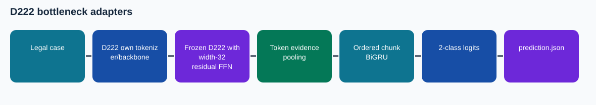

# D222 bottleneck adapters

This is a **source-audited Phase 4 documentation package assembled after the training runs**. The illustrated notebook has no invented execution outputs. Its results are cited from preserved records.

## Task and method

Binary Court Judgment Prediction from long legal case text. A zero-initialized up projection lets each width-32 bottleneck begin as an identity residual on selected feed-forward output layers. The task evidence head is trained alongside the adapters.

**Training/adaptation:** Frozen D222 with width-32 residual FFN adapters

## Architecture and experiment details

D222: 24-layer causal decoder with grouped-query attention and alternating local/global context For each unpadded chunk, the original backbone yields contextual token states. The head layer-normalizes them, then makes a softmax-weighted mixture of token mean, learned token attention and the last token. Normalized chunk positions enter through a learned projection. A bidirectional GRU contextualizes chunks in document order; learned attention and a chunk mean are mixed, then LayerNorm/dropout and a two-logit classifier predict the binary judgment.

Every selected feed-forward w2 output gets a width-32 down/GELU/up residual adapter. Zero initialization of the up projection makes the initial addition zero while the original backbone is frozen.

See [the technical reference](docs/TECHNICAL_REFERENCE.md) for the recorded configuration, validation boundary, and source-level mechanism. The [recorded trace](figures/recorded_trace.svg) is drawn from archived run records.

## Results and provenance

Original Kaggle run: complete; 353 optimizer updates; selected step 353. Official 994-case dev macro-F1 **0.530606** at recorded threshold 0.367270; default 0.5 dev macro-F1 0.442347. Verified prediction ZIP SHA-256 `3c0c236761a6fdc6d87cfac3ebf94cbc518e3f5229b89a02c50f7e888250c35d`, exactly 1,517 IDs.

No finished Codabench score for this exact export is established by the supplied screenshot. Codabench is distinct from local official-dev macro-F1. The screenshot and provenance are indexed in the collection README.

## Files

- `code/`: exact source/config snapshot from the repository's Phase 4 code area; the preserved runner or builder is identified in `docs/CODE_MAP.md`.
- `notebooks/05_D222_Adapters_Explained.ipynb`: later illustrated, unexecuted companion. Original runnable notebooks, where available, are in `code/`.
- `evidence/`: compact copied original records with the selected configuration, training log and export verification.
- `evidence/SOURCE_HASHES.json` and `evidence/README.md`: exact source hashes and an index of copied run records.
- `submission/`: original verified prediction ZIP, not a report/code submission bundle.
- `report/`: methodology PDF, editable LaTeX body, and Markdown text.
- `figures/architecture.svg`: data flow.

## Reproducing

Executed v3 runner: `code/v3_t4x2.ipynb`, `code/runner/phase4_cjpe/kaggle_runner.py` with `published_v3_schedule.json`; the six jobs share `EvidenceCaseModel` in `code/runner/phase4_cjpe/models.py`. Preserve the original data and checkpoint lineage, install PyTorch and the source's dependencies, map the Kaggle/local paths in the saved config, then run the original entry point. The compact GitHub package intentionally excludes large model weights and official course data. The original sources and downloaded checkpoints remain in the local Phase 4 archives.

## Interpretation

The local dev score uses a threshold recorded in the run; inspect its calibration/selection record before treating it as independent model-selection evidence. A prepared model notebook is source scaffolding, while `v3_t4x2.ipynb` and the Kaggle run evidence identify the executed v3 lineage.
