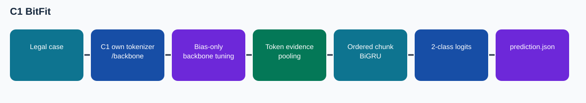

# C1 BitFit

This is a **source-audited Phase 4 documentation package assembled after the training runs**. The illustrated notebook has no invented execution outputs. Its results are cited from preserved records.

## Task and method

Binary Court Judgment Prediction from long legal case text. Only bias parameters in the C1 backbone receive gradients, with a trainable task evidence head. This tests an inexpensive adaptation of the same recurrent hybrid used by C1 full tuning.

**Training/adaptation:** Bias-only backbone tuning

## Results and provenance

Original Kaggle run: complete; 800 optimizer updates; selected step 400. Official 994-case dev macro-F1 **0.535560** at recorded threshold 0.449234; default 0.5 dev macro-F1 0.454764. Verified prediction ZIP SHA-256 `6d5be1e9fab3c623b9bb0323c54a5a95ab01f6421507a8fd9712e37c135d7c15`, exactly 1,517 IDs.

No finished Codabench score for this exact export is established by the supplied screenshot. Codabench is distinct from local official-dev macro-F1. The screenshot and provenance are indexed in the collection README.

## Files

- `code/`: exact source/config snapshot from the repository's Phase 4 code area; the preserved runner or builder is identified in `docs/CODE_MAP.md`.
- `notebooks/06_C1_BitFit_Explained.ipynb`: later illustrated, unexecuted companion. Original runnable notebooks, where available, are in `code/`.
- `evidence/`: compact copied original records with the selected configuration, training log and export verification.
- `submission/`: original verified prediction ZIP, not a report/code submission bundle.
- `report/`: methodology PDF, editable LaTeX body, and Markdown text.
- `figures/architecture.svg`: data flow.

## Reproducing

Executed v3 runner: `code/v3_t4x2.ipynb`, `code/runner/phase4_cjpe/kaggle_runner.py` with `published_v3_schedule.json`; the six jobs share `EvidenceCaseModel` in `code/runner/phase4_cjpe/models.py`. Preserve the original data and checkpoint lineage, install PyTorch and the source's dependencies, map the Kaggle/local paths in the saved config, then run the original entry point. The compact GitHub package intentionally excludes large model weights and official course data. The original sources and downloaded checkpoints remain in the local Phase 4 archives.

## Interpretation

The local dev score uses a threshold recorded in the run; inspect its calibration/selection record before treating it as independent model-selection evidence. A prepared model notebook is source scaffolding, while `v3_t4x2.ipynb` and the Kaggle run evidence identify the executed v3 lineage.
