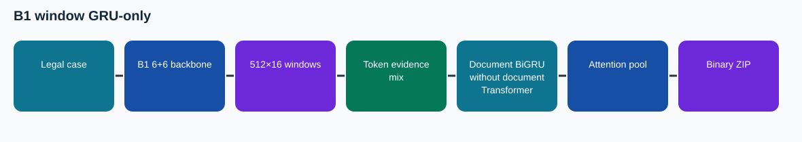

# B1 window GRU-only

This is a **source-audited Phase 4 documentation package assembled after the training runs**. The illustrated notebook has no invented execution outputs. Its results are cited from preserved records.

## Task and method

Binary Court Judgment Prediction from long legal case text. B1 6-encoder/6-decoder original Phase 1 backbone; 512 tokens per chunk, 16 ordered chunks per case, overlap 100, tail sampling. Document BiGRU without document Transformer. Token representation uses a learned mixture of mean, attention and last content token; position enters before document aggregation. The final learned attention pools document states for two-class logits.

**Training/adaptation:** Staged B1 fine-tuning; document head mode `gru_only`. Original B1 study notebook lineage `code/v1.ipynb` through `code/v7.ipynb`; latest source snapshot `code/source/b1_study/`. Saved configs and terminal/run evidence are in `evidence/`.

## Results and provenance

Version 7 run state **paused**; 7465 optimizer updates and 1 complete epochs, selected step 5000. Calibrated official 994-case dev macro-F1 **0.619677** at threshold 0.447596; default 0.5 dev macro-F1 0.649809. Selected checkpoint SHA-256 `d01f8978e9ac2d13eee5d202fa75df285c27915fecdbbc0909f72703466d8c80`; verified 1,517-ID ZIP SHA-256 `796c249f600dbd3140102ce45fd797b397ccc2277bcf1b11693167fc9f2a5455`.

No finished Codabench score for this exact export is established by the supplied screenshot. Codabench is distinct from local official-dev macro-F1. The screenshot and provenance are indexed in the collection README.

## Files

- `code/`: exact source/config snapshot from the repository's Phase 4 code area; the preserved runner or builder is identified in `docs/CODE_MAP.md`.
- `notebooks/09_B1_GRUOnly_Explained.ipynb`: later illustrated, unexecuted companion. Original runnable notebooks, where available, are in `code/`.
- `evidence/`: compact copied original records with the selected configuration, training log and export verification.
- `submission/`: original verified prediction ZIP, not a report/code submission bundle.
- `report/`: methodology PDF, editable LaTeX body, and Markdown text.
- `figures/architecture.svg`: data flow.

## Reproducing

Original B1 study notebook lineage `code/v1.ipynb` through `code/v7.ipynb`; latest source snapshot `code/source/b1_study/`. Saved configs and terminal/run evidence are in `evidence/`. Preserve the original data and checkpoint lineage, install PyTorch and the source's dependencies, map the Kaggle/local paths in the saved config, then run the original entry point. The compact GitHub package intentionally excludes large model weights and official course data. The original sources and downloaded checkpoints remain in the local Phase 4 archives.

## Interpretation

A budget-paused run is not converged; the target was four epochs with checkpoint selection and train-only calibration. The v7 source also defines gated depth expansion and an upper FFN option, but the recorded configs for these exports keep encoder_depth=6 and expand_ffn=false; those unlaunched options have no reported score. Original checkpoint bytes were downloaded and verified in the local archive, but are omitted from GitHub.
