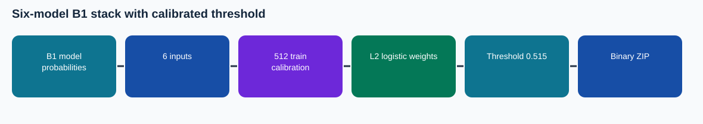

# Six-model B1 stack with calibrated threshold

This is a **source-audited Phase 4 documentation package assembled after the training runs**. The illustrated notebook has no invented execution outputs. Its results are cited from preserved records.

## Task and method

Binary Court Judgment Prediction from long legal case text. This is a prediction-level ensemble, not a newly trained Phase 1/B1 backbone. It joins saved calibration, dev and test probabilities from: v7_transformer, v6_transformer, v5_gru, v4_reference, v7_gru, v6_gru. An L2-regularized logistic regression learns the mixing weights from 512 training-calibration examples; each original model retains its own checkpoint. Decision threshold 0.514611.

**Training/adaptation:** Six B1 inputs; L2 logistic stack C=1.0 fit on 512 disjoint train calibration examples; decision threshold selected from five-fold out-of-fold calibration probabilities only. Official dev used for reporting; family was explored after other dev results, so cross-family comparison is exploratory. Hidden score unknown.

## Architecture and experiment details

Prediction-level B1 ensemble, not an additional neural backbone. For a case, stack the base-model probabilities into vector p. Compute logit = intercept + Σ(coefficient_i × p_i), apply sigmoid, and output 1 if the resulting probability reaches the recorded threshold. Every base probability comes from an independently trained B1 model; no backbone weight is updated when fitting the stack.

L2-regularized logistic regression combines 6 aligned model probabilities: v7_transformer, v6_transformer, v5_gru, v4_reference, v7_gru, v6_gru. The stored coefficients are 0.6206, 0.2262, 0.1801, 0.3552, 0.1386, 0.1386 and intercept -0.0395.

See [the technical reference](docs/TECHNICAL_REFERENCE.md) for the recorded configuration, validation boundary, and source-level mechanism. The [recorded trace](figures/recorded_trace.svg) is drawn from archived run records.

## Results and provenance

Five-fold train-calibration CV macro-F1 **0.716744** on 512 cases. Exploratory official 994-case dev macro-F1 **0.701977**. Verified 1,517-ID ZIP SHA-256 `e879cdf4f9bc3bef32baa398e4fd931a765589297f7899a2987916f663538ef4`.

User-provided Codabench screenshot: **0.6651** (finished submission). Codabench is distinct from local official-dev macro-F1. The screenshot and provenance are indexed in the collection README.

## Files

- `code/`: exact source/config snapshot from the repository's Phase 4 code area; the preserved runner or builder is identified in `docs/CODE_MAP.md`.
- `notebooks/13_B1_Stack6_CVCal_Explained.ipynb`: later illustrated, unexecuted companion. Original runnable notebooks, where available, are in `code/`.
- `evidence/`: compact copied original records with the selected configuration, training log and export verification.
- `evidence/SOURCE_HASHES.json` and `evidence/README.md`: exact source hashes and an index of copied run records.
- `submission/`: original verified prediction ZIP, not a report/code submission bundle.
- `report/`: methodology PDF, editable LaTeX body, and Markdown text.
- `figures/architecture.svg`: data flow.

## Reproducing

Run the original builder `code/build_b1_stack6_cvcal_submission.py` with the exact model probability arrays named and hashed in `evidence/VERIFIED_B1_STACK6_CVCAL.json`. The record also stores learned coefficients/intercept. Preserve the original data and checkpoint lineage, install PyTorch and the source's dependencies, map the Kaggle/local paths in the saved config, then run the original entry point. The compact GitHub package intentionally excludes large model weights and official course data. The original sources and downloaded checkpoints remain in the local Phase 4 archives.

## Interpretation

The stack was explored after inspecting other dev results, so comparisons across stack families on the same official dev set are post-selection and may be optimistic. The train-calibration CV is not an unseen test estimate. Reproduction needs the saved per-model probability arrays and selected checkpoint lineage in the original local B1 archive; the small package includes the builder script and full hash/provenance record, but not all probabilities or model weights.
