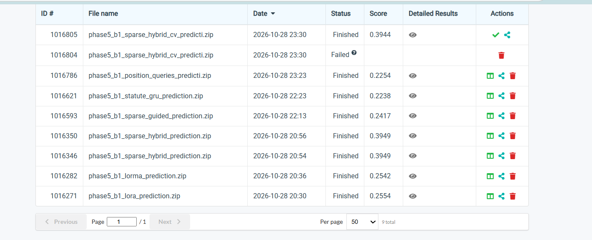

# Visible finished submissions

The images below are the supplied Codabench screenshots. The variant index transcribes distinct scored methods; duplicate uploads are not extra architectures.

SHA-256 `87c64341f08c2e675f8dd0d1538a95aa9ce05a9b54ab99450585f7dc59c06087`
