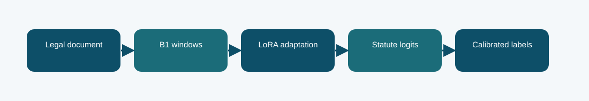

# B1 LoRA statute classifier

**Phase 5 · trained model · Codabench macro-F1 0.2554**
Scored submission ID(s): 1016271. Duplicate uploads of the same export are one variant, not separate architectures.

## The question behind this run

Start with the in-house Phase 1 B1 representation and change a small low-rank part of the network for statute labels. This is the neural reference for later Phase 5 branches: it tests what the inherited representation can do before document-scale lexical evidence is added.

## What the code does

A frozen B1 backbone produces document-window representations. LoRA adds trainable low-rank updates to selected linear transformations; a multi-label head emits one logit per statute. Per-label decision thresholds are fitted on an official-train calibration split.

## Evidence and result

The archived local result is **0.2555 official-dev macro-F1**. The visible finished Codabench result is **0.2554** on the macro-F1 scale. These are separate evaluations; neither is an estimate of the other. Its local official-dev macro-F1 is about 0.2555, close to the 0.2554 Codabench result. That agreement is evidence of a stable but limited baseline, not proof of convergence.

Long judgments can hide decisive statutory language outside the encoded windows; rare statutes make per-label thresholds noisy.

## Files

- [`code/phase5_b1_train.py`](code/phase5_b1_train.py) — original file, SHA-256 `645cb2e65313ff49aa6ae574aeab9b015be2365bf427b5e03e3672bc94e20996`
- [`code/phase5_core.py`](code/phase5_core.py) — original file, SHA-256 `5ea4fb38802cabb47692e80ae21b873afdb0caa67cee7fbbec59fc44db575009`
- [`code/phase5_b1_cal_infer.py`](code/phase5_b1_cal_infer.py) — original file, SHA-256 `eac8c1a4907f3cb90b38fb96ead9e2308e11770961cf4150878f8416ed5140ca`
- [`code/original_runner.ipynb`](code/original_runner.ipynb) — archived launcher/source notebook; saved outputs are not assumed.
- [`notebooks/ILLUSTRATED_RECONSTRUCTION.ipynb`](notebooks/ILLUSTRATED_RECONSTRUCTION.ipynb) — explanatory notebook made after the run; no saved training outputs.
- [`docs/TECHNICAL_REFERENCE.md`](docs/TECHNICAL_REFERENCE.md) — source symbols, method mechanics, provenance, and interpretation.
- [`report/METHODOLOGY_REPORT.tex`](report/METHODOLOGY_REPORT.tex) and [`report/METHODOLOGY_REPORT.pdf`](report/METHODOLOGY_REPORT.pdf) — editable and typeset methodology note.
- [`evidence/submitted_prediction.zip`](evidence/submitted_prediction.zip) — original-named export `phase5_b1_lora_prediction.zip`, 13019 predictions, CRC checked.
- [`evidence/PROVENANCE.json`](evidence/PROVENANCE.json) records original-file hashes and metric provenance.

## Reproduction boundary

The original source code is preserved byte for byte. It requires the authorized course dataset, the parent Phase 1 checkpoint and tokenizer, installed dependencies, and the appropriate GPU/runtime to retrain. Read the source entry point and original notebook before adapting paths: the historical Kaggle mounts are not local defaults. The illustrated notebook reads archived evidence; running it does not retrain the model. The prediction ZIP, where present, can be inspected without model weights.

## What we can and cannot conclude

Its local official-dev macro-F1 is about 0.2555, close to the 0.2554 Codabench result. That agreement is evidence of a stable but limited baseline, not proof of convergence. Long judgments can hide decisive statutory language outside the encoded windows; rare statutes make per-label thresholds noisy. The source and logs establish this particular run and export; this comparison does not isolate every changed variable or imply statistical significance.

Documentation was assembled after the runs with AI assistance and manually checked against the archived source, report, and displayed submissions. It is not a claim that the original Kaggle notebook had these explanatory cells or saved outputs.
