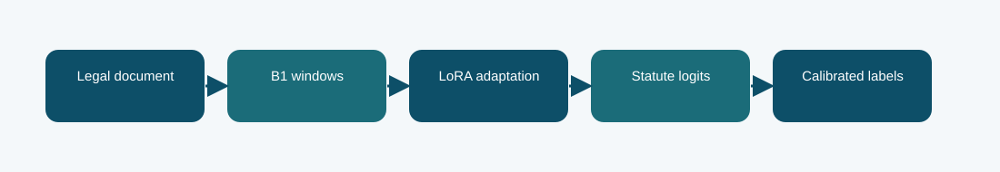

# B1 LoRA statute classifier: technical reference

## Contract and provenance

Phase 5 submission IDs: 1016271. The scored quantity is Codabench macro-F1 = 0.2554. Local archived metric: 0.2555 official-dev macro-F1. The source files below are exact copies of the existing repository snapshot; their SHA-256 values are recorded in `../evidence/PROVENANCE.json`.

## Design transition

Start with the in-house Phase 1 B1 representation and change a small low-rank part of the network for statute labels.

This is the neural reference for later Phase 5 branches: it tests what the inherited representation can do before document-scale lexical evidence is added.

## Forward path

A frozen B1 backbone produces document-window representations. LoRA adds trainable low-rank updates to selected linear transformations; a multi-label head emits one logit per statute. Per-label decision thresholds are fitted on an official-train calibration split.

## Source map

- **`phase5_b1_train.py`** (`645cb2e65313ff49aa6ae574aeab9b015be2365bf427b5e03e3672bc94e20996`): sha256 (line 34), LoRALinear (line 42), B1Classifier (line 57), Rows (line 89), read_json (line 102), tokenize_split (line 106), label_matrix (line 124), predict (line 135), train (line 147)
- **`phase5_core.py`** (`5ea4fb38802cabb47692e80ae21b873afdb0caa67cee7fbbec59fc44db575009`): pack_windows (line 6), f1_scores (line 24), choose_thresholds (line 44)
- **`phase5_b1_cal_infer.py`** (`eac8c1a4907f3cb90b38fb96ead9e2308e11770961cf4150878f8416ed5140ca`): digest (line 14), main (line 18)

The code map lists top-level classes/functions rather than claiming that the notebook itself contains an executed training trace. Shared modules can appear in several packages because these submission variants reuse the same model path.

## Selection, scoring, and possible failure mechanism

Its local official-dev macro-F1 is about 0.2555, close to the 0.2554 Codabench result. That agreement is evidence of a stable but limited baseline, not proof of convergence.

Long judgments can hide decisive statutory language outside the encoded windows; rare statutes make per-label thresholds noisy.

The distinction among training, calibration, local validation, and Codabench is essential. Hyperparameter or decoding selection described here comes from archived code/report fields, not a retrospective fit to Codabench labels. Where the original report does not provide a specific metric, it remains unreported.

## Independent inspection

Check the original run report and log under `../evidence/`, if present. Verify `../evidence/submitted_prediction.zip` has exactly `prediction.json` at its root and passes ZIP CRC. The JSON provenance manifest records the expected prediction count and file hashes. Review the original source notebook under `../code/` when available; the illustrated notebook is a later teaching aid.
