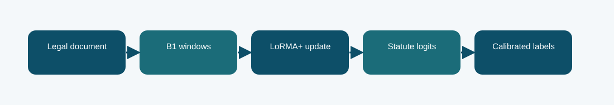

# B1 LoRMA+ statute classifier: technical reference

## Contract and provenance

Phase 5 submission IDs: 1016282. The scored quantity is Codabench macro-F1 = 0.2542. Local archived metric: 0.2517 official-dev macro-F1. The source files below are exact copies of the existing repository snapshot; their SHA-256 values are recorded in `../evidence/PROVENANCE.json`.

## Design transition

Test whether a multiplicative low-rank adaptation changes the inherited B1 representation more effectively than additive LoRA.

Only the adaptation mechanism changes relative to B1 LoRA; that makes the pair useful for testing parameter-efficient adaptation rather than changing the task pipeline all at once.

## Forward path

LoRMA+ wraps a linear output with trainable low-rank multiplicative factors while preserving the pretrained Phase 1 weights. The same multi-label calibration and evaluation route is retained for a meaningful comparison.

## Source map

- **`phase5_b1_train.py`** (`645cb2e65313ff49aa6ae574aeab9b015be2365bf427b5e03e3672bc94e20996`): sha256 (line 34), LoRALinear (line 42), B1Classifier (line 57), Rows (line 89), read_json (line 102), tokenize_split (line 106), label_matrix (line 124), predict (line 135), train (line 147)
- **`phase5_lorma.py`** (`d991d6da627a21f8f178dedff98c090eba364f55ba0b15db51467c384f7f1ba1`): LoRMAPlusLinear (line 11)
- **`phase5_core.py`** (`5ea4fb38802cabb47692e80ae21b873afdb0caa67cee7fbbec59fc44db575009`): pack_windows (line 6), f1_scores (line 24), choose_thresholds (line 44)

The code map lists top-level classes/functions rather than claiming that the notebook itself contains an executed training trace. Shared modules can appear in several packages because these submission variants reuse the same model path.

## Selection, scoring, and possible failure mechanism

The observed Codabench score, 0.2542, is slightly below LoRA's 0.2554. The difference is small and cannot establish a general ranking of the methods.

A low-rank output correction cannot recover evidence that the window selection never passes to the encoder.

The distinction among training, calibration, local validation, and Codabench is essential. Hyperparameter or decoding selection described here comes from archived code/report fields, not a retrospective fit to Codabench labels. Where the original report does not provide a specific metric, it remains unreported.

## Independent inspection

Check the original run report and log under `../evidence/`, if present. Verify `../evidence/submitted_prediction.zip` has exactly `prediction.json` at its root and passes ZIP CRC. The JSON provenance manifest records the expected prediction count and file hashes. Review the original source notebook under `../code/` when available; the illustrated notebook is a later teaching aid.
