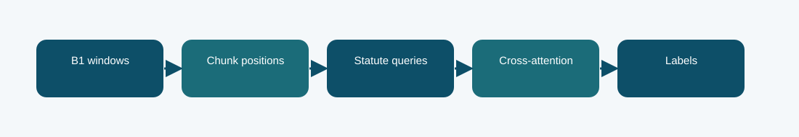

# B1 position-aware statute queries

**Phase 5 · trained model · Codabench macro-F1 0.2254**
Scored submission ID(s): 1016786. Duplicate uploads of the same export are one variant, not separate architectures.

## The question behind this run

Ask each statute label to attend to document chunks while preserving their order. This replaces a uniform document readout with label-conditioned chunk selection, testing whether different statutes need different parts of the judgment.

## What the code does

B1 produces four window representations. Learned statute queries and position-aware cross-attention gather evidence before multi-label classification.

## Evidence and result

The archived local result is **0.2299 official-dev macro-F1**. The visible finished Codabench result is **0.2254** on the macro-F1 scale. These are separate evaluations; neither is an estimate of the other. Local official-dev macro-F1 is about 0.2299 and Codabench is 0.2254. The result does not support an improvement over simpler LoRA or the full-text hybrid in this run.

A query can only attend to the four represented windows, so adding attention does not remove the upstream context bottleneck.

## Files

- [`code/phase5_position_queries.py`](code/phase5_position_queries.py) — original file, SHA-256 `5b50d61811aae7d98f184190003509a2ea3798ae837dd4fa27f70de5d16e09f5`
- [`code/phase5_multiwindow.py`](code/phase5_multiwindow.py) — original file, SHA-256 `86ac644db5ab5f19b2da1772deae2ebcc8fbe25b67cb599b30f765fa53a990da`
- [`code/phase5_b1_train.py`](code/phase5_b1_train.py) — original file, SHA-256 `645cb2e65313ff49aa6ae574aeab9b015be2365bf427b5e03e3672bc94e20996`
- [`code/original_runner.ipynb`](code/original_runner.ipynb) — archived launcher/source notebook; saved outputs are not assumed.
- [`notebooks/ILLUSTRATED_RECONSTRUCTION.ipynb`](notebooks/ILLUSTRATED_RECONSTRUCTION.ipynb) — explanatory notebook made after the run; no saved training outputs.
- [`docs/TECHNICAL_REFERENCE.md`](docs/TECHNICAL_REFERENCE.md) — source symbols, method mechanics, provenance, and interpretation.
- [`report/METHODOLOGY_REPORT.tex`](report/METHODOLOGY_REPORT.tex) and [`report/METHODOLOGY_REPORT.pdf`](report/METHODOLOGY_REPORT.pdf) — editable and typeset methodology note.
- [`evidence/submitted_prediction.zip`](evidence/submitted_prediction.zip) — original-named export `phase5_b1_position_queries_prediction.zip`, 13019 predictions, CRC checked.
- [`evidence/PROVENANCE.json`](evidence/PROVENANCE.json) records original-file hashes and metric provenance.

## Reproduction boundary

The original source code is preserved byte for byte. It requires the authorized course dataset, the parent Phase 1 checkpoint and tokenizer, installed dependencies, and the appropriate GPU/runtime to retrain. Read the source entry point and original notebook before adapting paths: the historical Kaggle mounts are not local defaults. The illustrated notebook reads archived evidence; running it does not retrain the model. The prediction ZIP, where present, can be inspected without model weights.

## What we can and cannot conclude

Local official-dev macro-F1 is about 0.2299 and Codabench is 0.2254. The result does not support an improvement over simpler LoRA or the full-text hybrid in this run. A query can only attend to the four represented windows, so adding attention does not remove the upstream context bottleneck. The source and logs establish this particular run and export; this comparison does not isolate every changed variable or imply statistical significance.

Documentation was assembled after the runs with AI assistance and manually checked against the archived source, report, and displayed submissions. It is not a claim that the original Kaggle notebook had these explanatory cells or saved outputs.
