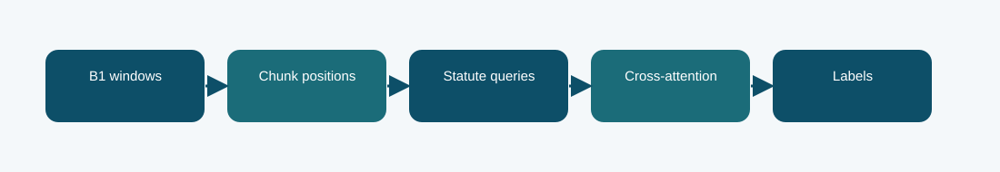

# B1 position-aware statute queries: technical reference

## Contract and provenance

Phase 5 submission IDs: 1016786. The scored quantity is Codabench macro-F1 = 0.2254. Local archived metric: 0.2299 official-dev macro-F1. The source files below are exact copies of the existing repository snapshot; their SHA-256 values are recorded in `../evidence/PROVENANCE.json`.

## Design transition

Ask each statute label to attend to document chunks while preserving their order.

This replaces a uniform document readout with label-conditioned chunk selection, testing whether different statutes need different parts of the judgment.

## Forward path

B1 produces four window representations. Learned statute queries and position-aware cross-attention gather evidence before multi-label classification.

## Source map

- **`phase5_position_queries.py`** (`5b50d61811aae7d98f184190003509a2ea3798ae837dd4fa27f70de5d16e09f5`): PositionQueryB1Classifier (line 11), install (line 44)
- **`phase5_multiwindow.py`** (`86ac644db5ab5f19b2da1772deae2ebcc8fbe25b67cb599b30f765fa53a990da`): pack_four_windows (line 26), AdapterBlock (line 41), MultiWindowB1Classifier (line 54), tokenize_split_four (line 85), install (line 105)
- **`phase5_b1_train.py`** (`645cb2e65313ff49aa6ae574aeab9b015be2365bf427b5e03e3672bc94e20996`): sha256 (line 34), LoRALinear (line 42), B1Classifier (line 57), Rows (line 89), read_json (line 102), tokenize_split (line 106), label_matrix (line 124), predict (line 135), train (line 147)

The code map lists top-level classes/functions rather than claiming that the notebook itself contains an executed training trace. Shared modules can appear in several packages because these submission variants reuse the same model path.

## Selection, scoring, and possible failure mechanism

Local official-dev macro-F1 is about 0.2299 and Codabench is 0.2254. The result does not support an improvement over simpler LoRA or the full-text hybrid in this run.

A query can only attend to the four represented windows, so adding attention does not remove the upstream context bottleneck.

The distinction among training, calibration, local validation, and Codabench is essential. Hyperparameter or decoding selection described here comes from archived code/report fields, not a retrospective fit to Codabench labels. Where the original report does not provide a specific metric, it remains unreported.

## Independent inspection

Check the original run report and log under `../evidence/`, if present. Verify `../evidence/submitted_prediction.zip` has exactly `prediction.json` at its root and passes ZIP CRC. The JSON provenance manifest records the expected prediction count and file hashes. Review the original source notebook under `../code/` when available; the illustrated notebook is a later teaching aid.
