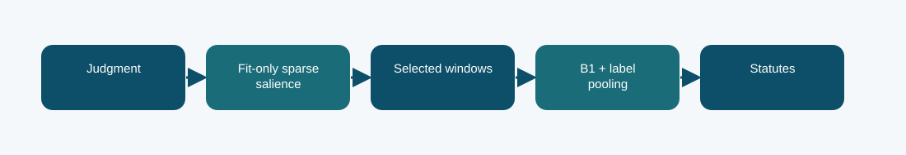

# B1 sparse-guided passage selection: technical reference

## Contract and provenance

Phase 5 submission IDs: 1016593. The scored quantity is Codabench macro-F1 = 0.2417. Local archived metric: 0.2464 official-dev macro-F1. The source files below are exact copies of the existing repository snapshot; their SHA-256 values are recorded in `../evidence/PROVENANCE.json`.

## Design transition

Try to make the limited neural context see passages that a sparse statute signal judges useful.

This changes evidence selection inside a single neural model rather than blending two final prediction streams.

## Forward path

A fit-only TF-IDF logistic salience model selects passage starts without dev or test labels. B1 encodes the selected windows; label-wise smooth-max pooling turns window evidence into statute probabilities.

## Source map

- **`phase5_sparse_guided_model.py`** (`0734b56f556c486cbe7f741c6bfd198d399c34396b7bc55b605c3064a7da2071`): install (line 11)
- **`phase5_sparse_guided_starts.py`** (`ebe4269cabef2e4d588470631846a5191f108ae826c346eefe8ce574943739d1`): select_batch (line 15), main (line 46)
- **`phase5_multiwindow.py`** (`86ac644db5ab5f19b2da1772deae2ebcc8fbe25b67cb599b30f765fa53a990da`): pack_four_windows (line 26), AdapterBlock (line 41), MultiWindowB1Classifier (line 54), tokenize_split_four (line 85), install (line 105)
- **`phase5_b1_train.py`** (`645cb2e65313ff49aa6ae574aeab9b015be2365bf427b5e03e3672bc94e20996`): sha256 (line 34), LoRALinear (line 42), B1Classifier (line 57), Rows (line 89), read_json (line 102), tokenize_split (line 106), label_matrix (line 124), predict (line 135), train (line 147)

The code map lists top-level classes/functions rather than claiming that the notebook itself contains an executed training trace. Shared modules can appear in several packages because these submission variants reuse the same model path.

## Selection, scoring, and possible failure mechanism

The local official-dev macro-F1 is about 0.2464 and Codabench is 0.2417, below the plain LoRA baseline. The selected passages may have overemphasized lexical cues or disrupted broader context; this is a hypothesis, not a measured ablation.

The logged run does not isolate the passage selector from the changed pooling head, so causal attribution is limited.

The distinction among training, calibration, local validation, and Codabench is essential. Hyperparameter or decoding selection described here comes from archived code/report fields, not a retrospective fit to Codabench labels. Where the original report does not provide a specific metric, it remains unreported.

## Independent inspection

Check the original run report and log under `../evidence/`, if present. Verify `../evidence/submitted_prediction.zip` has exactly `prediction.json` at its root and passes ZIP CRC. The JSON provenance manifest records the expected prediction count and file hashes. Review the original source notebook under `../code/` when available; the illustrated notebook is a later teaching aid.
