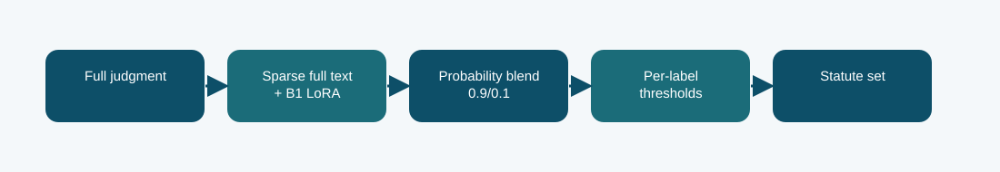

# B1 plus full-document sparse hybrid

**Phase 5 · two-branch prediction system · Codabench macro-F1 0.3949**
Scored submission ID(s): 1016346, 1016350. Duplicate uploads of the same export are one variant, not separate architectures.

## The question behind this run

The neural baseline struggled with long documents, so add a full-text branch that can retain sparse statute phrases wherever they appear. The weight was chosen on calibration data, then held fixed for dev and test. This is an ensemble of an adapted Phase 1 model and a sparse classifier, not a standalone neural adaptation.

## What the code does

The official-train sparse classifier reads the full document while the B1 LoRA branch supplies contextual probabilities. A fixed probability mixture uses 0.9 sparse and 0.1 B1 weight; thresholds are fitted on grouped official-train calibration.

## Evidence and result

The archived local result is **0.3909 official-dev macro-F1**. The visible finished Codabench result is **0.3949** on the macro-F1 scale. These are separate evaluations; neither is an estimate of the other. Official-dev macro-F1 0.3909 and Codabench 0.3949 both materially exceed the LoRA branch. The record supports the value of full-document lexical coverage, while the mechanism remains an inference from the comparison.

Course-method eligibility of a neural-plus-sparse hybrid was not confirmed in the archived report; keep that distinction visible.

## Files

- [`code/phase5_hybrid_blend.py`](code/phase5_hybrid_blend.py) — original file, SHA-256 `fc264b6dca1dc3a5a8daec135e730e450de4ef98a102038d9f1931745c5d2f1e`
- [`code/phase5_prepare_hybrid_probs.py`](code/phase5_prepare_hybrid_probs.py) — original file, SHA-256 `5b65d2f1a7aec7c5af956c401a470894fee12e591cd7ce6df04ebf2c8dbd8388`
- [`code/phase5_b1_train.py`](code/phase5_b1_train.py) — original file, SHA-256 `645cb2e65313ff49aa6ae574aeab9b015be2365bf427b5e03e3672bc94e20996`
- [`code/run_logistic.py`](code/run_logistic.py) — original file, SHA-256 `07290f2b46fe83681c105ad9cb9e4349d0fb88140d75116908f2fe0497ade7c5`
- [`code/run_sparse.py`](code/run_sparse.py) — original file, SHA-256 `1671b29aa039331742c931d06458f6c877f314161218de6637a665ddb87ef92f`
- No original runner notebook was located for this exact export. The illustrated notebook is a later reconstruction.
- [`notebooks/ILLUSTRATED_RECONSTRUCTION.ipynb`](notebooks/ILLUSTRATED_RECONSTRUCTION.ipynb) — explanatory notebook made after the run; no saved training outputs.
- [`docs/TECHNICAL_REFERENCE.md`](docs/TECHNICAL_REFERENCE.md) — source symbols, method mechanics, provenance, and interpretation.
- [`report/METHODOLOGY_REPORT.tex`](report/METHODOLOGY_REPORT.tex) and [`report/METHODOLOGY_REPORT.pdf`](report/METHODOLOGY_REPORT.pdf) — editable and typeset methodology note.
- [`evidence/submitted_prediction.zip`](evidence/submitted_prediction.zip) — original-named export `phase5_b1_sparse_hybrid_prediction.zip`, 13019 predictions, CRC checked.
- [`evidence/PROVENANCE.json`](evidence/PROVENANCE.json) records original-file hashes and metric provenance.

## Reproduction boundary

The original source code is preserved byte for byte. It requires the authorized course dataset, the parent Phase 1 checkpoint and tokenizer, installed dependencies, and the appropriate GPU/runtime to retrain. Read the source entry point and original notebook before adapting paths: the historical Kaggle mounts are not local defaults. The illustrated notebook reads archived evidence; running it does not retrain the model. The prediction ZIP, where present, can be inspected without model weights.

## What we can and cannot conclude

Official-dev macro-F1 0.3909 and Codabench 0.3949 both materially exceed the LoRA branch. The record supports the value of full-document lexical coverage, while the mechanism remains an inference from the comparison. Course-method eligibility of a neural-plus-sparse hybrid was not confirmed in the archived report; keep that distinction visible. The source and logs establish this particular run and export; this comparison does not isolate every changed variable or imply statistical significance.

Documentation was assembled after the runs with AI assistance and manually checked against the archived source, report, and displayed submissions. It is not a claim that the original Kaggle notebook had these explanatory cells or saved outputs.
