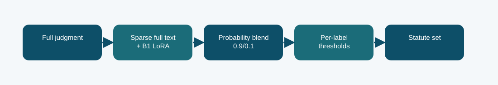

# B1 plus full-document sparse hybrid: technical reference

## Contract and provenance

Phase 5 submission IDs: 1016346, 1016350. The scored quantity is Codabench macro-F1 = 0.3949. Local archived metric: 0.3909 official-dev macro-F1. The source files below are exact copies of the existing repository snapshot; their SHA-256 values are recorded in `../evidence/PROVENANCE.json`.

## Design transition

The neural baseline struggled with long documents, so add a full-text branch that can retain sparse statute phrases wherever they appear.

The weight was chosen on calibration data, then held fixed for dev and test. This is an ensemble of an adapted Phase 1 model and a sparse classifier, not a standalone neural adaptation.

## Forward path

The official-train sparse classifier reads the full document while the B1 LoRA branch supplies contextual probabilities. A fixed probability mixture uses 0.9 sparse and 0.1 B1 weight; thresholds are fitted on grouped official-train calibration.

## Source map

- **`phase5_hybrid_blend.py`** (`fc264b6dca1dc3a5a8daec135e730e450de4ef98a102038d9f1931745c5d2f1e`): sha256 (line 18), labels (line 26), main (line 33)
- **`phase5_prepare_hybrid_probs.py`** (`5b65d2f1a7aec7c5af956c401a470894fee12e591cd7ce6df04ebf2c8dbd8388`): main (line 14)
- **`phase5_b1_train.py`** (`645cb2e65313ff49aa6ae574aeab9b015be2365bf427b5e03e3672bc94e20996`): sha256 (line 34), LoRALinear (line 42), B1Classifier (line 57), Rows (line 89), read_json (line 102), tokenize_split (line 106), label_matrix (line 124), predict (line 135), train (line 147)
- **`run_logistic.py`** (`07290f2b46fe83681c105ad9cb9e4349d0fb88140d75116908f2fe0497ade7c5`): main (line 14)
- **`run_sparse.py`** (`1671b29aa039331742c931d06458f6c877f314161218de6637a665ddb87ef92f`): read_rows (line 20), score (line 25), tune_thresholds (line 30), main (line 44)

The code map lists top-level classes/functions rather than claiming that the notebook itself contains an executed training trace. Shared modules can appear in several packages because these submission variants reuse the same model path.

## Selection, scoring, and possible failure mechanism

Official-dev macro-F1 0.3909 and Codabench 0.3949 both materially exceed the LoRA branch. The record supports the value of full-document lexical coverage, while the mechanism remains an inference from the comparison.

Course-method eligibility of a neural-plus-sparse hybrid was not confirmed in the archived report; keep that distinction visible.

The distinction among training, calibration, local validation, and Codabench is essential. Hyperparameter or decoding selection described here comes from archived code/report fields, not a retrospective fit to Codabench labels. Where the original report does not provide a specific metric, it remains unreported.

## Independent inspection

Check the original run report and log under `../evidence/`, if present. Verify `../evidence/submitted_prediction.zip` has exactly `prediction.json` at its root and passes ZIP CRC. The JSON provenance manifest records the expected prediction count and file hashes. Review the original source notebook under `../code/` when available; the illustrated notebook is a later teaching aid.
