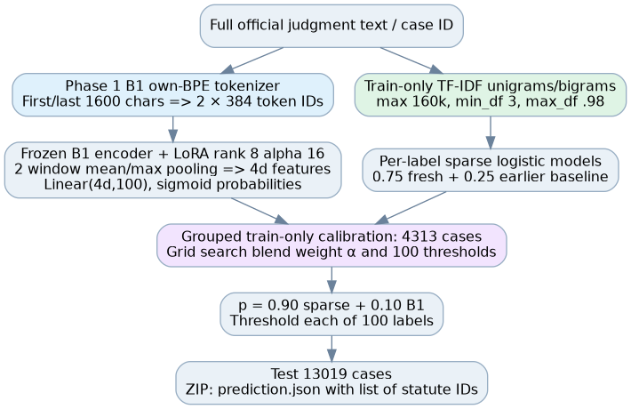

# Phase 5: B1 LoRA + Full-Document Sparse Hybrid — Source-Audited Methodology

**CS781 legal statute identification (LSI).** This report explains the actual winning Phase 5 two-branch inference pipeline rather than merely calling it a “sparse–neural ensemble.” Source basis: unchanged `phase5_b1_train.py`, `phase5_core.py`, `run_sparse.py`, `run_logistic.py`, `phase5_prepare_hybrid_probs.py` and `phase5_hybrid_blend.py` from the source ZIP, plus the public repository's submitted-variant evidence. It distinguishes **recorded** Codabench 0.3949 macro-F1 and official-dev 0.3909 macro-F1 from any unverified new rerun. Checkpoint weights themselves were not present in the public repository for inspection.

## 1. Why is this not an ordinary single-label classifier?

Each official case can refer to several statutes. The output for document i is therefore a **set of statute IDs**, not one class. The code treats the target as a binary matrix \(Y\in\{0,1\}^{N\times100}\): row i contains a 1 for every statute label named in the official training record, and zeros for the others. The model must produce 100 independent scores per document, then convert them into a list of selected IDs.

A single softmax over 100 categories would be structurally wrong: forcing all class probabilities to sum to one makes simultaneous statute labels compete as if mutually exclusive. The B1 branch instead uses independent sigmoid-compatible logits trained with binary cross-entropy; the sparse branch uses one-vs-rest classifiers. The final fusion acts on aligned 100-dimensional **per-label probability vectors**, not on a single document class.

The code asserts 100 labels, and the archived source manifest records **38,113 fitting cases, 4,313 training-calibration cases, 10,181 official-dev cases and 13,019 official-test cases**. These groups are not used interchangeably: the model fits on its designated train fit records, global blending and thresholds are selected on a held-out portion of official training records, and official-dev is evaluated after selection. The hidden Codabench test labels remain unknown to the pipeline.

## 2. Data provenance and leakage prevention

The input files are the official Phase 5 JSON splits. `phase5_b1_train.py` contains exact expected SHA-256 values for train/dev/test and checks them before constructing examples. It also hashes the upstream B1 model checkpoint and its `tokenizer.json`, then checks the saved split manifest. Training IDs must be unique; fit and calibration ID sets must be disjoint and must exclude any IDs marked excluded by the manifest. The code refuses a test file containing training labels. These checks are not an optional cosmetic report step; they prevent a near-correct implementation from quietly calibrating on a forbidden or mismatched split.

There is an additional, easily overlooked requirement when combining models: a `numpy` probability array's first row has no inherent case identity. If branch A and branch B are independently sorted or filtered, averaging their rows would mix different judgments even if both arrays had shape `[N,100]`. The hybrid code therefore writes/reads ID lists for calibration, dev and test and asserts their order matches the canonical official rows. It also checks that all arrays have the same `[number_of_cases,100]` shapes and only finite entries. This is the difference between a mathematically valid array operation and a semantically valid model ensemble.

## 3. Neural branch: from two BPE token windows to 100 logits

The B1 neural classifier loads the student's own Phase 1 encoder–decoder model from the checkpoint metadata (`variant == B_taskaligned`). It reconstructs the `EncoderDecoderLegalModel` from the stored config, loads the entire checkpoint strictly, and freezes all pretrained weights. Its tokenizer is the **saved own-BPE** model, not an external pretrained legal tokenizer; the source comments explain that its original Unicode 13 merge table is replayed rather than refitted under a newer Python Unicode database. Thus token IDs remain compatible with the trained B1 embedding matrix.

A legal judgment is too long for one short window. `pack_windows()` first takes the beginning **1,600 characters** and the final **1,600 characters**, tokenizes those substrings separately, and retains up to **384 BPE IDs** per side. It returns two fixed rows of IDs and a Boolean padding mask, each with shape `[2,384]`. It pads zeros but never marks padded positions valid. If a slice gives no tokens, the code uses fallback token ID 3 and marks that one position valid. This explicitly preserves beginning-and-ending evidence while accepting that text in the middle may be missed.

For B documents, input IDs are `[B,2,384]` and masks have the same shape. Before calling `backbone.encode`, they are reshaped to `[2B,384]`; the pretrained encoder returns contextual token states `[2B,384,d]` and an encoder-valid mask. The code then computes **two different kinds of feature pooling** for each 384-token window:

\[
\operatorname{mean}_w=\frac{\sum_{t=1}^{384}m_t h_t}{\max(1,\sum_t m_t)},\qquad
\operatorname{max}_w=\max_{t:m_t=1}h_t,
\]

where the max operator explicitly masks invalid padded positions to the numerical dtype's minimum. The pair of mean and max vectors has `2d` features per window. There are two windows, so concatenating both produces `[B,4d]`. The model uses dropout 0.1 followed by `nn.Linear(4*d,100)`, outputting **100 logits** per judgment. During inference, sigmoid converts these into independent per-statute probabilities.

In a LoRA update, each frozen original matrix W in selected B1 **encoder** attention and feed-forward projections is wrapped as

\[
\operatorname{LoRA}(x)=Wx+\frac{\alpha}{r}B A x,
\quad A\in\mathbb R^{r\times d_{in}},\quad B\in\mathbb R^{d_{out}\times r}.
\]

The inspected source sets rank `r=8` and alpha `16`, hence scale `alpha/r=2`; A is Kaiming-initialized and B starts at zero. Selected projections include fused QKV, attention output, and the SwiGLU `w1,w2,w3` matrices of every encoder block. Importantly, this source **does not update the entire B1 backbone or its decoder**; it attaches low-rank updates only to the encoder projections named above, while training the new `Linear(4d,100)` head. Do not confuse that with LoRMA, which is a distinct adaptation variant.

### Neural training objective and model selection

The loss is `BCEWithLogitsLoss`, not multiclass CE. For each label j and case i with ground truth \(y_{ij}\in\{0,1\}\), the positive term is weighted by a per-label factor derived from class frequency. Source lines 204–206 set

\[
w_j^+=\min\left(12,\sqrt{\frac{N-n_j}{\max(1,n_j)}}\right),
\]

where \(n_j\) counts positive fit-set labels. The cap prevents extremely rare labels from producing unbounded positive weights, though it does not guarantee that the rare class is learned well. The code trains with AdamW on the trainable parameters only, weight decay .01, GPU FP16 autocast + GradScaler, gradient accumulation, and global norm clipping at 1.0. Seed is specified in the source. CLI hyperparameters such as batch size, epochs and learning rate belong to the actual run command/manifest and should not be invented from the function alone.

At each epoch end, B1 probabilities on the **training-calibration** set are converted to decisions using thresholds from `choose_thresholds()`. The code chooses the epoch with highest calibration Macro-F1, saves only the **trainable state** (adapters and task head), per-label thresholds, selected epoch, calibration metrics and upstream checkpoint SHA; it then restores those selected parameters before computing official-dev and test probabilities. It exports `dev_probabilities.npy`, `test_probabilities.npy` and a standalone B1 LoRA submission ZIP. This B1-only run scored 0.2554 official hidden macro-F1, recorded separately from the final hybrid.

## 4. Full-document sparse branch: different evidence and a different failure mode

The sparse branch is purposefully not limited to a 384-token start/end view. It uses TF–IDF over the **full original legal judgment text**, so an Act name, provision number or citation in the middle of a long case can still provide a feature. The source configuration for the freshly fitted vectorizer is:

- word unigrams and bigrams (`ngram_range=(1,2)`);
- at most 160,000 learned TF–IDF features;
- `min_df=3`, `max_df=0.98`;
- `sublinear_tf=True` and float32 feature storage;
- vocabulary fit **only** on official-training fit rows.

The selected classification branch is not simply `TF–IDF → one sigmoid` either. The source includes an earlier official-data sparse baseline, a modified-Huber one-vs-rest candidate and a fresh **one-vs-rest logistic SGD** model. `run_logistic.py` fits a classifier with `SGDClassifier(loss="log_loss",alpha=1e-5,class_weight="balanced",max_iter=12,tol=1e-3,random_state=781)`, wrapped with `OneVsRestClassifier`. It compares the fresh logistic probabilities with mixtures that include a saved prior full-document logistic baseline. The preparation script for the final winner insists on the selected `candidate == "blend_75"`; it then calculates

\[
\underbrace{p_{\mathrm{sparse}}}_{100\,\text{labels}}
=0.75\,p_{\mathrm{fresh\ logistic}}+0.25\,p_{\mathrm{prior\ sparse}}.
\]

This is the **first blend**, internal to the sparse branch. It is easy to miss because a top-level report describing only “90% sparse” omits how that sparse estimate was built. Both sparse models are fitted from permitted in-house text/labels; the original code does not import an outside legal ontology. `phase5_prepare_hybrid_probs.py` builds calibration/dev/test `[N,100]` float32 probability files from that selected sparse artifact and writes each case-ID ordering.

A sparse classifier's ability to match explicit citations is not the same as semantic understanding. It can miss indirect statements such as “the aforementioned provision” without an explicit surface form, and it can overemphasize common formulaic legal language. That is the rationale for retaining a small neural contribution instead of replacing B1 entirely.

## 5. The final hybrid: *second* blend and exact threshold selection

The winning submission is generated by `phase5_hybrid_blend.py`. For each candidate global sparse weight

\[
\alpha\in\{0,0.25,0.50,0.75,0.90\},
\]

it blends the **already constructed** sparse probabilities with the B1 LoRA probabilities as

\[
p_{ij}^{\alpha}=\alpha p_{\mathrm{sparse},ij}+(1-\alpha)p_{\mathrm{B1},ij}.
\]

It selects a threshold vector on the training-calibration cases *separately for each α*, measures macro-F1 there, then selects the α with the best calibration macro-F1. The archived report records selected α=0.90, meaning final probabilities contain 90% sparse-branch and 10% B1-branch scores. This is not equivalent to "90% of the model parameters are sparse", and it does not assert that no neural training occurred. The internal sparse probability formula makes the final full mixture conceptually

\[
p_{ij}=0.90(0.75p_{\mathrm{fresh},ij}+0.25p_{\mathrm{prior},ij})+0.10p_{\mathrm{B1},ij}.
\]

Before choosing the final label set, `choose_thresholds()` performs a **two-stage calibration** rather than naively applying one 0.5 cutoff. The shared candidate threshold grid consists of 0.01–0.20 in steps of 0.01 plus 0.225–0.90 in steps of 0.025. It first selects the single global threshold maximizing calibration Macro-F1. For a statute label with fewer than **10 positive calibration examples**, it leaves that global threshold in place. For labels with enough support, it computes that label's own best F1 threshold; then it shrinks the local threshold toward the global one using

\[
\tau_j=\mathrm{clip}\left(
\frac{n_j}{n_j+40}\tau_j^{local}+
\frac{40}{n_j+40}\tau^{global},\;0.01,0.90\right).
\]

This regularizes rare labels: even if one local threshold seems excellent on a handful of examples, the scheme refuses to trust it completely. Final multi-label predictions are `label j selected iff p_ij >= tau_j`; a case can contain zero, one or many predicted statute IDs. The code then writes an ordered list of 100-label-index subsets for all 13,019 official test records, zipped as `prediction.json` at archive root.

## 6. Why these design choices make sense—and what the results actually support

The B1 encoder handles contextual variation: two passages referring to the same legal concept can have different wording, and the model's learned representations may link them. The TF–IDF classifier handles literal statutory evidence across the entire document and can recover a rare Act name outside the neural windows. Because the document median may substantially exceed B1's approximately two-window 768-token total input, a complementary full-text route is plausible. But this is a **hypothesis grounded in architecture and data length**, not a fully isolated causal result.

The archived official-dev evaluation for the chosen hybrid was **macro-F1 0.3909** (and micro-F1 0.5000), while its completed Codabench submission reached **macro-F1 0.3949**. The B1 LoRA-only submitted score was 0.2554. The difference is substantial in this recorded experiment, but several implementation choices change simultaneously: addition of a sparse branch, its internal blend, threshold calibration, and model outputs. It therefore cannot prove that *all* lexical approaches beat *all* neural approaches, nor can it establish independent contributions from each changed component without matched ablations.

On the development run described in the main report, the 100 label supports range from 68 to 2,936 with median 175; those are **support statistics for the saved LoRA dev evaluation**, not the fit split. The long tail is the reason to use Macro-F1 and shrinkage thresholds rather than optimize only an aggregate micro-score. Macro-F1 is the arithmetic mean of the 100 per-label F1 values and therefore weights a rare statute equally with a common statute. This creates a real selection tradeoff: optimizing rare-class F1 can increase false positives in common classes and vice versa.

The new methodology report deliberately does not claim that the sparse/neural mixture was eligible as a *separate neural architecture* under any minimum architecture-count rule. Its status is a **prediction-level two-branch ensemble**, and the repository records that course-method eligibility was not independently confirmed. This categorical distinction matters in the viva.

## 7. Exact algorithmic interfaces, memory and reproducibility

| Stage | Shape / configuration | Source |
|---|---|---|
| Labels `Y` | `[N,100]` binary | `phase5_hybrid_blend.py:26–30` |
| B1 token IDs and validity | `[B,2,384]` each | `phase5_core.py:6–21` |
| B1 encoder hidden features | `[2B,384,d]` | `phase5_b1_train.py:76–83` |
| Per-window mean / max | `[2B,d]` each | Same |
| Two-window feature concatenation | `[B,4d]` | Same |
| B1 logits/probabilities | `[B,100]` | Same, sigmoid at prediction |
| TF–IDF | `[N,F]`, `F<=160000` sparse matrix | `run_sparse.py:59–64` |
| Sparse probabilities | `[N,100]` | `phase5_prepare_hybrid_probs.py:29–37` |
| Hybrid probabilities | `[N,100]` | `phase5_hybrid_blend.py:57–66` |
| Threshold vector | `[100]` | `phase5_core.py:44–64` |
| Final output | list of `{id,pred}` | `phase5_hybrid_blend.py:67–70` |

As an **analytical** memory bound, the B1 token-ID tensor at micro-batch B=1 contains 768 ID entries, or ~6 KiB if converted to int64; the Boolean validity mask adds ~0.75 KiB. This is tiny compared with the pretrained backbone weights, activations, and optimizer states. A full dense `[N,160000]` float32 TF–IDF array would be prohibitively large, which is precisely why scikit-learn's sparse CSR representation matters; the source uses sparse `fit_transform`/`transform`, not a dense conversion. Actual peak VRAM is not derivable without a profiler and was not measured for this documentation output.

The code explicitly checks train/dev/test hashes, checkpoint/tokenizer hashes, disjoint manifest IDs, finite probability vectors, row alignment, and output ZIP creation. Reproduction requires the original B1 Phase 1 checkpoint and tokenizer, the official training data, the pretrained sparse artifacts used in this particular pipeline, and the recorded run configuration; some large binary artifacts remain outside GitHub. This documentation cannot by itself regenerate historical exact predictions without those binaries. The source files were copied unmodified in `phase5/source/` of the local documentation package.

## 8. Traceability and the one-page viva answer

The shortest correct explanation is: **I first trained a B1 LoRA classifier from two BPE views of every judgment, producing 100 sigmoid probabilities. Separately I learned a full-document TF–IDF multi-label classifier, including a 75/25 mixture of fresh and earlier sparse logistic routes. Then I aligned both outputs by official case ID, selected a 90% sparse / 10% B1 probability mixture on training-only calibration data, shrunk individual statute thresholds toward a globally validated threshold, and exported lists of statute IDs for each test case.** The 0.3949 Macro-F1 is a reported Codabench result for the exported ensemble, not a claim that sparse features alone always outperform neural representations.

Source/line audit: `phase5_core.py` window packing 6–21, F1 24–41, thresholds 44–64; `phase5_b1_train.py` LoRA 42–54, encoder/head 57–86, training 147–254; `run_sparse.py` vectorizer and sparse learning 44–84; `run_logistic.py` logistic selection 14–52; `phase5_prepare_hybrid_probs.py` full sparse probabilities 14–39; `phase5_hybrid_blend.py` final calibration, alignment and ZIP 33–95. Full original source snapshots are included unchanged in the accompanying methods package.
