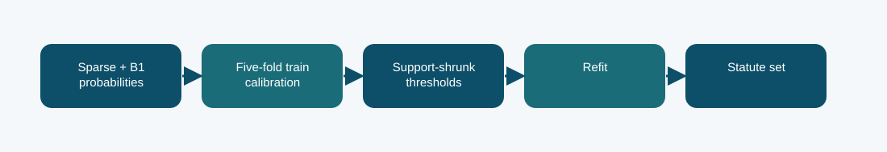

# B1 sparse hybrid with calibration CV

**Phase 5 · calibration variant · Codabench macro-F1 0.3944**
Scored submission ID(s): 1016805. Duplicate uploads of the same export are one variant, not separate architectures.

## The question behind this run

Check whether the strong sparse hybrid depended too much on one calibration split's fitted thresholds. The cross-validation route limits optimistic threshold fitting without using official dev labels for selection.

## What the code does

The same 0.9 sparse/0.1 B1 blend is evaluated with five-fold cross-validation inside the official-train calibration subset. Class thresholds shrink toward a global prior according to support; the final thresholds are refit on all calibration rows.

## Evidence and result

The archived local result is **0.3933 official-dev macro-F1**. The visible finished Codabench result is **0.3944** on the macro-F1 scale. These are separate evaluations; neither is an estimate of the other. The report records calibration CV macro-F1 0.4282, official-dev macro-F1 0.3933, and Codabench 0.3944. The latter is effectively tied with the fixed hybrid and does not establish a hidden-score gain.

Five-fold calibration still has variance for rare labels; selection is not a substitute for a larger independent development set.

## Files

- [`code/phase5_hybrid_calibration_cv.py`](code/phase5_hybrid_calibration_cv.py) — original file, SHA-256 `b456fcc8d7bd8072311ca3011dbf16d0e8e6e17b4c6330a4d9f4f436f68ea1aa`
- [`code/phase5_prepare_hybrid_probs.py`](code/phase5_prepare_hybrid_probs.py) — original file, SHA-256 `5b65d2f1a7aec7c5af956c401a470894fee12e591cd7ce6df04ebf2c8dbd8388`
- [`code/phase5_b1_train.py`](code/phase5_b1_train.py) — original file, SHA-256 `645cb2e65313ff49aa6ae574aeab9b015be2365bf427b5e03e3672bc94e20996`
- [`code/run_logistic.py`](code/run_logistic.py) — original file, SHA-256 `07290f2b46fe83681c105ad9cb9e4349d0fb88140d75116908f2fe0497ade7c5`
- [`code/original_runner.ipynb`](code/original_runner.ipynb) — archived launcher/source notebook; saved outputs are not assumed.
- [`notebooks/ILLUSTRATED_RECONSTRUCTION.ipynb`](notebooks/ILLUSTRATED_RECONSTRUCTION.ipynb) — explanatory notebook made after the run; no saved training outputs.
- [`docs/TECHNICAL_REFERENCE.md`](docs/TECHNICAL_REFERENCE.md) — source symbols, method mechanics, provenance, and interpretation.
- [`report/METHODOLOGY_REPORT.tex`](report/METHODOLOGY_REPORT.tex) and [`report/METHODOLOGY_REPORT.pdf`](report/METHODOLOGY_REPORT.pdf) — editable and typeset methodology note.
- [`evidence/submitted_prediction.zip`](evidence/submitted_prediction.zip) — original-named export `phase5_b1_sparse_hybrid_cv_prediction.zip`, 13019 predictions, CRC checked.
- [`evidence/PROVENANCE.json`](evidence/PROVENANCE.json) records original-file hashes and metric provenance.

## Reproduction boundary

The original source code is preserved byte for byte. It requires the authorized course dataset, the parent Phase 1 checkpoint and tokenizer, installed dependencies, and the appropriate GPU/runtime to retrain. Read the source entry point and original notebook before adapting paths: the historical Kaggle mounts are not local defaults. The illustrated notebook reads archived evidence; running it does not retrain the model. The prediction ZIP, where present, can be inspected without model weights.

## What we can and cannot conclude

The report records calibration CV macro-F1 0.4282, official-dev macro-F1 0.3933, and Codabench 0.3944. The latter is effectively tied with the fixed hybrid and does not establish a hidden-score gain. Five-fold calibration still has variance for rare labels; selection is not a substitute for a larger independent development set. The source and logs establish this particular run and export; this comparison does not isolate every changed variable or imply statistical significance.

Documentation was assembled after the runs with AI assistance and manually checked against the archived source, report, and displayed submissions. It is not a claim that the original Kaggle notebook had these explanatory cells or saved outputs.
