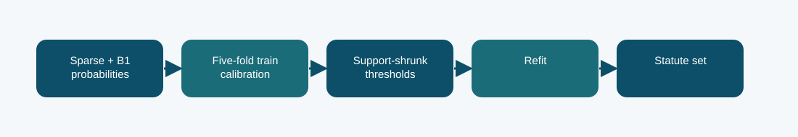

# B1 sparse hybrid with calibration CV: technical reference

## Contract and provenance

Phase 5 submission IDs: 1016805. The scored quantity is Codabench macro-F1 = 0.3944. Local archived metric: 0.3933 official-dev macro-F1. The source files below are exact copies of the existing repository snapshot; their SHA-256 values are recorded in `../evidence/PROVENANCE.json`.

## Design transition

Check whether the strong sparse hybrid depended too much on one calibration split's fitted thresholds.

The cross-validation route limits optimistic threshold fitting without using official dev labels for selection.

## Forward path

The same 0.9 sparse/0.1 B1 blend is evaluated with five-fold cross-validation inside the official-train calibration subset. Class thresholds shrink toward a global prior according to support; the final thresholds are refit on all calibration rows.

## Source map

- **`phase5_hybrid_calibration_cv.py`** (`b456fcc8d7bd8072311ca3011dbf16d0e8e6e17b4c6330a4d9f4f436f68ea1aa`): sha256 (line 30), make_labels (line 38), fit_threshold_parts (line 45), thresholds_from_parts (line 62), main (line 78)
- **`phase5_prepare_hybrid_probs.py`** (`5b65d2f1a7aec7c5af956c401a470894fee12e591cd7ce6df04ebf2c8dbd8388`): main (line 14)
- **`phase5_b1_train.py`** (`645cb2e65313ff49aa6ae574aeab9b015be2365bf427b5e03e3672bc94e20996`): sha256 (line 34), LoRALinear (line 42), B1Classifier (line 57), Rows (line 89), read_json (line 102), tokenize_split (line 106), label_matrix (line 124), predict (line 135), train (line 147)
- **`run_logistic.py`** (`07290f2b46fe83681c105ad9cb9e4349d0fb88140d75116908f2fe0497ade7c5`): main (line 14)

The code map lists top-level classes/functions rather than claiming that the notebook itself contains an executed training trace. Shared modules can appear in several packages because these submission variants reuse the same model path.

## Selection, scoring, and possible failure mechanism

The report records calibration CV macro-F1 0.4282, official-dev macro-F1 0.3933, and Codabench 0.3944. The latter is effectively tied with the fixed hybrid and does not establish a hidden-score gain.

Five-fold calibration still has variance for rare labels; selection is not a substitute for a larger independent development set.

The distinction among training, calibration, local validation, and Codabench is essential. Hyperparameter or decoding selection described here comes from archived code/report fields, not a retrospective fit to Codabench labels. Where the original report does not provide a specific metric, it remains unreported.

## Independent inspection

Check the original run report and log under `../evidence/`, if present. Verify `../evidence/submitted_prediction.zip` has exactly `prediction.json` at its root and passes ZIP CRC. The JSON provenance manifest records the expected prediction count and file hashes. Review the original source notebook under `../code/` when available; the illustrated notebook is a later teaching aid.
