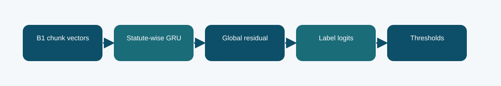

# B1 statute-wise GRU memory

**Phase 5 · trained model · Codabench macro-F1 0.2238**
Scored submission ID(s): 1016621. Duplicate uploads of the same export are one variant, not separate architectures.

## The question behind this run

Test whether recurrent memory can accumulate label-specific evidence across the windows of a long judgment. The recurrent head can model order across chunks, unlike a purely independent max or mean pool, but adds trainable complexity on top of a small per-label signal.

## What the code does

B1 encodes four windows; statute-wise gated recurrent units update a memory for each label, and a global residual head supplements the local evidence stream.

## Evidence and result

The archived local result is **0.2293 official-dev macro-F1**. The visible finished Codabench result is **0.2238** on the macro-F1 scale. These are separate evaluations; neither is an estimate of the other. Local official-dev macro-F1 is 0.2293 and Codabench is 0.2238. More head capacity alone did not improve the observed result; the report cannot prove whether optimization or evidence placement was the dominant cause.

The recurrent path processes a bounded number of chunks; it is not full-document attention.

## Files

- [`code/phase5_statute_gru.py`](code/phase5_statute_gru.py) — original file, SHA-256 `2a91a94f60bc9c3f6db4bf391fd85018a3e3fd9fba6b6aa2e5a514d4b42ec99c`
- [`code/phase5_multiwindow.py`](code/phase5_multiwindow.py) — original file, SHA-256 `86ac644db5ab5f19b2da1772deae2ebcc8fbe25b67cb599b30f765fa53a990da`
- [`code/phase5_b1_train.py`](code/phase5_b1_train.py) — original file, SHA-256 `645cb2e65313ff49aa6ae574aeab9b015be2365bf427b5e03e3672bc94e20996`
- [`code/original_runner.ipynb`](code/original_runner.ipynb) — archived launcher/source notebook; saved outputs are not assumed.
- [`notebooks/ILLUSTRATED_RECONSTRUCTION.ipynb`](notebooks/ILLUSTRATED_RECONSTRUCTION.ipynb) — explanatory notebook made after the run; no saved training outputs.
- [`docs/TECHNICAL_REFERENCE.md`](docs/TECHNICAL_REFERENCE.md) — source symbols, method mechanics, provenance, and interpretation.
- [`report/METHODOLOGY_REPORT.tex`](report/METHODOLOGY_REPORT.tex) and [`report/METHODOLOGY_REPORT.pdf`](report/METHODOLOGY_REPORT.pdf) — editable and typeset methodology note.
- [`evidence/submitted_prediction.zip`](evidence/submitted_prediction.zip) — original-named export `phase5_b1_statute_gru_prediction.zip`, 13019 predictions, CRC checked.
- [`evidence/PROVENANCE.json`](evidence/PROVENANCE.json) records original-file hashes and metric provenance.

## Reproduction boundary

The original source code is preserved byte for byte. It requires the authorized course dataset, the parent Phase 1 checkpoint and tokenizer, installed dependencies, and the appropriate GPU/runtime to retrain. Read the source entry point and original notebook before adapting paths: the historical Kaggle mounts are not local defaults. The illustrated notebook reads archived evidence; running it does not retrain the model. The prediction ZIP, where present, can be inspected without model weights.

## What we can and cannot conclude

Local official-dev macro-F1 is 0.2293 and Codabench is 0.2238. More head capacity alone did not improve the observed result; the report cannot prove whether optimization or evidence placement was the dominant cause. The recurrent path processes a bounded number of chunks; it is not full-document attention. The source and logs establish this particular run and export; this comparison does not isolate every changed variable or imply statistical significance.

Documentation was assembled after the runs with AI assistance and manually checked against the archived source, report, and displayed submissions. It is not a claim that the original Kaggle notebook had these explanatory cells or saved outputs.
