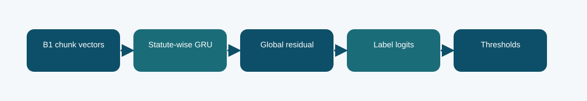

# B1 statute-wise GRU memory: technical reference

## Contract and provenance

Phase 5 submission IDs: 1016621. The scored quantity is Codabench macro-F1 = 0.2238. Local archived metric: 0.2293 official-dev macro-F1. The source files below are exact copies of the existing repository snapshot; their SHA-256 values are recorded in `../evidence/PROVENANCE.json`.

## Design transition

Test whether recurrent memory can accumulate label-specific evidence across the windows of a long judgment.

The recurrent head can model order across chunks, unlike a purely independent max or mean pool, but adds trainable complexity on top of a small per-label signal.

## Forward path

B1 encodes four windows; statute-wise gated recurrent units update a memory for each label, and a global residual head supplements the local evidence stream.

## Source map

- **`phase5_statute_gru.py`** (`2a91a94f60bc9c3f6db4bf391fd85018a3e3fd9fba6b6aa2e5a514d4b42ec99c`): StatuteMemoryB1Classifier (line 11), install (line 43)
- **`phase5_multiwindow.py`** (`86ac644db5ab5f19b2da1772deae2ebcc8fbe25b67cb599b30f765fa53a990da`): pack_four_windows (line 26), AdapterBlock (line 41), MultiWindowB1Classifier (line 54), tokenize_split_four (line 85), install (line 105)
- **`phase5_b1_train.py`** (`645cb2e65313ff49aa6ae574aeab9b015be2365bf427b5e03e3672bc94e20996`): sha256 (line 34), LoRALinear (line 42), B1Classifier (line 57), Rows (line 89), read_json (line 102), tokenize_split (line 106), label_matrix (line 124), predict (line 135), train (line 147)

The code map lists top-level classes/functions rather than claiming that the notebook itself contains an executed training trace. Shared modules can appear in several packages because these submission variants reuse the same model path.

## Selection, scoring, and possible failure mechanism

Local official-dev macro-F1 is 0.2293 and Codabench is 0.2238. More head capacity alone did not improve the observed result; the report cannot prove whether optimization or evidence placement was the dominant cause.

The recurrent path processes a bounded number of chunks; it is not full-document attention.

The distinction among training, calibration, local validation, and Codabench is essential. Hyperparameter or decoding selection described here comes from archived code/report fields, not a retrospective fit to Codabench labels. Where the original report does not provide a specific metric, it remains unreported.

## Independent inspection

Check the original run report and log under `../evidence/`, if present. Verify `../evidence/submitted_prediction.zip` has exactly `prediction.json` at its root and passes ZIP CRC. The JSON provenance manifest records the expected prediction count and file hashes. Review the original source notebook under `../code/` when available; the illustrated notebook is a later teaching aid.
