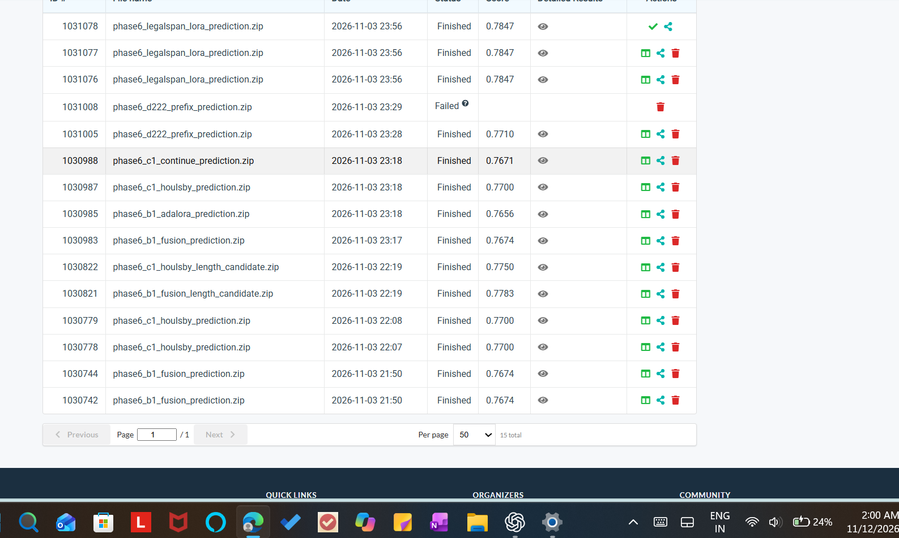

# Visible finished submissions

The images below are the supplied Codabench screenshots. The variant index transcribes distinct scored methods; duplicate uploads are not extra architectures.

SHA-256 `318ec5b3cc4037a031dfa6fb12bd4dd2eedda9d9c834d88d9ea185c735dcf67d`
