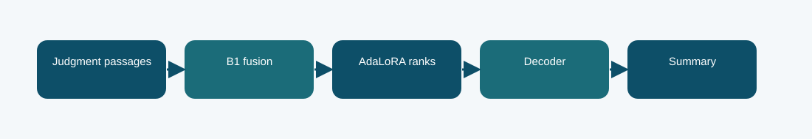

# B1 AdaLoRA summarizer: technical reference

## Contract and provenance

Phase 6 submission IDs: 1030985. The scored quantity is Codabench BERTScore F1 = 0.7656. Local archived metric: -1.6305 validation negative NLL; BERTScore not measured in this report. The source files below are exact copies of the existing repository snapshot; their SHA-256 values are recorded in `../evidence/PROVENANCE.json`.

## Design transition

Try allocating low-rank adaptation capacity where the summarizer's B1 projections most need it.

The dynamic rank budget is a parameter-efficiency experiment; it does not change the task's 100 test IDs or the summary output schema.

## Forward path

AdaLoRA wraps linear layers with trainable low-rank factors and adjusts rank allocation during optimizer updates. The B1 passage-fusion path supplies long-document context.

## Source map

- **`b1_adalora.py`** (`768c00167623ba837641ebdcd0eebb0c2ec0210d67ad90c642c6c918215458c8`): AdaLoRALinear (line 11), allocate_ranks (line 44), build (line 67), on_optimizer_step (line 95)
- **`b1_fusion.py`** (`58c9ee6bddcca2fd62d285ebaf6fb70524405cda5de90c451ea46984ddb26aa5`): _sha256 (line 39), _find (line 47), _verify_source (line 60), _discover_source (line 84), _activate_source (line 110), TokenizerAdapter (line 124), LoRMAOutputLinear (line 141), B1PassageFusion (line 160), build (line 243), training_loss (line 299), generate (line 310)
- **`train_phase6.py`** (`4d1b2f0c303e140e659136f8712c2337cfd095004a643c49e8b0a03c4fb84af8`): sha (line 19), save_json (line 24), trainable_state (line 31), restore_trainable (line 35), pack_source (line 44), main (line 59)

The code map lists top-level classes/functions rather than claiming that the notebook itself contains an executed training trace. Shared modules can appear in several packages because these submission variants reuse the same model path.

## Selection, scoring, and possible failure mechanism

Codabench BERTScore F1 was 0.7656. The archived report selected epoch 1, so this result is particularly sensitive to training duration and checkpoint selection.

The saved evidence does not support a claim that adaptive rank allocation beat the fixed B1 fusion system.

The distinction among training, calibration, local validation, and Codabench is essential. Hyperparameter or decoding selection described here comes from archived code/report fields, not a retrospective fit to Codabench labels. Where the original report does not provide a specific metric, it remains unreported.

## Independent inspection

Check the original run report and log under `../evidence/`, if present. Verify `../evidence/submitted_prediction.zip` has exactly `prediction.json` at its root and passes ZIP CRC. The JSON provenance manifest records the expected prediction count and file hashes. Review the original source notebook under `../code/` when available; the illustrated notebook is a later teaching aid.
