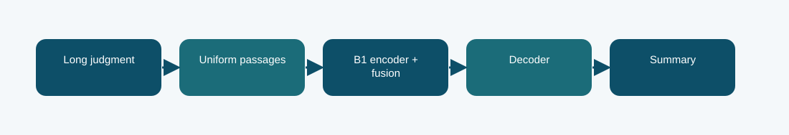

# B1 passage fusion with LoRMA+

**Phase 6 · trained summarizer · Codabench BERTScore F1 0.7674**
Scored submission ID(s): 1030742, 1030744, 1030983. Duplicate uploads of the same export are one variant, not separate architectures.

## The question behind this run

A judgment is longer than one encoder context, so use passages and fuse their evidence before generation. Document-only uniform coverage including the first and last passage avoids choosing test passages from reference summaries.

## What the code does

The Phase 1 B1 encoder represents passages; a fusion module composes them for an autoregressive decoder. LoRMA+ adapts output-side transformations while the inherited weights remain the starting point.

## Evidence and result

The archived local result is **-1.6703 validation negative NLL; BERTScore not measured in this report**. The visible finished Codabench result is **0.7674** on the BERTScore F1 scale. These are separate evaluations; neither is an estimate of the other. The scored BERTScore F1 is 0.7674. The saved report selected epoch 6 by negative summary NLL, not by test or Codabench score.

Semantic similarity does not by itself establish factual or legal correctness of a generated summary.

## Files

- [`code/b1_fusion.py`](code/b1_fusion.py) — original file, SHA-256 `58c9ee6bddcca2fd62d285ebaf6fb70524405cda5de90c451ea46984ddb26aa5`
- [`code/phase6_data.py`](code/phase6_data.py) — original file, SHA-256 `7b539dd1679e593c85058aa14d31f04ad92b85ff7c9d9e9fa647d48aa3a40b4f`
- [`code/train_phase6.py`](code/train_phase6.py) — original file, SHA-256 `4d1b2f0c303e140e659136f8712c2337cfd095004a643c49e8b0a03c4fb84af8`
- [`code/original_runner.ipynb`](code/original_runner.ipynb) — archived launcher/source notebook; saved outputs are not assumed.
- [`notebooks/ILLUSTRATED_RECONSTRUCTION.ipynb`](notebooks/ILLUSTRATED_RECONSTRUCTION.ipynb) — explanatory notebook made after the run; no saved training outputs.
- [`docs/TECHNICAL_REFERENCE.md`](docs/TECHNICAL_REFERENCE.md) — source symbols, method mechanics, provenance, and interpretation.
- [`report/METHODOLOGY_REPORT.tex`](report/METHODOLOGY_REPORT.tex) and [`report/METHODOLOGY_REPORT.pdf`](report/METHODOLOGY_REPORT.pdf) — editable and typeset methodology note.
- [`evidence/submitted_prediction.zip`](evidence/submitted_prediction.zip) — original-named export `phase6_b1_fusion_prediction.zip`, 100 predictions, CRC checked.
- [`evidence/PROVENANCE.json`](evidence/PROVENANCE.json) records original-file hashes and metric provenance.

## Reproduction boundary

The original source code is preserved byte for byte. It requires the authorized course dataset, the parent Phase 1 checkpoint and tokenizer, installed dependencies, and the appropriate GPU/runtime to retrain. Read the source entry point and original notebook before adapting paths: the historical Kaggle mounts are not local defaults. The illustrated notebook reads archived evidence; running it does not retrain the model. The prediction ZIP, where present, can be inspected without model weights.

## What we can and cannot conclude

The scored BERTScore F1 is 0.7674. The saved report selected epoch 6 by negative summary NLL, not by test or Codabench score. Semantic similarity does not by itself establish factual or legal correctness of a generated summary. The source and logs establish this particular run and export; this comparison does not isolate every changed variable or imply statistical significance.

Documentation was assembled after the runs with AI assistance and manually checked against the archived source, report, and displayed submissions. It is not a claim that the original Kaggle notebook had these explanatory cells or saved outputs.
