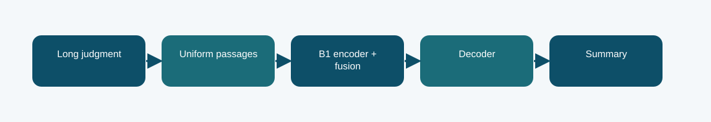

# B1 passage fusion with LoRMA+: technical reference

## Contract and provenance

Phase 6 submission IDs: 1030742, 1030744, 1030983. The scored quantity is Codabench BERTScore F1 = 0.7674. Local archived metric: -1.6703 validation negative NLL; BERTScore not measured in this report. The source files below are exact copies of the existing repository snapshot; their SHA-256 values are recorded in `../evidence/PROVENANCE.json`.

## Design transition

A judgment is longer than one encoder context, so use passages and fuse their evidence before generation.

Document-only uniform coverage including the first and last passage avoids choosing test passages from reference summaries.

## Forward path

The Phase 1 B1 encoder represents passages; a fusion module composes them for an autoregressive decoder. LoRMA+ adapts output-side transformations while the inherited weights remain the starting point.

## Source map

- **`b1_fusion.py`** (`58c9ee6bddcca2fd62d285ebaf6fb70524405cda5de90c451ea46984ddb26aa5`): _sha256 (line 39), _find (line 47), _verify_source (line 60), _discover_source (line 84), _activate_source (line 110), TokenizerAdapter (line 124), LoRMAOutputLinear (line 141), B1PassageFusion (line 160), build (line 243), training_loss (line 299), generate (line 310)
- **`phase6_data.py`** (`7b539dd1679e593c85058aa14d31f04ad92b85ff7c9d9e9fa647d48aa3a40b4f`): normalize_rows (line 6), document_hash (line 27), split_rows (line 31), select_passages (line 40), validate_predictions (line 50)
- **`train_phase6.py`** (`4d1b2f0c303e140e659136f8712c2337cfd095004a643c49e8b0a03c4fb84af8`): sha (line 19), save_json (line 24), trainable_state (line 31), restore_trainable (line 35), pack_source (line 44), main (line 59)

The code map lists top-level classes/functions rather than claiming that the notebook itself contains an executed training trace. Shared modules can appear in several packages because these submission variants reuse the same model path.

## Selection, scoring, and possible failure mechanism

The scored BERTScore F1 is 0.7674. The saved report selected epoch 6 by negative summary NLL, not by test or Codabench score.

Semantic similarity does not by itself establish factual or legal correctness of a generated summary.

The distinction among training, calibration, local validation, and Codabench is essential. Hyperparameter or decoding selection described here comes from archived code/report fields, not a retrospective fit to Codabench labels. Where the original report does not provide a specific metric, it remains unreported.

## Independent inspection

Check the original run report and log under `../evidence/`, if present. Verify `../evidence/submitted_prediction.zip` has exactly `prediction.json` at its root and passes ZIP CRC. The JSON provenance manifest records the expected prediction count and file hashes. Review the original source notebook under `../code/` when available; the illustrated notebook is a later teaching aid.
