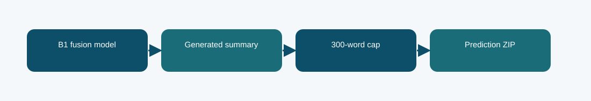

# B1 fusion with 300-word output cap

**Phase 6 · decoding variant · Codabench BERTScore F1 0.7783**
Scored submission ID(s): 1030821. Duplicate uploads of the same export are one variant, not separate architectures.

## The question behind this run

Inspect whether the same B1 fusion model loses overlap by generating summaries longer than the reference style. The cap was chosen on 32 held-out validation cases using an approximate ROUGE-1 F1 proxy, then checked on 64 confirmation cases.

## What the code does

The existing B1 fusion generations are truncated to at most 300 whitespace-delimited words. No new model weights are trained for this entry.

## Evidence and result

The archived local result is **not reported**. The visible finished Codabench result is **0.7783** on the BERTScore F1 scale. These are separate evaluations; neither is an estimate of the other. The proxy rose from 0.22108 to 0.25564 on validation and from 0.23031 to 0.26328 on confirmation; Codabench BERTScore F1 was 0.7783 versus 0.7674 for the untruncated export.

The selection proxy was not BERTScore, and this is a decoding/export variant, not another architecture.

## Files

- [`code/b1_fusion.py`](code/b1_fusion.py) — original file, SHA-256 `58c9ee6bddcca2fd62d285ebaf6fb70524405cda5de90c451ea46984ddb26aa5`
- [`code/train_phase6.py`](code/train_phase6.py) — original file, SHA-256 `4d1b2f0c303e140e659136f8712c2337cfd095004a643c49e8b0a03c4fb84af8`
- [`code/original_runner.ipynb`](code/original_runner.ipynb) — archived launcher/source notebook; saved outputs are not assumed.
- [`notebooks/ILLUSTRATED_RECONSTRUCTION.ipynb`](notebooks/ILLUSTRATED_RECONSTRUCTION.ipynb) — explanatory notebook made after the run; no saved training outputs.
- [`docs/TECHNICAL_REFERENCE.md`](docs/TECHNICAL_REFERENCE.md) — source symbols, method mechanics, provenance, and interpretation.
- [`report/METHODOLOGY_REPORT.tex`](report/METHODOLOGY_REPORT.tex) and [`report/METHODOLOGY_REPORT.pdf`](report/METHODOLOGY_REPORT.pdf) — editable and typeset methodology note.
- [`evidence/submitted_prediction.zip`](evidence/submitted_prediction.zip) — original-named export `phase6_b1_fusion_length_candidate.zip`, 100 predictions, CRC checked.
- [`evidence/PROVENANCE.json`](evidence/PROVENANCE.json) records original-file hashes and metric provenance.

## Reproduction boundary

The original source code is preserved byte for byte. It requires the authorized course dataset, the parent Phase 1 checkpoint and tokenizer, installed dependencies, and the appropriate GPU/runtime to retrain. Read the source entry point and original notebook before adapting paths: the historical Kaggle mounts are not local defaults. The illustrated notebook reads archived evidence; running it does not retrain the model. The prediction ZIP, where present, can be inspected without model weights.

## What we can and cannot conclude

The proxy rose from 0.22108 to 0.25564 on validation and from 0.23031 to 0.26328 on confirmation; Codabench BERTScore F1 was 0.7783 versus 0.7674 for the untruncated export. The selection proxy was not BERTScore, and this is a decoding/export variant, not another architecture. The source and logs establish this particular run and export; this comparison does not isolate every changed variable or imply statistical significance.

Documentation was assembled after the runs with AI assistance and manually checked against the archived source, report, and displayed submissions. It is not a claim that the original Kaggle notebook had these explanatory cells or saved outputs.
