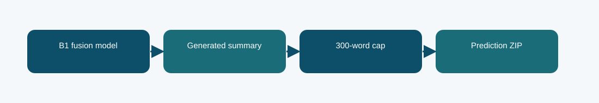

# B1 fusion with 300-word output cap: technical reference

## Contract and provenance

Phase 6 submission IDs: 1030821. The scored quantity is Codabench BERTScore F1 = 0.7783. Local archived metric: not reported. The source files below are exact copies of the existing repository snapshot; their SHA-256 values are recorded in `../evidence/PROVENANCE.json`.

## Design transition

Inspect whether the same B1 fusion model loses overlap by generating summaries longer than the reference style.

The cap was chosen on 32 held-out validation cases using an approximate ROUGE-1 F1 proxy, then checked on 64 confirmation cases.

## Forward path

The existing B1 fusion generations are truncated to at most 300 whitespace-delimited words. No new model weights are trained for this entry.

## Source map

- **`b1_fusion.py`** (`58c9ee6bddcca2fd62d285ebaf6fb70524405cda5de90c451ea46984ddb26aa5`): _sha256 (line 39), _find (line 47), _verify_source (line 60), _discover_source (line 84), _activate_source (line 110), TokenizerAdapter (line 124), LoRMAOutputLinear (line 141), B1PassageFusion (line 160), build (line 243), training_loss (line 299), generate (line 310)
- **`train_phase6.py`** (`4d1b2f0c303e140e659136f8712c2337cfd095004a643c49e8b0a03c4fb84af8`): sha (line 19), save_json (line 24), trainable_state (line 31), restore_trainable (line 35), pack_source (line 44), main (line 59)

The code map lists top-level classes/functions rather than claiming that the notebook itself contains an executed training trace. Shared modules can appear in several packages because these submission variants reuse the same model path.

## Selection, scoring, and possible failure mechanism

The proxy rose from 0.22108 to 0.25564 on validation and from 0.23031 to 0.26328 on confirmation; Codabench BERTScore F1 was 0.7783 versus 0.7674 for the untruncated export.

The selection proxy was not BERTScore, and this is a decoding/export variant, not another architecture.

The distinction among training, calibration, local validation, and Codabench is essential. Hyperparameter or decoding selection described here comes from archived code/report fields, not a retrospective fit to Codabench labels. Where the original report does not provide a specific metric, it remains unreported.

## Independent inspection

Check the original run report and log under `../evidence/`, if present. Verify `../evidence/submitted_prediction.zip` has exactly `prediction.json` at its root and passes ZIP CRC. The JSON provenance manifest records the expected prediction count and file hashes. Review the original source notebook under `../code/` when available; the illustrated notebook is a later teaching aid.
