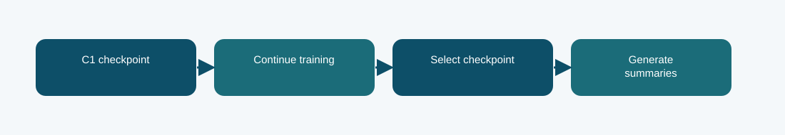

# C1 Houlsby continued checkpoint: technical reference

## Contract and provenance

Phase 6 submission IDs: 1030988. The scored quantity is Codabench BERTScore F1 = 0.7671. Local archived metric: -1.9365 validation negative NLL; BERTScore not measured in this report. The source files below are exact copies of the existing repository snapshot; their SHA-256 values are recorded in `../evidence/PROVENANCE.json`.

## Design transition

See whether more updates on the selected C1 Houlsby lineage improve summary quality.

The continued run's own report supplies its selected checkpoint and validation negative NLL; its prediction ZIP is a separate submitted export.

## Forward path

The same C1 architecture and bottleneck adapters resume from their own checkpoint and continue optimization. This is not a fresh architecture.

## Source map

- **`c1_houlsby.py`** (`aac5188ee4f3c29e861938c2ddba05edbbcb9c32d1e02f79fd99d4b6d3aeab37`): BottleneckAdapter (line 19), EncoderWithAdapter (line 31), FusionWithAdapter (line 41), adapt_model (line 51), build (line 65), training_loss (line 115), generate (line 127)
- **`train_phase6.py`** (`4d1b2f0c303e140e659136f8712c2337cfd095004a643c49e8b0a03c4fb84af8`): sha (line 19), save_json (line 24), trainable_state (line 31), restore_trainable (line 35), pack_source (line 44), main (line 59)

The code map lists top-level classes/functions rather than claiming that the notebook itself contains an executed training trace. Shared modules can appear in several packages because these submission variants reuse the same model path.

## Selection, scoring, and possible failure mechanism

Codabench BERTScore F1 fell from 0.7700 to 0.7671. More training alone did not improve the observed hidden score.

A small score decrease does not identify whether overfitting, decoding variation, or stochastic evaluation drove the change.

The distinction among training, calibration, local validation, and Codabench is essential. Hyperparameter or decoding selection described here comes from archived code/report fields, not a retrospective fit to Codabench labels. Where the original report does not provide a specific metric, it remains unreported.

## Independent inspection

Check the original run report and log under `../evidence/`, if present. Verify `../evidence/submitted_prediction.zip` has exactly `prediction.json` at its root and passes ZIP CRC. The JSON provenance manifest records the expected prediction count and file hashes. Review the original source notebook under `../code/` when available; the illustrated notebook is a later teaching aid.
