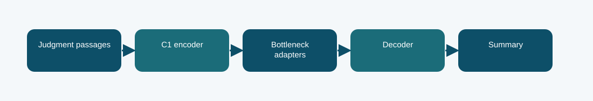

# C1 Houlsby bottleneck summarizer: technical reference

## Contract and provenance

Phase 6 submission IDs: 1030778, 1030779, 1030987. The scored quantity is Codabench BERTScore F1 = 0.7700. Local archived metric: -1.9414 validation negative NLL; BERTScore not measured in this report. The source files below are exact copies of the existing repository snapshot; their SHA-256 values are recorded in `../evidence/PROVENANCE.json`.

## Design transition

Reuse the Phase 1 C1 legal encoder while changing a small bottleneck module for summarization.

This tests a different Phase 1 lineage and adaptation family against B1 fusion under the same summarization contract.

## Forward path

Houlsby-style adapters insert down-project, nonlinear transform, up-project residual modules in the encoder. Recurrent readout tuning and the generation head map case evidence into the summary task.

## Source map

- **`c1_houlsby.py`** (`aac5188ee4f3c29e861938c2ddba05edbbcb9c32d1e02f79fd99d4b6d3aeab37`): BottleneckAdapter (line 19), EncoderWithAdapter (line 31), FusionWithAdapter (line 41), adapt_model (line 51), build (line 65), training_loss (line 115), generate (line 127)
- **`phase6_data.py`** (`7b539dd1679e593c85058aa14d31f04ad92b85ff7c9d9e9fa647d48aa3a40b4f`): normalize_rows (line 6), document_hash (line 27), split_rows (line 31), select_passages (line 40), validate_predictions (line 50)
- **`train_phase6.py`** (`4d1b2f0c303e140e659136f8712c2337cfd095004a643c49e8b0a03c4fb84af8`): sha (line 19), save_json (line 24), trainable_state (line 31), restore_trainable (line 35), pack_source (line 44), main (line 59)

The code map lists top-level classes/functions rather than claiming that the notebook itself contains an executed training trace. Shared modules can appear in several packages because these submission variants reuse the same model path.

## Selection, scoring, and possible failure mechanism

The Codabench BERTScore F1 was 0.7700. The run report selects epoch 3 using negative summary NLL; that is a training selection metric, not the hidden score.

Different backbones and adaptation methods change together, so a single score cannot isolate the benefit of Houlsby adapters.

The distinction among training, calibration, local validation, and Codabench is essential. Hyperparameter or decoding selection described here comes from archived code/report fields, not a retrospective fit to Codabench labels. Where the original report does not provide a specific metric, it remains unreported.

## Independent inspection

Check the original run report and log under `../evidence/`, if present. Verify `../evidence/submitted_prediction.zip` has exactly `prediction.json` at its root and passes ZIP CRC. The JSON provenance manifest records the expected prediction count and file hashes. Review the original source notebook under `../code/` when available; the illustrated notebook is a later teaching aid.
