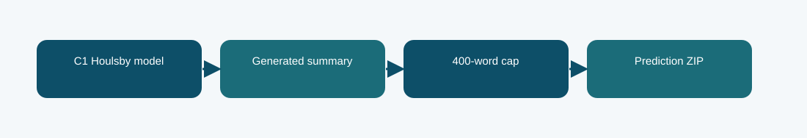

# C1 Houlsby with 400-word output cap

**Phase 6 · decoding variant · Codabench BERTScore F1 0.7750**
Scored submission ID(s): 1030822. Duplicate uploads of the same export are one variant, not separate architectures.

## The question behind this run

Check whether C1's generated answer length is mismatched to the reference summaries. The cap was selected on 32 validation examples by approximate ROUGE-1 F1 and tested on a distinct 64-example confirmation set.

## What the code does

The existing C1 Houlsby output is truncated at 400 whitespace-delimited words; the model weights and adapter architecture are unchanged.

## Evidence and result

The archived local result is **not reported**. The visible finished Codabench result is **0.7750** on the BERTScore F1 scale. These are separate evaluations; neither is an estimate of the other. The proxy rose from 0.29545 to 0.30539 on validation and 0.28951 to 0.29776 on confirmation; Codabench BERTScore F1 was 0.7750, compared with 0.7700 for the original export.

Do not interpret this as a new trained model or as evidence that a 400-word cap generalizes to every dataset.

## Files

- [`code/c1_houlsby.py`](code/c1_houlsby.py) — original file, SHA-256 `aac5188ee4f3c29e861938c2ddba05edbbcb9c32d1e02f79fd99d4b6d3aeab37`
- [`code/train_phase6.py`](code/train_phase6.py) — original file, SHA-256 `4d1b2f0c303e140e659136f8712c2337cfd095004a643c49e8b0a03c4fb84af8`
- [`code/original_runner.ipynb`](code/original_runner.ipynb) — archived launcher/source notebook; saved outputs are not assumed.
- [`notebooks/ILLUSTRATED_RECONSTRUCTION.ipynb`](notebooks/ILLUSTRATED_RECONSTRUCTION.ipynb) — explanatory notebook made after the run; no saved training outputs.
- [`docs/TECHNICAL_REFERENCE.md`](docs/TECHNICAL_REFERENCE.md) — source symbols, method mechanics, provenance, and interpretation.
- [`report/METHODOLOGY_REPORT.tex`](report/METHODOLOGY_REPORT.tex) and [`report/METHODOLOGY_REPORT.pdf`](report/METHODOLOGY_REPORT.pdf) — editable and typeset methodology note.
- [`evidence/submitted_prediction.zip`](evidence/submitted_prediction.zip) — original-named export `phase6_c1_houlsby_length_candidate.zip`, 100 predictions, CRC checked.
- [`evidence/PROVENANCE.json`](evidence/PROVENANCE.json) records original-file hashes and metric provenance.

## Reproduction boundary

The original source code is preserved byte for byte. It requires the authorized course dataset, the parent Phase 1 checkpoint and tokenizer, installed dependencies, and the appropriate GPU/runtime to retrain. Read the source entry point and original notebook before adapting paths: the historical Kaggle mounts are not local defaults. The illustrated notebook reads archived evidence; running it does not retrain the model. The prediction ZIP, where present, can be inspected without model weights.

## What we can and cannot conclude

The proxy rose from 0.29545 to 0.30539 on validation and 0.28951 to 0.29776 on confirmation; Codabench BERTScore F1 was 0.7750, compared with 0.7700 for the original export. Do not interpret this as a new trained model or as evidence that a 400-word cap generalizes to every dataset. The source and logs establish this particular run and export; this comparison does not isolate every changed variable or imply statistical significance.

Documentation was assembled after the runs with AI assistance and manually checked against the archived source, report, and displayed submissions. It is not a claim that the original Kaggle notebook had these explanatory cells or saved outputs.
