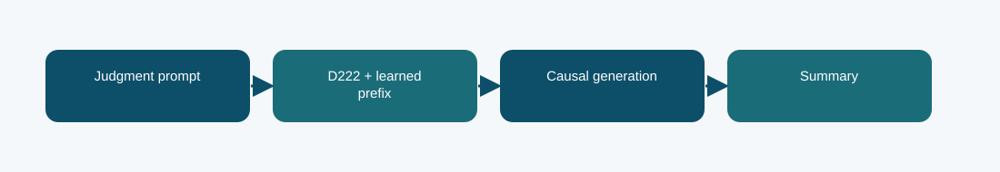

# D222 prefix-tuned summarizer

**Phase 6 · trained summarizer · Codabench BERTScore F1 0.7710**
Scored submission ID(s): 1031005. Duplicate uploads of the same export are one variant, not separate architectures.

## The question behind this run

Ask whether learned task prefixes can steer a Phase 1 D222 model toward concise legal summaries with few trainable parameters. This adaptation changes the conditioning mechanism rather than inserting adapters into every transformation.

## What the code does

Trainable prefix key/value representations enter the attention pathway. The causal batch forms summary targets while the base model remains the source of legal language modeling knowledge.

## Evidence and result

The archived local result is **-1.6961 validation negative NLL; BERTScore not measured in this report**. The visible finished Codabench result is **0.7710** on the BERTScore F1 scale. These are separate evaluations; neither is an estimate of the other. Codabench BERTScore F1 was 0.7710. One repeat upload failed, but the earlier finished submission is the scored evidence.

Prefix conditioning still depends on the parent model's document coverage and can miss facts beyond its context.

## Files

- [`code/d222_prefix.py`](code/d222_prefix.py) — original file, SHA-256 `297e37408eeb46c7203fd49cf7db5d5db9d8e2d0b1d90b0d8daa71345bf91157`
- [`code/phase6_data.py`](code/phase6_data.py) — original file, SHA-256 `7b539dd1679e593c85058aa14d31f04ad92b85ff7c9d9e9fa647d48aa3a40b4f`
- [`code/train_phase6.py`](code/train_phase6.py) — original file, SHA-256 `4d1b2f0c303e140e659136f8712c2337cfd095004a643c49e8b0a03c4fb84af8`
- [`code/original_runner.ipynb`](code/original_runner.ipynb) — archived launcher/source notebook; saved outputs are not assumed.
- [`notebooks/ILLUSTRATED_RECONSTRUCTION.ipynb`](notebooks/ILLUSTRATED_RECONSTRUCTION.ipynb) — explanatory notebook made after the run; no saved training outputs.
- [`docs/TECHNICAL_REFERENCE.md`](docs/TECHNICAL_REFERENCE.md) — source symbols, method mechanics, provenance, and interpretation.
- [`report/METHODOLOGY_REPORT.tex`](report/METHODOLOGY_REPORT.tex) and [`report/METHODOLOGY_REPORT.pdf`](report/METHODOLOGY_REPORT.pdf) — editable and typeset methodology note.
- [`evidence/submitted_prediction.zip`](evidence/submitted_prediction.zip) — original-named export `phase6_d222_prefix_prediction.zip`, 100 predictions, CRC checked.
- [`evidence/PROVENANCE.json`](evidence/PROVENANCE.json) records original-file hashes and metric provenance.

## Reproduction boundary

The original source code is preserved byte for byte. It requires the authorized course dataset, the parent Phase 1 checkpoint and tokenizer, installed dependencies, and the appropriate GPU/runtime to retrain. Read the source entry point and original notebook before adapting paths: the historical Kaggle mounts are not local defaults. The illustrated notebook reads archived evidence; running it does not retrain the model. The prediction ZIP, where present, can be inspected without model weights.

## What we can and cannot conclude

Codabench BERTScore F1 was 0.7710. One repeat upload failed, but the earlier finished submission is the scored evidence. Prefix conditioning still depends on the parent model's document coverage and can miss facts beyond its context. The source and logs establish this particular run and export; this comparison does not isolate every changed variable or imply statistical significance.

Documentation was assembled after the runs with AI assistance and manually checked against the archived source, report, and displayed submissions. It is not a claim that the original Kaggle notebook had these explanatory cells or saved outputs.
