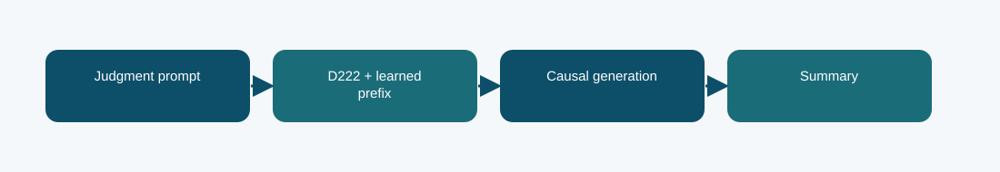

# D222 prefix-tuned summarizer: technical reference

## Contract and provenance

Phase 6 submission IDs: 1031005. The scored quantity is Codabench BERTScore F1 = 0.7710. Local archived metric: -1.6961 validation negative NLL; BERTScore not measured in this report. The source files below are exact copies of the existing repository snapshot; their SHA-256 values are recorded in `../evidence/PROVENANCE.json`.

## Design transition

Ask whether learned task prefixes can steer a Phase 1 D222 model toward concise legal summaries with few trainable parameters.

This adaptation changes the conditioning mechanism rather than inserting adapters into every transformation.

## Forward path

Trainable prefix key/value representations enter the attention pathway. The causal batch forms summary targets while the base model remains the source of legal language modeling knowledge.

## Source map

- **`d222_prefix.py`** (`297e37408eeb46c7203fd49cf7db5d5db9d8e2d0b1d90b0d8daa71345bf91157`): GlobalPrefixAttention (line 19), adapt_model (line 57), _activate_source (line 69), build (line 93), _causal_batch (line 132), training_loss (line 145), generate (line 152)
- **`phase6_data.py`** (`7b539dd1679e593c85058aa14d31f04ad92b85ff7c9d9e9fa647d48aa3a40b4f`): normalize_rows (line 6), document_hash (line 27), split_rows (line 31), select_passages (line 40), validate_predictions (line 50)
- **`train_phase6.py`** (`4d1b2f0c303e140e659136f8712c2337cfd095004a643c49e8b0a03c4fb84af8`): sha (line 19), save_json (line 24), trainable_state (line 31), restore_trainable (line 35), pack_source (line 44), main (line 59)

The code map lists top-level classes/functions rather than claiming that the notebook itself contains an executed training trace. Shared modules can appear in several packages because these submission variants reuse the same model path.

## Selection, scoring, and possible failure mechanism

Codabench BERTScore F1 was 0.7710. One repeat upload failed, but the earlier finished submission is the scored evidence.

Prefix conditioning still depends on the parent model's document coverage and can miss facts beyond its context.

The distinction among training, calibration, local validation, and Codabench is essential. Hyperparameter or decoding selection described here comes from archived code/report fields, not a retrospective fit to Codabench labels. Where the original report does not provide a specific metric, it remains unreported.

## Independent inspection

Check the original run report and log under `../evidence/`, if present. Verify `../evidence/submitted_prediction.zip` has exactly `prediction.json` at its root and passes ZIP CRC. The JSON provenance manifest records the expected prediction count and file hashes. Review the original source notebook under `../code/` when available; the illustrated notebook is a later teaching aid.
