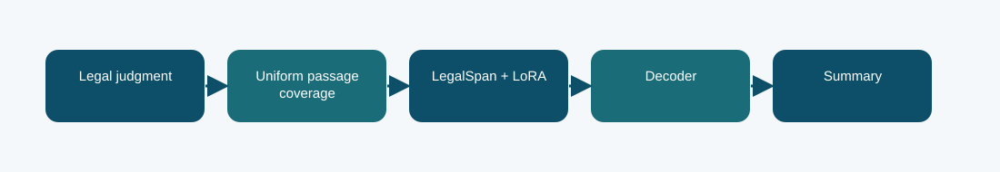

# LegalSpan LoRA summarizer

**Phase 6 · trained summarizer · Codabench BERTScore F1 0.7847**
Scored submission ID(s): 1031076, 1031077, 1031078. Duplicate uploads of the same export are one variant, not separate architectures.

## The question behind this run

Keep the legal span representation from Phase 1 and adapt only compact low-rank modules to summarization. The report records selected epoch 4 by negative summary NLL, with no reference-dependent test passage selection.

## What the code does

The LegalSpan source and tokenizer feed a document-only passage strategy with first/last coverage. LoRA modules modify selected projections, and autoregressive generation produces the summary.

## Evidence and result

The archived local result is **-1.1865 validation negative NLL; BERTScore not measured in this report**. The visible finished Codabench result is **0.7847** on the BERTScore F1 scale. These are separate evaluations; neither is an estimate of the other. Codabench BERTScore F1 was 0.7847, the highest among these submitted Phase 6 variants. The evidence supports this result for the scored submission, not a universal model ranking.

BERTScore is a semantic-overlap measure; legal fact fidelity and citation accuracy require separate review.

## Files

- [`code/legalspan_lora.py`](code/legalspan_lora.py) — original file, SHA-256 `e00240bf5d8af9eec458d37832c6248f974b897101bb20922f07575f3770c399`
- [`code/phase6_data.py`](code/phase6_data.py) — original file, SHA-256 `7b539dd1679e593c85058aa14d31f04ad92b85ff7c9d9e9fa647d48aa3a40b4f`
- [`code/train_phase6.py`](code/train_phase6.py) — original file, SHA-256 `4d1b2f0c303e140e659136f8712c2337cfd095004a643c49e8b0a03c4fb84af8`
- [`code/original_runner.ipynb`](code/original_runner.ipynb) — archived launcher/source notebook; saved outputs are not assumed.
- [`notebooks/ILLUSTRATED_RECONSTRUCTION.ipynb`](notebooks/ILLUSTRATED_RECONSTRUCTION.ipynb) — explanatory notebook made after the run; no saved training outputs.
- [`docs/TECHNICAL_REFERENCE.md`](docs/TECHNICAL_REFERENCE.md) — source symbols, method mechanics, provenance, and interpretation.
- [`report/METHODOLOGY_REPORT.tex`](report/METHODOLOGY_REPORT.tex) and [`report/METHODOLOGY_REPORT.pdf`](report/METHODOLOGY_REPORT.pdf) — editable and typeset methodology note.
- [`evidence/submitted_prediction.zip`](evidence/submitted_prediction.zip) — original-named export `phase6_legalspan_lora_prediction.zip`, 100 predictions, CRC checked.
- [`evidence/PROVENANCE.json`](evidence/PROVENANCE.json) records original-file hashes and metric provenance.

## Reproduction boundary

The original source code is preserved byte for byte. It requires the authorized course dataset, the parent Phase 1 checkpoint and tokenizer, installed dependencies, and the appropriate GPU/runtime to retrain. Read the source entry point and original notebook before adapting paths: the historical Kaggle mounts are not local defaults. The illustrated notebook reads archived evidence; running it does not retrain the model. The prediction ZIP, where present, can be inspected without model weights.

## What we can and cannot conclude

Codabench BERTScore F1 was 0.7847, the highest among these submitted Phase 6 variants. The evidence supports this result for the scored submission, not a universal model ranking. BERTScore is a semantic-overlap measure; legal fact fidelity and citation accuracy require separate review. The source and logs establish this particular run and export; this comparison does not isolate every changed variable or imply statistical significance.

Documentation was assembled after the runs with AI assistance and manually checked against the archived source, report, and displayed submissions. It is not a claim that the original Kaggle notebook had these explanatory cells or saved outputs.
