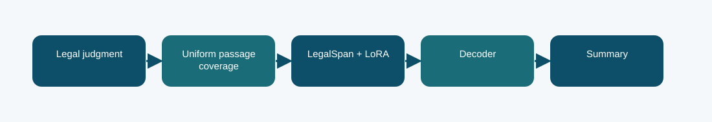

# LegalSpan LoRA summarizer: technical reference

## Contract and provenance

Phase 6 submission IDs: 1031076, 1031077, 1031078. The scored quantity is Codabench BERTScore F1 = 0.7847. Local archived metric: -1.1865 validation negative NLL; BERTScore not measured in this report. The source files below are exact copies of the existing repository snapshot; their SHA-256 values are recorded in `../evidence/PROVENANCE.json`.

## Design transition

Keep the legal span representation from Phase 1 and adapt only compact low-rank modules to summarization.

The report records selected epoch 4 by negative summary NLL, with no reference-dependent test passage selection.

## Forward path

The LegalSpan source and tokenizer feed a document-only passage strategy with first/last coverage. LoRA modules modify selected projections, and autoregressive generation produces the summary.

## Source map

- **`legalspan_lora.py`** (`e00240bf5d8af9eec458d37832c6248f974b897101bb20922f07575f3770c399`): _char_class (line 38), _pieces (line 48), TokenizerAdapter (line 60), LoRALinear (line 112), _adapt (line 129), _unique_file (line 146), _import_source (line 153), _sha256 (line 182), build (line 190), _roles (line 238), _validate_batch (line 242), training_loss (line 247), generate (line 269)
- **`phase6_data.py`** (`7b539dd1679e593c85058aa14d31f04ad92b85ff7c9d9e9fa647d48aa3a40b4f`): normalize_rows (line 6), document_hash (line 27), split_rows (line 31), select_passages (line 40), validate_predictions (line 50)
- **`train_phase6.py`** (`4d1b2f0c303e140e659136f8712c2337cfd095004a643c49e8b0a03c4fb84af8`): sha (line 19), save_json (line 24), trainable_state (line 31), restore_trainable (line 35), pack_source (line 44), main (line 59)

The code map lists top-level classes/functions rather than claiming that the notebook itself contains an executed training trace. Shared modules can appear in several packages because these submission variants reuse the same model path.

## Selection, scoring, and possible failure mechanism

Codabench BERTScore F1 was 0.7847, the highest among these submitted Phase 6 variants. The evidence supports this result for the scored submission, not a universal model ranking.

BERTScore is a semantic-overlap measure; legal fact fidelity and citation accuracy require separate review.

The distinction among training, calibration, local validation, and Codabench is essential. Hyperparameter or decoding selection described here comes from archived code/report fields, not a retrospective fit to Codabench labels. Where the original report does not provide a specific metric, it remains unreported.

## Independent inspection

Check the original run report and log under `../evidence/`, if present. Verify `../evidence/submitted_prediction.zip` has exactly `prediction.json` at its root and passes ZIP CRC. The JSON provenance manifest records the expected prediction count and file hashes. Review the original source notebook under `../code/` when available; the illustrated notebook is a later teaching aid.
