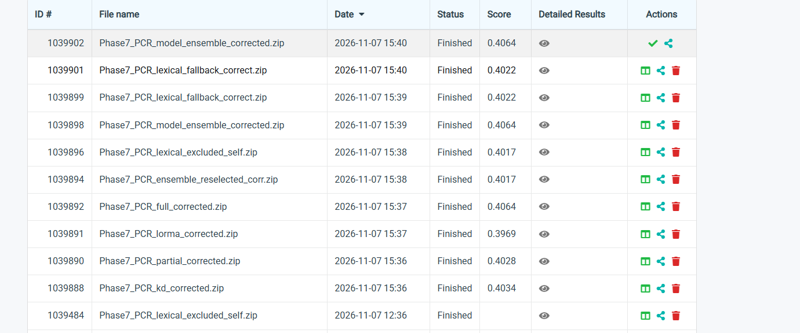
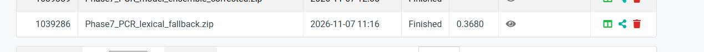

# Visible finished submissions

The images below are the supplied Codabench screenshots. The variant index transcribes distinct scored methods; duplicate uploads are not extra architectures.

SHA-256 `292f25b9e62e2fc5ba23c7c658ec996e25c02b58dffaba5738ab637072af976f`

SHA-256 `e426353e850ff42d107f4940da2b9317d8306213980fa9c53468766179116e9d`
