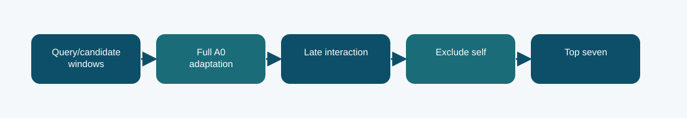

# Full fine-tuned neural retriever: technical reference

## Contract and provenance

Phase 7 submission IDs: 1039892. The scored quantity is Codabench micro-F1@7 = 0.4064. Local archived metric: 0.4036 corrected local-dev micro-F1@7. The source files below are exact copies of the existing repository snapshot; their SHA-256 values are recorded in `../evidence/PROVENANCE.json`.

## Design transition

Test whether adapting the full in-house Phase 1 A0 language model improves case matching beyond lexical overlap.

The full model has about 110.3 million trainable parameters in the saved GPU report, much more than the partial or LoRMA branches.

## Forward path

Four evenly spaced 256-token windows encode each query and candidate. The model mean-pools hidden states within each window and applies late max interaction across windows; supervised hard negatives come from the lexical retriever.

## Source map

- **`phase7_run.py`** (`849a42dc8b5f179ce01197419c9cd2429bd324e4d3d60a949b863caa9b70191e`): ModelConfig (line 23), RMSNorm (line 42), RotaryEmbedding (line 53), CausalMHA (line 71), SwiGLU (line 94), TransformerBlock (line 105), LegalGPT (line 117), log (line 169), sha256_file (line 173), read_json (line 181), record_text (line 186), load_split (line 190), locate_data_root (line 197), metric_at7 (line 236)
- **`phase7_export.py`** (`8080cd75b1600dbd2fb7ef2be574bff3e06b18dfbaaeaa34678ecb0ad9d2f9ea`): ModelConfig (line 23), RMSNorm (line 42), RotaryEmbedding (line 53), CausalMHA (line 71), SwiGLU (line 94), TransformerBlock (line 105), LegalGPT (line 117), log (line 169), sha256_file (line 173), read_json (line 181), record_text (line 186), load_split (line 190), locate_data_root (line 197), metric_at7 (line 236)

The code map lists top-level classes/functions rather than claiming that the notebook itself contains an executed training trace. Shared modules can appear in several packages because these submission variants reuse the same model path.

## Selection, scoring, and possible failure mechanism

Corrected local dev micro-F1@7 was 0.4036 on 118 queries; Codabench was 0.4064. The latter ties the corrected model ensemble in the screenshot.

A score tie on one hidden evaluation does not show the ensemble and full model made identical predictions.

The distinction among training, calibration, local validation, and Codabench is essential. Hyperparameter or decoding selection described here comes from archived code/report fields, not a retrospective fit to Codabench labels. Where the original report does not provide a specific metric, it remains unreported.

## Independent inspection

Check the original run report and log under `../evidence/`, if present. Verify `../evidence/submitted_prediction.zip` has exactly `prediction.json` at its root and passes ZIP CRC. The JSON provenance manifest records the expected prediction count and file hashes. Review the original source notebook under `../code/` when available; the illustrated notebook is a later teaching aid.
