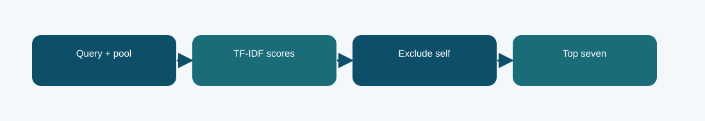

# Lexical ranking excluding query itself: technical reference

## Contract and provenance

Phase 7 submission IDs: 1039896. The scored quantity is Codabench micro-F1@7 = 0.4017. Local archived metric: not independently reported after correction. The source files below are exact copies of the existing repository snapshot; their SHA-256 values are recorded in `../evidence/PROVENANCE.json`.

## Design transition

A prior case retrieval system must never return its own query as precedent.

This isolates the validity correction from the neural model so its score can be compared with the uncorrected lexical fallback.

## Forward path

The export removes self IDs before ranking and fills the seven slots with eligible lexical candidates from each query's pool.

## Source map

- **`phase7_export.py`** (`8080cd75b1600dbd2fb7ef2be574bff3e06b18dfbaaeaa34678ecb0ad9d2f9ea`): ModelConfig (line 23), RMSNorm (line 42), RotaryEmbedding (line 53), CausalMHA (line 71), SwiGLU (line 94), TransformerBlock (line 105), LegalGPT (line 117), log (line 169), sha256_file (line 173), read_json (line 181), record_text (line 186), load_split (line 190), locate_data_root (line 197), metric_at7 (line 236)
- **`phase7_run.py`** (`849a42dc8b5f179ce01197419c9cd2429bd324e4d3d60a949b863caa9b70191e`): ModelConfig (line 23), RMSNorm (line 42), RotaryEmbedding (line 53), CausalMHA (line 71), SwiGLU (line 94), TransformerBlock (line 105), LegalGPT (line 117), log (line 169), sha256_file (line 173), read_json (line 181), record_text (line 186), load_split (line 190), locate_data_root (line 197), metric_at7 (line 236)

The code map lists top-level classes/functions rather than claiming that the notebook itself contains an executed training trace. Shared modules can appear in several packages because these submission variants reuse the same model path.

## Selection, scoring, and possible failure mechanism

Codabench micro-F1@7 rose to 0.4017 from the earlier 0.3680 lexical submission. The comparison also changes the export rule, so it should not be labelled a model-training gain.

The score difference cannot isolate every other version change without the missing original ZIP.

The distinction among training, calibration, local validation, and Codabench is essential. Hyperparameter or decoding selection described here comes from archived code/report fields, not a retrospective fit to Codabench labels. Where the original report does not provide a specific metric, it remains unreported.

## Independent inspection

Check the original run report and log under `../evidence/`, if present. Verify `../evidence/submitted_prediction.zip` has exactly `prediction.json` at its root and passes ZIP CRC. The JSON provenance manifest records the expected prediction count and file hashes. Review the original source notebook under `../code/` when available; the illustrated notebook is a later teaching aid.
