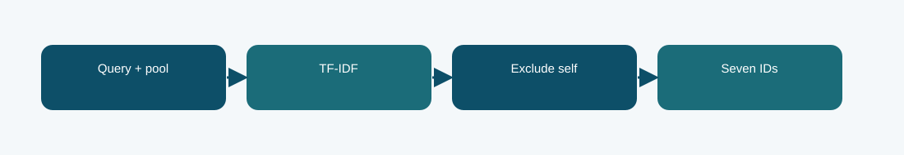

# Corrected lexical fallback

**Phase 7 · retrieval correction · Codabench micro-F1@7 0.4022**
Scored submission ID(s): 1039899, 1039901. Duplicate uploads of the same export are one variant, not separate architectures.

## The question behind this run

Retain a simple valid submission path if the neural scorer fails to load. The fallback uses no adapted retrieval checkpoint, so it is a useful control against the more complex neural systems.

## What the code does

Corrected lexical ranking excludes the query itself, checks pool membership and uniqueness, and emits exactly seven candidate IDs.

## Evidence and result

The archived local result is **not independently reported after correction**. The visible finished Codabench result is **0.4022** on the micro-F1@7 scale. These are separate evaluations; neither is an estimate of the other. Its Codabench micro-F1@7 was 0.4022, near the corrected neural runs. This shows the lexical signal remained strong on this task.

It does not demonstrate that lexical matching understands legal entailment or precedent relevance.

## Files

- [`code/phase7_export.py`](code/phase7_export.py) — original file, SHA-256 `8080cd75b1600dbd2fb7ef2be574bff3e06b18dfbaaeaa34678ecb0ad9d2f9ea`
- [`code/phase7_run.py`](code/phase7_run.py) — original file, SHA-256 `849a42dc8b5f179ce01197419c9cd2429bd324e4d3d60a949b863caa9b70191e`
- No original runner notebook was located for this exact export. The illustrated notebook is a later reconstruction.
- [`notebooks/ILLUSTRATED_RECONSTRUCTION.ipynb`](notebooks/ILLUSTRATED_RECONSTRUCTION.ipynb) — explanatory notebook made after the run; no saved training outputs.
- [`docs/TECHNICAL_REFERENCE.md`](docs/TECHNICAL_REFERENCE.md) — source symbols, method mechanics, provenance, and interpretation.
- [`report/METHODOLOGY_REPORT.tex`](report/METHODOLOGY_REPORT.tex) and [`report/METHODOLOGY_REPORT.pdf`](report/METHODOLOGY_REPORT.pdf) — editable and typeset methodology note.
- [`evidence/submitted_prediction.zip`](evidence/submitted_prediction.zip) — original-named export `Phase7_PCR_lexical_fallback_corrected.zip`, 237 predictions, CRC checked.
- [`evidence/PROVENANCE.json`](evidence/PROVENANCE.json) records original-file hashes and metric provenance.

## Reproduction boundary

The original source code is preserved byte for byte. It requires the authorized course dataset, the parent Phase 1 checkpoint and tokenizer, installed dependencies, and the appropriate GPU/runtime to retrain. Read the source entry point and original notebook before adapting paths: the historical Kaggle mounts are not local defaults. The illustrated notebook reads archived evidence; running it does not retrain the model. The prediction ZIP, where present, can be inspected without model weights.

## What we can and cannot conclude

Its Codabench micro-F1@7 was 0.4022, near the corrected neural runs. This shows the lexical signal remained strong on this task. It does not demonstrate that lexical matching understands legal entailment or precedent relevance. The source and logs establish this particular run and export; this comparison does not isolate every changed variable or imply statistical significance.

Documentation was assembled after the runs with AI assistance and manually checked against the archived source, report, and displayed submissions. It is not a claim that the original Kaggle notebook had these explanatory cells or saved outputs.
