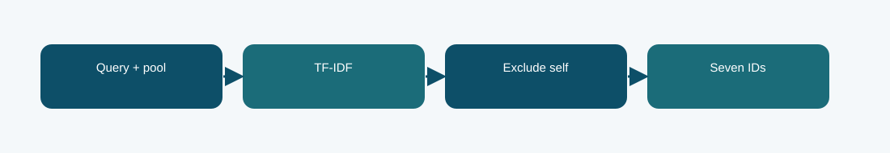

# Corrected lexical fallback: technical reference

## Contract and provenance

Phase 7 submission IDs: 1039899, 1039901. The scored quantity is Codabench micro-F1@7 = 0.4022. Local archived metric: not independently reported after correction. The source files below are exact copies of the existing repository snapshot; their SHA-256 values are recorded in `../evidence/PROVENANCE.json`.

## Design transition

Retain a simple valid submission path if the neural scorer fails to load.

The fallback uses no adapted retrieval checkpoint, so it is a useful control against the more complex neural systems.

## Forward path

Corrected lexical ranking excludes the query itself, checks pool membership and uniqueness, and emits exactly seven candidate IDs.

## Source map

- **`phase7_export.py`** (`8080cd75b1600dbd2fb7ef2be574bff3e06b18dfbaaeaa34678ecb0ad9d2f9ea`): ModelConfig (line 23), RMSNorm (line 42), RotaryEmbedding (line 53), CausalMHA (line 71), SwiGLU (line 94), TransformerBlock (line 105), LegalGPT (line 117), log (line 169), sha256_file (line 173), read_json (line 181), record_text (line 186), load_split (line 190), locate_data_root (line 197), metric_at7 (line 236)
- **`phase7_run.py`** (`849a42dc8b5f179ce01197419c9cd2429bd324e4d3d60a949b863caa9b70191e`): ModelConfig (line 23), RMSNorm (line 42), RotaryEmbedding (line 53), CausalMHA (line 71), SwiGLU (line 94), TransformerBlock (line 105), LegalGPT (line 117), log (line 169), sha256_file (line 173), read_json (line 181), record_text (line 186), load_split (line 190), locate_data_root (line 197), metric_at7 (line 236)

The code map lists top-level classes/functions rather than claiming that the notebook itself contains an executed training trace. Shared modules can appear in several packages because these submission variants reuse the same model path.

## Selection, scoring, and possible failure mechanism

Its Codabench micro-F1@7 was 0.4022, near the corrected neural runs. This shows the lexical signal remained strong on this task.

It does not demonstrate that lexical matching understands legal entailment or precedent relevance.

The distinction among training, calibration, local validation, and Codabench is essential. Hyperparameter or decoding selection described here comes from archived code/report fields, not a retrospective fit to Codabench labels. Where the original report does not provide a specific metric, it remains unreported.

## Independent inspection

Check the original run report and log under `../evidence/`, if present. Verify `../evidence/submitted_prediction.zip` has exactly `prediction.json` at its root and passes ZIP CRC. The JSON provenance manifest records the expected prediction count and file hashes. Review the original source notebook under `../code/` when available; the illustrated notebook is a later teaching aid.
