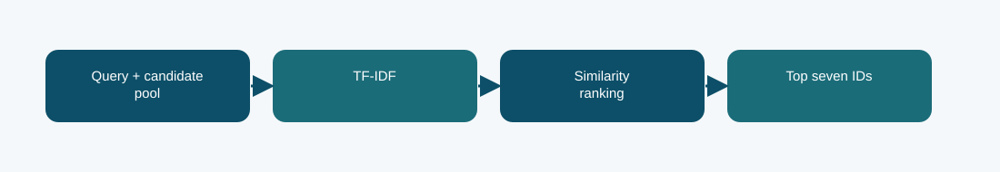

# Initial lexical fallback

**Phase 7 · retrieval baseline · Codabench micro-F1@7 0.3680**
Scored submission ID(s): 1039286. Duplicate uploads of the same export are one variant, not separate architectures.

## The question behind this run

Establish a no-neural retrieval floor before spending T4 time on adaptation. This is a retrieval baseline and fallback, not a Phase 1 neural architecture.

## What the code does

TF-IDF document features rank candidates by lexical similarity and emit seven IDs per query. The initial submission predates the later self-match correction.

## Evidence and result

The archived local result is **not independently reported after correction**. The visible finished Codabench result is **0.3680** on the micro-F1@7 scale. These are separate evaluations; neither is an estimate of the other. The initial Codabench micro-F1@7 was 0.3680. Its exact submitted ZIP is not present in the inspected local archive, so the package does not invent or regenerate it as historical evidence.

The historical ZIP is missing locally; this package includes source and run evidence but no exact-byte prediction artifact.

## Files

- [`code/phase7_run.py`](code/phase7_run.py) — original file, SHA-256 `849a42dc8b5f179ce01197419c9cd2429bd324e4d3d60a949b863caa9b70191e`
- No original runner notebook was located for this exact export. The illustrated notebook is a later reconstruction.
- [`notebooks/ILLUSTRATED_RECONSTRUCTION.ipynb`](notebooks/ILLUSTRATED_RECONSTRUCTION.ipynb) — explanatory notebook made after the run; no saved training outputs.
- [`docs/TECHNICAL_REFERENCE.md`](docs/TECHNICAL_REFERENCE.md) — source symbols, method mechanics, provenance, and interpretation.
- [`report/METHODOLOGY_REPORT.tex`](report/METHODOLOGY_REPORT.tex) and [`report/METHODOLOGY_REPORT.pdf`](report/METHODOLOGY_REPORT.pdf) — editable and typeset methodology note.
- The exact historical prediction ZIP was not located locally; none is fabricated here.
- [`evidence/PROVENANCE.json`](evidence/PROVENANCE.json) records original-file hashes and metric provenance.

## Reproduction boundary

The original source code is preserved byte for byte. It requires the authorized course dataset, the parent Phase 1 checkpoint and tokenizer, installed dependencies, and the appropriate GPU/runtime to retrain. Read the source entry point and original notebook before adapting paths: the historical Kaggle mounts are not local defaults. The illustrated notebook reads archived evidence; running it does not retrain the model. The prediction ZIP, where present, can be inspected without model weights.

## What we can and cannot conclude

The initial Codabench micro-F1@7 was 0.3680. Its exact submitted ZIP is not present in the inspected local archive, so the package does not invent or regenerate it as historical evidence. The historical ZIP is missing locally; this package includes source and run evidence but no exact-byte prediction artifact. The source and logs establish this particular run and export; this comparison does not isolate every changed variable or imply statistical significance.

Documentation was assembled after the runs with AI assistance and manually checked against the archived source, report, and displayed submissions. It is not a claim that the original Kaggle notebook had these explanatory cells or saved outputs.
